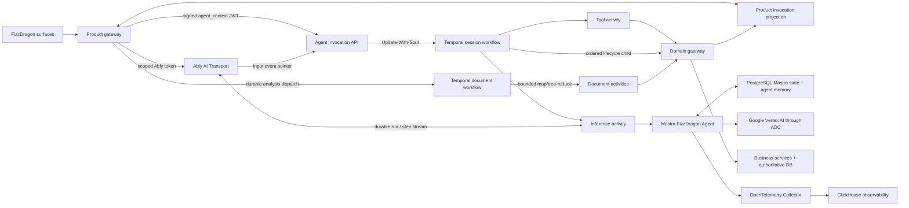

# FizzDragon Agent Platform

This is the target implementation of FizzDragon's unified product agent. It is
independent from `apps/agent` and `apps/studio-agent-runtime`; those applications
remain untouched while product traffic is migrated.

The platform is one agent with server-signed, per-request capability packs. A
Story Studio session can receive story graph capabilities. A Crew Management
session can receive crew and task capabilities. Conversation text can never
mount a capability, widen a business scope, or grant a permission.

## Dependency and release isolation

`apps/agent-platform` is deliberately not an npm workspace of the legacy
monorepo. It owns its package manifest, lockfile, dependency installation, CI
job, production artifacts, and release cadence. This prevents npm hoisting from
silently upgrading either the legacy Agent or the replacement platform while
both exist during migration.

Run dependency and lifecycle commands from this directory. The root CI treats
the platform as an independent application.

## Architecture



The boundaries are deliberate:

- **Mastra** owns agent composition, dynamic instructions, model selection,
  capability tools, request context, and observability.
- **Google Vertex AI** is the current inference provider. The Worker constructs
  explicit AI SDK Vertex model objects for both the primary Agent and
  Observational Memory; it never routes `google/...` model strings through the
  Gemini Developer API.
- **Temporal** owns durable control flow, retry policy, cancellation, bounded
  model/tool iteration, per-session serialization, invocation admission,
  Worker Deployment versioning, and terminal cleanup.
- **`@ably/ai-transport`** is the agent-session protocol implemented over Ably
  Pub/Sub. It owns run/step/message semantics, streaming, steering,
  reconnect/resume, and approval events. Raw Pub/Sub is the substrate, not the
  application contract.
- **Business services** authorize and atomically commit mutations. They are the
  only source of truth for story graphs, crews, tasks, billing, and permissions.
- **Product invocation projection and admission outbox** atomically reserve
  stable invocation/run identities before dispatch. A leased, multi-replica
  outbox redelivers the same identity after a gateway crash, timeout, or
  ambiguous Agent response. The same row records monotonic lifecycle
  transitions from the Worker, so it is also the reconnect-safe UI fact for
  failures and cancellations that happen before an Ably Run can emit
  `run-start`. Temporal remains the execution authority.
- **PostgreSQL Mastra storage** provides the framework's complete persistent
  storage contract and stores threads, messages, and observational memory. It
  is framework state and derived conversational context, never business truth.
  The model receives only the current Ably run delta; Mastra supplies bounded
  historical context from this store.
- **OpenTelemetry Collector** isolates telemetry delivery from product
  execution, persists an at-least-once export queue, and batches writes.
- **ClickHouse** stores high-volume trace and observability data behind the
  Collector. It is not an Agent startup dependency or business state.

Mastra storage has its own `agent_memory` PostgreSQL schema and explicit
checksummed migrations generated and verified against the pinned adapter. The
API credential is read-only, the Worker credential has DML but no DDL, and
readiness verifies each connected PostgreSQL identity. Message and thread
ownership is validated against the server-signed security partition before
reconciliation. Ably remains the realtime protocol/read model; it is not
replayed in full into every model step and it is not the durable memory
authority.

## Non-negotiable runtime invariants

1. The client sends an Ably `inputEventId`, its causal UI message ID, and the
   gateway-issued `sessionName`. The product gateway reserves stable
   invocation/run IDs before dispatch. Actor identity, surface, business scope,
   roles, and permissions come only from the gateway-signed JWT. Every token
   must carry `iat` and `exp`, and its lifetime cannot exceed 15 minutes.
2. A deterministic Temporal Workflow ID identifies the signed session.
   Invocations enter it atomically through Update-With-Start. The internal
   Agent API returns success only after the Workflow accepts the bounded queue
   update. The product API may return HTTP 202 as soon as the invocation is
   durably reserved: if the immediate Agent call is ambiguous, a PostgreSQL
   outbox keeps retrying under a renewable lease. A full queue is different:
   it is recorded as a semantic rejection and returns HTTP 429 without killing
   the session Workflow. Stable product-reserved invocation/run UUIDs identify
   one visible aggregate. Every durable trigger has its own attempt UUID and
   monotonic ordinal. The root must be ordinal zero; a continuation is admitted
   only after the prior attempt is waiting for approval and must be exactly the
   next ordinal.
3. Each model or tool attempt is its own Temporal Activity. Ably Invocation and
   Step identities derive from the durable attempt ID, preventing approval
   continuations from colliding with the root attempt.
4. A Temporal retry supersedes the same Ably step; it does not append a fake
   duplicate assistant turn.
5. Cancellation uses two coordinated planes: Ably `run.cancel()` provides the
   immediate realtime signal, while an authenticated Temporal Update is the
   durable backstop for active and queued invocations. Activities heartbeat,
   Workers flush cancellation heartbeats at most once per second, and every
   post-open cancellation executes non-cancellable terminal cleanup.
6. Model calls never mutate business state. Tools call the domain gateway with
   a stable idempotency key.
7. Authorization is checked against immutable signed context when capabilities
   are mounted and again before execution. The domain service re-resolves
   current authorization and performs the final check.
8. The model receives only new or changed messages from the current Ably run.
   Completed output observed after an Activity retry is reconciled into memory
   and never generated twice.
9. Story graph changes are versioned, compare-and-swap, final-state validated,
   and committed in one database transaction. Operation ordering has no
   semantics.
10. Interactive control, inference, tool, lifecycle, cleanup, and
    long-document work run on isolated Temporal queues. A slow model or large
    screenplay cannot starve cancellation or terminal projection.
11. Large documents are analyzed from immutable, bounded source sections into
    persisted map/reduce artifacts. Raw source text and model outputs never
    enter Temporal history, and finalization requires complete chunk coverage.

## Local development

Use Node `24.18.0` or newer on the Node 24 release line with npm `11.16.0`; a
Node version manager is not required. Local development is verified on
`24.18.1`, while the production image is pinned to the latest published
official Docker patch (`24.18.0-bookworm-slim`).

The Worker uses Google Application Default Credentials. Authenticate once with
an account that has `roles/aiplatform.user` on the configured project:

```bash
gcloud auth application-default login
gcloud auth application-default set-quota-project glass-proxy-501907-d2
```

The second command is unnecessary when the login command already reports that
it added the same quota project. Do not create or paste a Gemini API key.

In the Ably app referenced by `ABLY_API_KEY`, create a channel rule for the
namespace `agent` and enable **Message annotations, updates, deletes, and
appends**. AI Transport streams one logical response through message appends,
so this `mutableMessages: true` rule is mandatory and also implies persistence
for `agent:v1:conversation:*`.

With the repository's local PostgreSQL on `127.0.0.1:5433`, Redis on
`127.0.0.1:6380`, Docker, and the Temporal CLI installed, start the complete
stack from this directory:

```bash
npm ci
npm run dev:stack
```

The command validates configuration, starts or reuses Temporal, starts or
reuses the pinned OpenTelemetry Collector, applies product and Agent Memory
migrations, and compiles the exact Worker executable that it will load. It does
not spend local startup time packaging the separate production Worker artifact;
`npm run build` still creates and verifies that artifact. The command then
starts the NestJS product gateway and Temporal Worker, makes the verified local
Worker version Temporal's Current Version, and only then opens the Mastra
invocation API. It exits only after all liveness and readiness checks pass, so
the API cannot accept a Workflow before a compatible Worker is routable.
Generated Ed25519 identities exist only in process memory. `Ctrl+C` stops only
processes and containers created by this command.

The local Collector uses
[`deploy/otel-collector/local.yaml`](deploy/otel-collector/local.yaml) and the
same digest-pinned official image as production. It receives the
privacy-filtered OTLP data and emits sampled basic debug telemetry; production
uses the chart-owned durable ClickHouse pipeline.

Create a short-lived local gateway token without adding a token-minting endpoint
to the service:

```bash
npm run local:token -- \
  --actorId actor-1 \
  --surface story-studio \
  --workspaceId workspace-1 \
  --projectId project-1 \
  --permissions story.read,story.write
```

The internal, gateway-authenticated `POST /api/v1/invocations` accepts:

```json
{
  "inputEventId": "ably-input-event-id",
  "invocationId": "0197f4a2-0800-7000-8000-000000000010",
  "attemptId": "0197f4a2-0800-7000-8000-000000000012",
  "attemptOrdinal": 0,
  "provisionalRunId": "0197f4a2-0800-7000-8000-000000000011",
  "sessionName": "agent:v1:conversation:0197f4a2-0800-7000-8000-000000000004"
}
```

`POST /api/v1/cancellations` accepts the canonical `sessionName` plus the
accepted `invocationId` and returns one of `cancellation-requested`,
`already-terminal`, or `not-active`.
The product gateway must re-authorize the session and issue a fresh signed Agent
token; the browser never calls this internal endpoint directly.

The browser-facing product endpoint returns only the durable `invocationId`.
The Temporal session Workflow ID is an internal routing detail and is never a
client contract.

All built-in direct Mastra agent execution routes are denied. Product execution
must cross the durable invocation boundary.

## Verification

```bash
npm run check-types
npm test
AGENT_MEMORY_POSTGRES_INTEGRATION=1 npm run test:integration -- \
  src/memory/agent-memory.integration.test.ts
TEMPORAL_CLI_PATH="$(command -v temporal)" npm run test:integration -- \
  src/runtime/workflows.integration.test.ts
npm run build
npm run test:build-smoke
npm run test:security
```

`TEMPORAL_CLI_PATH` is optional. When absent (including CI), the official
Temporal test environment downloads and caches the SDK-compatible test server.

The integration suites verify real PostgreSQL reconciliation and start a real
local Temporal server to prove atomic admission, invocation deduplication,
capacity rejection followed by successful retry, serialization, pre-run
failure projection, failure containment, active and queued cancellation,
session reuse after cancellation, and terminal cleanup. The build smoke test
starts the actual self-hosted
artifact with every external dependency unavailable and requires process
liveness. The security check audits every independent production artifact
lockfile and fails on high or critical advisories.

## Production

Build output consists of:

- `.mastra/output/` — self-hosted API artifact
- `.temporal/worker/` — standalone Worker artifact containing the compiled
  activities, prebuilt deterministic Workflow bundle, exact production
  dependencies, and its own lockfile
- `.migrations/agent-memory/` — standalone, checksummed Mastra storage migrator
  with only the migration runtime dependencies and its own lockfile

The multi-target `Dockerfile` packages those three artifacts as three
least-privilege images:

```bash
docker build -f apps/agent-platform/Dockerfile --target api \
  -t fizzdragon-agent-platform-api .
docker build -f apps/agent-platform/Dockerfile --target worker \
  -t fizzdragon-agent-platform-worker .
docker build -f apps/agent-platform/Dockerfile --target migrator \
  -t fizzdragon-agent-memory-migrator .
```

Run these commands from the repository root. All targets run as a non-root user
behind `tini`; the API and Worker have independent health checks. The API image
does not contain the Vertex provider or any inference configuration. Only the
Worker contains the provider, performs the ADC preflight, and receives
domain-execution capability.

Set an immutable `AGENT_RELEASE` (image digest or commit SHA). Workers use
Temporal Worker Deployments with `PINNED` default behavior so an in-flight run
cannot silently change Workflow code.

Build, scan, and deploy the API and Worker as separate images. The API receives
neither model-provider nor Ably execution credentials. The Worker uses an
attached workload identity on Google Cloud or Workload Identity Federation on
Azure/Alibaba Cloud; never distribute a service-account private key. Run the
migrator as a one-shot release job before either runtime receives traffic. The
Worker image root is `.temporal/worker/` and starts with `npm start`; it
intentionally omits API-only dependencies and configuration such as Hono, JWT
verification, API ports, and Collector health probes. Do not install
dependencies again during image startup.

Only `/api/v1/invocations`, `/api/v1/cancellations`, `/api/v1/history`, and the two health
endpoints should be reachable from the trusted product-gateway network. They
must not be exposed directly to browsers or the public Internet. Do not expose
Mastra Studio on the product ingress.

See [architecture](docs/architecture.md),
[domain gateway contract](docs/domain-gateway-contract.md), and
[operations](docs/operations.md). The version-pinned Collector configuration is
the chart-owned
[`agent-platform-otel-collector.yaml`](../../deploy/helm/fizzdragon/files/agent-platform-otel-collector.yaml);
the deployed ConfigMap mounts that exact source file.
