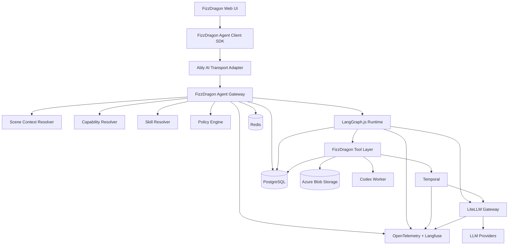
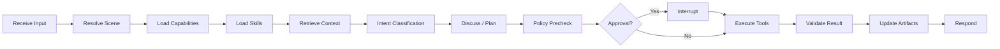
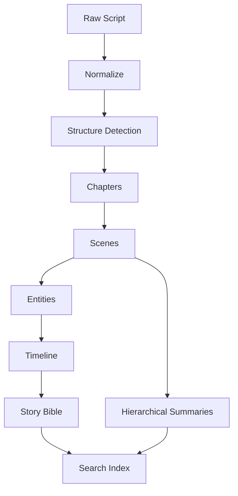
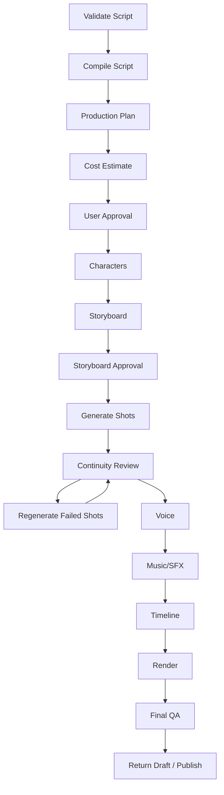

# FizzDragon AI Agent Platform

## 生产级开发技术指导文档

> 文档版本：v1.0  
> 日期：2026-08-07  
> 适用范围：FizzDragon Web / Project 无限画布 / 剧本编辑器 / 影游编辑器 / 分镜 / 视频时间线 / 一键成片 / AI Copilot  
> 目标：构建一个**多模型、可对话、可操作页面、可加载 Skills、支持超长剧本、支持 Human-in-the-loop、支持长时间自动化生产、可恢复、可审计、可扩展**的生产级 AI Agent 平台。

---

# 0. Executive Decision

FizzDragon 不应把 Agent 系统建立在“一个万能 Agent + 一堆工具”的模式上。

最终推荐架构：

```text
FizzDragon 原生 UI
        ↓
FizzDragon Agent Client SDK
        ↓
Ably AI Transport Adapter
        ↓
FizzDragon Agent Gateway
        ├── Scene Context Resolver
        ├── Capability Resolver
        ├── Skill Resolver
        ├── Policy Engine
        ├── Model Router
        ├── Cost/Budget Guard
        └── Agent Event Adapter
        ↓
LangGraph.js
        ├── Project Canvas Agent
        ├── Script Agent
        ├── Interactive Film Agent
        ├── Storyboard Agent
        └── Timeline Agent
        ↓
FizzDragon Tool Layer
        ├── Project Commands
        ├── Image / Video / Audio
        ├── Story / Character / Scene
        ├── Interactive Film Graph
        ├── Timeline / Render
        └── Codex Worker
        ↓
Temporal
        └── 一键成片 / 批量生成 / 等待回调 / 重试 / 暂停 / 恢复
        ↓
LiteLLM Gateway
        ├── OpenAI
        ├── Anthropic
        ├── Gemini
        ├── Qwen
        ├── DeepSeek
        ├── BytePlus
        └── 其他模型
```

### 核心技术选型

| 层                 | 推荐技术                                                 | 定位                                    |
| ------------------ | -------------------------------------------------------- | --------------------------------------- |
| Web UI             | FizzDragon 自研 React UI                                 | 产品体验与业务 UI                       |
| Agent UI Protocol  | FizzDragon Agent Protocol，参考 AG-UI                    | 前后端标准事件                          |
| Realtime Transport | Ably AI Transport（Adapter 模式）                        | Durable Session、多设备、断线恢复、审批 |
| 通用 Agent Runtime | LangGraph.js                                             | 交互式 Agent、状态、HITL、场景子图      |
| 长时间 Workflow    | Temporal                                                 | Durable Execution                       |
| Model Gateway      | LiteLLM Proxy                                            | 多模型统一、限流、预算、Fallback        |
| Skills             | FizzDragon Skill Registry + Agent Skills `SKILL.md` 格式 | 动态专业能力                            |
| Tools              | FizzDragon Command/Query APIs + MCP 可选                 | 真正业务操作                            |
| 代码/小游戏 Agent  | Codex Worker                                             | HTML/CSS/JS/互动逻辑/构建/测试          |
| 项目事实库         | PostgreSQL                                               | Single Source of Truth                  |
| Agent Checkpoint   | PostgreSQL                                               | LangGraph Checkpointer                  |
| 大型素材           | Azure Blob Storage                                       | 剧本、图片、视频、音频、构建产物        |
| 临时缓存           | Redis                                                    | 限流、短期锁、缓存；非事实源            |
| Observability      | OpenTelemetry + Langfuse                                 | Trace / Cost / Eval                     |
| 长文本知识         | Story Compiler + Structured DB + Search Index            | 十万字剧本处理                          |

### 明确不建议

- 不再让 Mastra 成为核心生产依赖。
- 不让 Codex 成为整个创作系统的总 Agent Runtime。
- 不让 Claude Agent SDK 成为通用 Runtime。
- 不把 Dify / Flowise / LibreChat 嵌入核心产品。
- 不让模型直接写数据库。
- 不让 Agent 自由循环数小时完成“一键成片”。
- 不把十万字剧本每次完整塞进 Prompt。
- 不把 Redis / Ably / LangGraph State 当成项目事实数据库。
- 不允许未经版本化、Eval、Canary 的 Prompt / Skill 直接上线。

---

# 1. 产品目标

FizzDragon AI 助手必须同时支持以下模式。

## 1.1 Conversational Copilot

用户可以与 AI 讨论，而不是一发消息就执行。

例如：

```text
用户：
我不知道这一章怎么设计互动。

AI：
这一章的冲突点在人物是否离开贾府。
我建议在 Scene 12 设置一次关键选择，
两个分支分别影响后续角色关系。

用户：
可以，先给我看看结构。

AI：
[生成 BranchPlan，但不修改项目]

用户：
就按照这个创建。

AI：
[调用影游节点工具正式创建]
```

---

## 1.2 Page Copilot

AI 必须知道用户当前在哪个页面、选中了什么、当前可执行什么操作。

例如：

### Project 无限画布

AI 可以：

- 读取选中节点
- 分析剧本
- 创建文本节点
- 创建角色节点
- 创建图片/视频节点
- 添加 Edge
- 自动布局
- 生成故事关系图
- 提取人物/地点/道具

### 影游编辑器

AI 可以：

- 创建 Video Node
- 创建 Choice Node
- 创建 Condition Node
- 创建 Ending Node
- 连接节点
- 修改选项
- 检查死路
- 检查不可达节点
- 计算路径时长
- 生成分支并汇流

### 分镜

AI 可以：

- 创建 Shot
- 修改 Shot
- 生成 Camera Language
- 生成 Prompt
- 创建 Reference
- 批量生成图像
- 检查角色一致性

### 视频时间线

AI 可以：

- 添加 Clip
- Trim
- Move
- 添加配音
- 添加字幕
- 添加音乐/SFX
- 创建预览
- 请求最终 Render

---

## 1.3 Autopilot / 一键成片

从几万字甚至十几万字剧本：

```text
剧本
→ 故事结构
→ Story Bible
→ 角色设计
→ 场景拆分
→ 分镜
→ Image Reference
→ 视频镜头
→ Voice
→ Music/SFX
→ Timeline
→ Continuity Review
→ 自动返工
→ Render
→ 成片
```

可能持续：

- 几十分钟
- 数小时
- 数天

必须支持：

- 用户关掉页面
- Worker 重启
- 第三方 API 超时
- 视频模型排队
- 用户中途暂停
- 用户修改方向
- 预算不足
- 某些镜头失败
- 任务部分重试
- 恢复后不重复扣费

这部分必须由 Temporal 管理。

---

# 2. 设计原则

## 2.1 AI 不拥有业务事实

模型只负责：

```text
理解
规划
生成
判断
提出 Command
```

真正业务状态由 FizzDragon 服务端保存。

### 禁止

```text
LLM → SQL
LLM → ORM
LLM → 直接删除/修改数据库
```

### 正确

```text
LLM
↓
Tool Call / ProjectCommand
↓
Schema Validation
↓
Policy Engine
↓
Command Handler
↓
Transaction
↓
Database
```

---

## 2.2 Agent 不负责业务级 Durable Execution

LangGraph 管：

- Agent state
- Thread
- Conversation
- Planning
- Tool routing
- Human-in-the-loop
- Context / Memory
- 页面 Copilot

Temporal 管：

- 跨小时任务
- 第三方异步回调
- 批量生产
- Retry
- Timeout
- Backoff
- Cancellation
- Compensation
- Workflow versioning

---

## 2.3 所有副作用必须幂等

任何可能重试的操作必须支持：

```text
idempotencyKey
```

包括：

- 扣积分
- 创建节点
- 生成图片
- 生成视频
- 发布
- 创建 Artifact
- 创建 Timeline
- 外部 Provider 请求

推荐：

```text
idempotencyKey =
projectId + agentRunId + toolCallId + operationVersion
```

---

## 2.4 所有项目修改必须可追踪

所有 Agent 写操作都产生：

```text
ProjectCommand
ProjectEvent
ProjectVersion
AuditLog
```

必须可以回答：

```text
谁修改的？
用户还是 AI？
哪个 Agent Run？
哪个模型？
用了什么 Skill？
用了什么 Prompt 版本？
修改前是什么？
修改后是什么？
花了多少钱？
用户是否审批？
```

---

# 3. 总体系统架构



---

# 4. Agent Gateway

Agent Gateway 是整个系统的产品级控制面。

推荐作为 `fizzdragon-server` 中的独立模块，后续负载大时再独立 Deployment。

## 4.1 Gateway 职责

```text
Authentication
Authorization
Project Context
Scene Context
Capability Resolution
Skill Resolution
Model Selection
Budget
Policy
Agent Lifecycle
Realtime Event
Approval
Audit
Rate Limit
```

---

## 4.2 请求结构

```ts
interface AgentRunRequest {
  userId: string;
  projectId: string;

  workspace: {
    type:
      | "project_canvas"
      | "script_editor"
      | "interactive_film"
      | "storyboard"
      | "video_timeline"
      | "asset_library";

    entityId?: string;
    selectedEntityIds?: string[];
    visibleEntityIds?: string[];
  };

  message: {
    id: string;
    text: string;
    attachments?: AttachmentRef[];
  };

  model: {
    profileId: string;
  };

  conversationId: string;
  clientStateVersion: number;
}
```

---

# 5. Scene Context Resolver

不同场景，Agent 能力必须不同。

```ts
interface AgentSceneContext {
  workspaceType: WorkspaceType;
  projectId: string;

  currentEntity?: EntityReference;
  selectedEntities: EntityReference[];
  visibleEntities: EntityReference[];

  capabilities: CapabilityPack[];
  skills: SkillReference[];
  tools: ToolReference[];

  frontendActions: FrontendActionReference[];

  permissions: PermissionSet;
  projectVersion: number;
}
```

---

## 5.1 Project Canvas Capability Pack

```text
canvas.read
canvas.readSelected
canvas.createNode
canvas.updateNode
canvas.createEdge
canvas.groupNodes
canvas.applyLayout
canvas.previewPatch

script.analyze
story.extractCharacters
story.extractLocations
story.createMap
```

---

## 5.2 Interactive Film Capability Pack

```text
interactiveFilm.readGraph
interactiveFilm.createVideoNode
interactiveFilm.createChoiceNode
interactiveFilm.createConditionNode
interactiveFilm.createEndingNode
interactiveFilm.updateNode
interactiveFilm.connectNodes
interactiveFilm.validateGraph
interactiveFilm.calculatePathDuration
interactiveFilm.preview
```

---

## 5.3 Storyboard Capability Pack

```text
storyboard.read
storyboard.createShot
storyboard.updateShot
storyboard.generatePrompt
storyboard.generateImage
storyboard.reviewConsistency
storyboard.applyCameraPlan
```

---

# 6. LangGraph Runtime

推荐使用：

```text
@langchain/langgraph
@langchain/langgraph-checkpoint-postgres
```

LangGraph 只负责交互式 Agent。

## 6.1 主图



---

## 6.2 子图

```text
FizzDragonAgentGraph

├── ProjectCanvasSubgraph
├── ScriptEditorSubgraph
├── InteractiveFilmSubgraph
├── StoryboardSubgraph
├── TimelineSubgraph
└── AssetLibrarySubgraph
```

子图不是完全独立的 Agent 服务。

共享：

```text
user
project
conversation
model preference
global memory
policy
budget
```

不同：

```text
tool pack
skill pack
context adapter
artifact schema
risk rules
```

---

# 7. Human-in-the-loop

这是一级能力，不是附加功能。

## 7.1 三种 Agent 模式

```text
DISCUSS
ASSIST
AUTOPILOT
```

### DISCUSS

只能：

- Read
- Analyze
- Generate Draft
- Recommend

不能产生真实副作用。

### ASSIST

允许：

- 创建草稿
- 创建可撤销节点
- 更新未发布对象
- 生成低成本内容

### AUTOPILOT

允许执行复杂计划，但仍受：

```text
Policy Engine
Budget
Approval Gates
```

控制。

---

## 7.2 风险等级

```ts
type RiskLevel = "read" | "reversible" | "sensitive" | "critical";
```

### Read

无需审批：

```text
查询
阅读
分析
建议
```

### Reversible

可以自动执行，但必须版本化：

```text
创建草稿节点
创建角色草稿
生成文本分镜
```

### Sensitive

必须审批：

```text
批量生成视频
覆盖大量节点
消耗大量积分
批量重新生成
```

### Critical

必须二次确认：

```text
删除
发布
公开
覆盖已发布版本
高额消费
```

---

## 7.3 Approval

```ts
interface ApprovalRequest {
  id: string;

  runId: string;
  operation: string;

  title: string;
  description: string;

  estimatedCredits?: number;
  affectedEntities: EntityReference[];

  reversible: boolean;

  actions: Array<"approve" | "edit_and_approve" | "reject">;
}
```

LangGraph 使用 `interrupt()` 暂停。

Ably AI Transport 负责把 Approval 持久传递给任意设备。

---

# 8. FizzDragon Tools

## 8.1 Query Tool 与 Command Tool 分离

### Query

无副作用：

```text
getProject
getCurrentScene
searchCharacters
getStoryBible
readCanvasNodes
```

### Command

有副作用：

```text
createCharacter
createCanvasNodes
createChoiceNode
generateImage
generateVideo
publishProject
```

---

## 8.2 Command Envelope

```ts
interface CommandEnvelope<T> {
  commandId: string;
  idempotencyKey: string;

  userId: string;
  projectId: string;
  agentRunId: string;

  expectedProjectVersion: number;

  operation: string;
  payload: T;

  metadata: {
    modelId: string;
    skillVersions: string[];
    promptVersion: string;
    toolVersion: string;
  };
}
```

---

## 8.3 Optimistic Concurrency

写操作必须带：

```text
expectedProjectVersion
```

如果版本冲突：

```text
409 PROJECT_VERSION_CONFLICT
```

Agent 不得自动覆盖。

必须：

```text
reload
→ calculate new patch
→ optionally ask user
```

---

# 9. Skills System

使用开放的 Agent Skills `SKILL.md` 目录风格，但由 FizzDragon 自己治理。

```text
skills/
├── cinematic-storyboard/
│   ├── SKILL.md
│   ├── references/
│   ├── scripts/
│   └── assets/
│
├── interactive-story-branching/
├── character-consistency/
├── chinese-period-drama/
└── short-form-pacing/
```

---

## 9.1 Skill Manifest

除 `SKILL.md` 外增加 FizzDragon Manifest：

```json
{
  "id": "interactive-story-branching",
  "version": "2.3.1",

  "workspaceTypes": ["script_editor", "interactive_film"],

  "requiredTools": ["interactiveFilm.createChoiceNode", "interactiveFilm.connectNodes"],

  "models": {
    "minimumReliabilityTier": "production"
  },

  "risk": {
    "allowsWrite": true,
    "allowsPaidGeneration": false
  },

  "evalSuite": "evals/interactive-story-v2"
}
```

---

## 9.2 Skills 动态加载

禁止：

```text
每次给 Agent 全部 Skills
```

应该：

```text
User Input
↓
Scene
↓
Intent
↓
Skill Resolver
↓
Top relevant skills
```

只加载必要的 Skill Summary。

详细 references 需要时再读取。

---

# 10. 超长剧本：Story Compiler

十万字剧本不能作为聊天历史。

上传后立即进入：

```text
Story Ingestion Workflow
```

## 10.1 数据处理



---

## 10.2 业务实体

推荐：

```text
script_documents
script_versions
chapters
scenes
dialogues
characters
locations
props
story_events
story_arcs
character_relationships
timeline_events
story_bibles
summaries
source_spans
```

---

## 10.3 Context Pack

处理一个 Scene 时，只注入：

```text
Current Scene Source
Previous Scene Summary
Next Scene Summary
Relevant Characters
Relevant Locations
Relevant Props
Relevant Story Arc
Story Bible Constraints
Related Foreshadowing
Current Skill
```

不注入全文。

---

## 10.4 Source Traceability

所有抽取内容必须记录：

```ts
interface SourceSpan {
  documentId: string;
  versionId: string;
  startOffset: number;
  endOffset: number;
}
```

避免 Agent 虚构角色事实后无法追溯。

---

# 11. 一键成片：Temporal

## 11.1 Workflow



---

## 11.2 Workflow 只描述确定性阶段

错误：

```text
Temporal Activity:
askLLMToDoEverything()
```

正确：

```text
Temporal Workflow:
compileScript()
planProduction()
generateCharacters()
generateStoryboards()
generateShots()
reviewShots()
generateAudio()
render()
```

AI 决策作为明确节点调用 LangGraph / Model。

---

## 11.3 Temporal Activity Policy

每个 Activity：

```text
timeout
retry policy
heartbeat
idempotency
cancellation
```

都必须显式配置。

视频生成：

```text
Submit Activity
→ externalJobId
→ wait callback / polling
→ save result
```

不要保持 HTTP 请求几十分钟。

---

# 12. Model Gateway：LiteLLM

FizzDragon 不允许业务代码直接散落各种 Provider SDK。

统一：

```text
FizzDragon
↓
LiteLLM
↓
Providers
```

## 12.1 Model Profile

```ts
interface ModelProfile {
  id: string;
  displayName: string;

  providerModel: string;

  capabilities: {
    tools: boolean;
    vision: boolean;
    structuredOutput: boolean;
    longContext: boolean;
    reasoning: boolean;
  };

  reliabilityTier: "experimental" | "standard" | "production";

  allowedWorkspaces: WorkspaceType[];

  maxInputTokens: number;
  maxOutputTokens: number;

  budgetClass: "low" | "standard" | "premium";
}
```

---

## 12.2 用户切换模型

用户可以切模型，但不能让任意模型执行任意操作。

例如：

```text
Model A:
写作强
Tool Calling 中等

→ 允许讨论
→ 允许生成 Draft
→ 禁止 Critical write
```

```text
Model B:
Tool Calling Production Tier

→ 允许 Agent write
→ 允许 AutoPilot
```

---

## 12.3 Fallback

Fallback 必须在相同 Capability Tier 之间。

禁止：

```text
Production Tool Model
失败
↓
自动切换廉价聊天模型
↓
继续修改项目
```

---

# 13. Codex Worker

Codex 不做主 Agent Runtime。

它作为专项 Worker。

适用于：

```text
interactive-code
html/css/js
mini game
custom component
build
test
lint
fix
```

流程：

```text
LangGraph
↓
buildInteractiveExperience
↓
Codex Worker
↓
isolated workspace
↓
generate code
↓
build
↓
test
↓
artifact
↓
FizzDragon
```

---

## 13.1 Codex Workspace

```text
/workspaces/
  {projectId}/
    {runId}/
      manifest.json
      src/
      public/
      tests/
      build/
```

必须：

- Container sandbox
- CPU limit
- Memory limit
- Disk quota
- Network policy
- Max execution time

---

# 14. Realtime：Ably AI Transport

Ably 的角色：

```text
Durable Client-Agent Session
```

不是：

```text
Agent Runtime
Workflow
Database
```

---

## 14.1 为什么保留

解决：

```text
断线恢复
刷新恢复
多 Tab
多设备
Token/事件流
用户 interrupt
steer
cancel
approval
presence
session history
```

---

## 14.2 Adapter Pattern

FizzDragon 不能把业务 Schema 与 Ably SDK 绑定。

```ts
interface AgentTransport {
  publish(event: AgentEvent): Promise<void>;

  subscribe(sessionId: string, handler: (event: AgentEvent) => void): Unsubscribe;

  sendControl(command: AgentControlCommand): Promise<void>;
}
```

实现：

```text
AblyAITransport
NativeWebSocketTransport
```

---

## 14.3 PostgreSQL 仍是事实来源

Ably 里的事件用于：

```text
Realtime delivery
Session recovery
Multi-device experience
```

正式：

```text
Message
Approval
ToolCall
Run
Artifact
```

仍需 PostgreSQL 持久化。

---

# 15. FizzDragon Agent Event Protocol

协议必须版本化。

```text
fizz.agent.v1
```

## 15.1 事件类型

```ts
type AgentEvent =
  | RunStarted
  | MessageStarted
  | MessageDelta
  | MessageCompleted
  | PlanCreated
  | PlanUpdated
  | StepStarted
  | StepProgress
  | StepCompleted
  | ToolProposed
  | ApprovalRequired
  | ApprovalResolved
  | ToolStarted
  | ToolProgress
  | ToolCompleted
  | ToolFailed
  | ArtifactCreated
  | ArtifactUpdated
  | ProjectPatchProposed
  | ProjectPatchApplied
  | RunPaused
  | RunResumed
  | RunCancelled
  | RunCompleted
  | RunFailed;
```

---

## 15.2 Event Envelope

```ts
interface AgentEventEnvelope<T> {
  id: string;

  protocolVersion: "fizz.agent.v1";

  sessionId: string;
  runId: string;
  conversationId: string;

  sequence: number;

  timestamp: string;

  type: string;
  data: T;
}
```

`sequence` 必须单调递增。

前端 reconnect：

```text
lastSequence=428
```

Gateway 从 429 开始恢复。

---

# 16. Page → Agent 双向交互

前端不仅接收消息，也可以暴露 Frontend Actions。

例如：

```text
focusNode
openInspector
previewPatch
highlightScene
showDiff
zoomToNodes
openAssetPicker
```

这些属于：

```text
UI Action
```

不是业务写操作。

---

# 17. Agent Memory

分四类。

## 17.1 Conversation State

LangGraph Thread：

```text
短期讨论
当前计划
当前 Pending Approval
```

---

## 17.2 Project Memory

PostgreSQL：

```text
Story Bible
Characters
Visual Style
Project Rules
Confirmed Decisions
```

---

## 17.3 User Preference

例如：

```text
偏好真人电影
默认 16:9
常用语言
常用模型
```

独立 User Profile。

---

## 17.4 Runtime Cache

Redis：

```text
临时上下文
Tool metadata
短 TTL lookup
```

不得作为长期 Memory。

---

# 18. 数据模型

至少包含：

```text
agent_conversations
agent_runs
agent_messages
agent_steps
agent_tool_calls
agent_approvals
agent_artifacts
agent_events

project_commands
project_events
project_versions

skills
skill_versions
skill_evaluations

model_profiles
model_usage
model_costs

workflow_runs
generation_jobs
```

---

# 19. Agent Run 状态机

```text
CREATED
↓
RUNNING
↓
WAITING_FOR_APPROVAL
↓
RUNNING
↓
WAITING_FOR_EXTERNAL_JOB
↓
RUNNING
↓
COMPLETED
```

异常：

```text
FAILED
CANCELLED
EXPIRED
```

状态变化必须原子。

---

# 20. 稳定性设计

所谓“超稳定”，不是要求模型永不犯错。

目标是：

```text
错误可发现
错误可限制
错误可回滚
错误不重复扣费
错误不破坏项目
错误可恢复
```

---

## 20.1 Retry 分层

### LLM 网络错误

LiteLLM Retry/Fallback。

### Tool 临时错误

Tool Layer Retry。

### 第三方生成失败

Temporal Activity Retry。

### Agent 逻辑失败

LangGraph 节点级处理。

禁止四层同时无脑 Retry。

---

## 20.2 Circuit Breaker

对 Provider：

```text
错误率 > threshold
↓
Open circuit
↓
暂时停止流量
```

---

## 20.3 Budget Guard

每个 Run：

```text
softBudget
hardBudget
```

例如：

```text
soft: 5,000 credits
→ 询问用户

hard: 8,000 credits
→ 自动暂停
```

---

# 21. Observability

所有系统使用统一：

```text
traceId
runId
workflowId
projectId
userId
```

## OpenTelemetry

监控：

```text
HTTP
Database
Temporal
Ably
Provider
Tool
Queue
Storage
```

## Langfuse

监控：

```text
Prompt
LLM call
Token
Latency
Tool call
Cost
Evaluation
```

---

# 22. Evaluation

任何 Prompt / Skill / Model 更新都必须经过 Eval。

## 22.1 Dataset

建立至少：

```text
canvas-agent
interactive-film
script-analysis
storyboard
long-script
approval
tool-selection
failure-recovery
```

---

## 22.2 指标

```text
Task Success Rate
Tool Selection Accuracy
Schema Validity
Project Mutation Accuracy
Approval Accuracy
Hallucination Rate
Cost
Latency
Retry Rate
User Correction Rate
```

---

## 22.3 Release

```text
Local Eval
↓
CI Eval
↓
Staging
↓
5% Canary
↓
25%
↓
100%
```

失败自动 Rollback Prompt / Skill / Model config。

---

# 23. Security

## 23.1 Tool 权限

每个 Tool：

```text
requiredPermissions
riskLevel
rateLimit
costClass
workspaceTypes
```

---

## 23.2 Prompt Injection

外部输入：

```text
剧本
网页
文件
MCP 返回
Skill
```

全部视为不可信数据。

Tool authorization 永远由服务端决定。

---

## 23.3 Secrets

禁止把：

```text
Provider API Key
Database password
Azure credentials
Internal admin token
```

暴露到 Agent Prompt / Workspace。

---

## 23.4 Codex

Codex Worker 单独 Sandbox。

绝不与：

```text
fizzdragon-server
production secrets
database credential
```

共享权限。

---

# 24. Deployment

初期不要过度微服务化。

推荐：

```text
Deployment 1
fizzdragon-server

Deployment 2
fizzdragon-agent-worker

Deployment 3
fizzdragon-temporal-worker

Deployment 4
fizzdragon-model-gateway

Deployment 5
fizzdragon-codex-worker
```

---

## 24.1 fizzdragon-agent-worker

包含：

```text
LangGraph
Context Resolver
Capability Resolver
Skill Loader
Policy Client
Tool Client
```

---

## 24.2 扩容

Agent Worker：

```text
stateless compute
+
Postgres checkpoints
```

因此可水平扩容。

---

# 25. Repository Structure

推荐：

```text
apps/
  web/
  server/
  agent-worker/
  temporal-worker/
  codex-worker/

packages/
  agent-protocol/
  agent-client/
  agent-runtime/
  agent-tools/
  agent-policy/
  agent-skills/
  model-router/
  story-compiler/
  project-commands/
  observability/

skills/
  cinematic-storyboard/
  interactive-story/
  character-consistency/

evals/
  canvas/
  interactive-film/
  long-script/
```

---

# 26. API

## Start Run

```http
POST /v1/agent/runs
```

```json
{
  "projectId": "p_123",
  "conversationId": "c_123",
  "workspace": {
    "type": "interactive_film",
    "entityId": "game_123",
    "selectedEntityIds": ["node_123"]
  },
  "modelProfileId": "creative-premium",
  "message": {
    "text": "在这个视频后面增加两个选择"
  }
}
```

---

## Approve

```http
POST /v1/agent/approvals/{approvalId}
```

```json
{
  "decision": "approve"
}
```

---

## Modify Approval

```json
{
  "decision": "edit_and_approve",
  "patch": {
    "maxVideos": 5
  }
}
```

---

## Cancel

```http
POST /v1/agent/runs/{runId}/cancel
```

---

## Steer

用户中途修改方向：

```http
POST /v1/agent/runs/{runId}/steer
```

```json
{
  "instruction": "后面的镜头全部调整为1980年代香港电影风格"
}
```

---

# 27. 前端体验规范

Agent Panel 至少支持：

```text
Chat
Plan
Progress
Tool Activity
Approval
Artifacts
Diff
Pause
Cancel
Steer
```

不要把所有过程都显示成聊天 Bubble。

---

# 28. 一键成片 UI

```text
One Click Movie
37%

✓ Script Parsed
✓ Story Bible
✓ Characters
● Storyboard 92 / 240
○ Video
○ Voice
○ Timeline
○ Render

Estimated remaining credits: 31,200

[Pause]
[Change Direction]
[Cancel]
```

---

# 29. 故障测试

正式上线前必须自动化测试：

```text
Agent Worker crash
Temporal Worker crash
Server rolling deployment
Postgres reconnect
Ably disconnect
Browser refresh
Browser offline 10 min
same account 2 devices
duplicate approval
duplicate command
duplicate callback
model timeout
provider 500
video job timeout
video callback duplicated
Temporal Activity retry
project version conflict
user cancels mid-generation
budget exceeded
Skill loading failure
```

---

# 30. SLO 建议

## Agent API

```text
Availability ≥ 99.9%
```

## Realtime

```text
Reconnect success ≥ 99.95%
```

## Command Duplication

```text
Duplicate side effects = 0
```

## Project Corruption

```text
AI-caused unrecoverable project corruption = 0
```

## Approval

```text
Critical operation without approval = 0
```

---

# 31. 开发路线

## Phase 1 — Foundation

开发：

```text
Agent Protocol
Agent Gateway
LangGraph
LiteLLM
Postgres Checkpoint
Tool Registry
Policy Engine
Ably Adapter
```

第一个场景：

```text
Project Canvas Agent
```

能力：

```text
读取节点
分析选中节点
创建节点
创建 Edge
审批
撤销
```

---

## Phase 2 — Interactive Film

新增：

```text
Choice Node
Video Node
Condition Node
Graph Validation
```

---

## Phase 3 — Skills

实现：

```text
Skill Registry
Skill Versioning
Skill Resolver
Skill Evals
```

---

## Phase 4 — Long Script

实现：

```text
Story Compiler
Story Bible
Hierarchical Summary
Retrieval
```

---

## Phase 5 — Temporal

实现：

```text
Long Generation Workflow
Video generation
Batch generation
Approval
Resume
Cancel
```

---

## Phase 6 — One Click Movie

连接：

```text
Story
Character
Storyboard
Video
Voice
Timeline
Render
QA
```

---

## Phase 7 — Codex Worker

用于：

```text
Interactive Code
Mini Game
HTML/CSS/JS
Build/Test
```

---

# 32. Mastra 迁移策略

不要一次删除。

### Step 1

新增：

```ts
interface AgentRuntime
```

现有实现：

```text
MastraRuntime
```

新增：

```text
LangGraphRuntime
```

### Step 2

新场景使用 LangGraph。

### Step 3

将旧场景迁移。

### Step 4

Mastra 无流量后删除。

---

# 33. Architecture Ownership

| State              | Owner                             |
| ------------------ | --------------------------------- |
| Project            | PostgreSQL                        |
| Script             | PostgreSQL / Blob                 |
| Story Bible        | PostgreSQL                        |
| Conversation       | PostgreSQL                        |
| Agent Thread       | LangGraph Checkpoint / PostgreSQL |
| Long Workflow      | Temporal                          |
| Realtime Session   | Ably                              |
| Model Config       | Model Gateway                     |
| Skill Version      | PostgreSQL / Git                  |
| UI Ephemeral State | Browser                           |
| Cache              | Redis                             |

任何数据只能有一个 authoritative owner。

---

# 34. 最重要的 20 条工程规则

1. LLM 不允许直接写数据库。
2. 每一个 write tool 都必须支持幂等。
3. 高风险操作必须由 Policy Engine 决定审批。
4. Agent 不决定自己的权限。
5. Agent 不决定自己的最大预算。
6. 用户可以随时 Pause / Cancel / Steer。
7. 项目写操作必须 Versioned。
8. 所有 Agent 修改必须 Audit。
9. 一键成片必须使用 Temporal。
10. LangGraph 不处理数小时外部等待。
11. Temporal 不管理 Token Stream。
12. Ably 不作为项目数据库。
13. Redis 不作为 Agent 事实库。
14. Skills 必须版本化。
15. Skills 上线必须 Eval。
16. Model 必须 Capability Profile。
17. Experimental Model 不允许 Critical Write。
18. 十万字剧本必须 Story Compile。
19. Codex 必须 Sandbox。
20. 每次发布都必须可以 Rollback。

---

# 35. 最终推荐

FizzDragon AI 平台应采用：

```text
FizzDragon Native UI
+
FizzDragon Agent Gateway
+
LangGraph.js
+
Temporal
+
Ably AI Transport Adapter
+
LiteLLM
+
PostgreSQL
+
FizzDragon Tool/Command Layer
+
FizzDragon Skill Registry
+
Story Compiler
+
Codex Worker
+
OpenTelemetry
+
Langfuse
```

它们的职责必须保持清晰：

```text
LangGraph
= AI 如何交互、思考、选择工具

Temporal
= 长任务如何保证一定执行/恢复

Ably
= 用户如何持续连接 Agent

LiteLLM
= 使用哪个模型

Policy Engine
= AI 有没有资格执行

Tools
= 真正做事情

Skills
= 告诉 AI 专业任务应该怎么做

PostgreSQL
= 真相是什么

Codex
= 专业代码生产 Worker
```

---

# 36. 参考的官方技术资料

- LangGraph JavaScript Overview  
  https://docs.langchain.com/oss/javascript/langgraph/overview

- LangGraph Interrupts  
  https://docs.langchain.com/oss/javascript/langgraph/interrupts

- LangGraph Persistence  
  https://docs.langchain.com/oss/javascript/langgraph/persistence

- LangGraph Subgraphs  
  https://docs.langchain.com/oss/javascript/langgraph/use-subgraphs

- Temporal Documentation  
  https://docs.temporal.io/

- Temporal Workflows  
  https://docs.temporal.io/workflows

- Temporal Messages / Signals / Updates  
  https://docs.temporal.io/handling-messages

- LiteLLM AI Gateway  
  https://docs.litellm.ai/

- Ably AI Transport  
  https://ably.com/docs/ai-transport

- Ably Human-in-the-loop  
  https://ably.com/docs/ai-transport/features/human-in-the-loop

- AG-UI Protocol  
  https://docs.ag-ui.com/

- Agent Skills Specification  
  https://agentskills.io/specification

- Codex Open Source Repository  
  https://github.com/openai/codex

- Codex App Server  
  https://github.com/openai/codex/tree/main/codex-rs/app-server

---

# 37. 一句话架构定义

> **FizzDragon AI Agent Platform 是一个以 LangGraph 为交互式智能执行核心、Temporal 为业务级 Durable Execution 核心、Ably 为 Durable Client Session、LiteLLM 为多模型网关、PostgreSQL 为唯一事实源，并通过场景化 Tools、Skills、Policy 和 Story Compiler 深度集成 FizzDragon 创作产品的生产级 AI Copilot / Autopilot 平台。**
