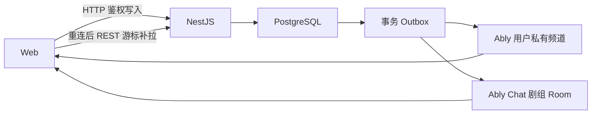

# FizzDragon 剧组协作产品开发文档

状态：核心产品与代码链路已闭环；外部服务生产验收待部署凭证
最后订正：2026-07-29
前端：`apps/web`
后端：`apps/server` + PostgreSQL
实时服务：Ably Pub/Sub + Ably Chat
可选外部服务：BoldSign

## 1. 产品定义

FizzDragon 剧组是线上 AI 内容创作者的协作与制作空间，不是线下制片
ERP，也不是在 FizzDragon 里复刻一套微信、飞书或 GitHub。

产品要收拢五条原本分散的工作链路：

1. 一个剧组、一个群聊。
2. 类似 GitHub Projects / Issues 的制作任务。
3. 与 FizzStudio 项目、独立任务画布和提交版本的连接。
4. 类似 Google Drive 的剧组资产中心。
5. 成员、招募、可选合同、积分报酬与结算。

合同不是加入剧组或开始创作的前置条件。真实法币付款、KYC、税务和发票
不属于当前阶段。

## 2. 不再有效的旧决策

以下方案已正式废弃，后续实现不得据此继续扩展：

- 用 Episode / EpisodeAssignment 承担全部任务管理。
- 不开发通用 CrewTask。
- 文件中心只做平铺列表，不做目录和权限。
- 普通 Conversations 继续使用 WebSocket + Redis，仅 Studio Agent 使用
  Ably。
- 将任务状态变化自动刷进剧组群聊。
- 提交任务后冻结整个工作画布、使其无法继续编辑。

当前实现已经移除旧剧集 Assignment 模块，统一使用 CrewTask 与任务项目。

## 3. 核心产品原则

1. 一个剧组只有一个群聊，暂不支持私聊和多频道。
2. 群聊属于平台全局 Conversations，剧组工作台只是关联入口和上下文。
3. PostgreSQL 是消息、任务、文件和结算的业务事实源。
4. Ably 负责低延迟实时分发，不替代业务数据库和服务端鉴权。
5. FizzDragon 用户系统是唯一身份源，不创建第三方用户。
6. 所有关键权限由服务端执行；隐藏按钮不能代替鉴权。
7. 任务是 Issue，任务项目是 Projects，任务画布是隔离的制作分支。
8. 提交会冻结“本次提交版本”，不会锁死成员仍在工作的任务画布。
9. 剧组资产只有一份业务事实；消息、任务和画布通过引用复用同一资产。
10. 合同可选，未配置 BoldSign 时其余协作链路仍正常工作。
11. 报酬使用社区积分记账，固定换算为 `100 积分 = USD 1`；只有结算记录
    发生换算，当前阶段不自动出金。
12. `.com` 剧组资产使用 Cloudflare R2，`.cn` 使用阿里云 OSS。

## 4. 信息架构

剧组工作台使用独立、占满视口的制作布局，一级导航为：

1. **群聊**：默认入口，日常沟通、富消息、文件与业务卡片。
2. **制作任务**：Backlog、表格、看板、日历、路线图、自定义视图。
3. **资产中心**：目录、文件、搜索、筛选、预览、上传、回收站和权限。
4. **成员管理**：成员角色、邀请、移除、所有权转移和可选合同。
5. **岗位招募**：岗位发布、冻结、申请、审核和入组。
6. **基本信息**：剧组摘要和公开状态。

全局通知中心位于工作台侧栏，可直接深链到任务、评论、成员、合同和聊天。

## 5. 端到端用户流程

### 5.1 邀请或招募入组

1. 主理人通过账号邀请成员，或申请人投递公开岗位。
2. 服务端校验容量、岗位状态和成员状态。
3. 通过后，在同一事务中建立 CrewMember、WorkspaceMember 和制作项目访问。
4. 成员获得剧组群聊参与者身份和站内通知。
5. 成员进入工作台后可立即聊天、查看被授权资产和领取任务。
6. 合同可以随后发起，不阻塞入组。

成员被移除时同步撤销：

- 群聊读取、发送和实时订阅权限。
- Workspace 与任务项目访问。
- 资产显式授权，防止重新入组后旧授权静默复活。

### 5.2 创建和执行任务

1. 主理人创建任务项目，并配置工作流列、标签、迭代和自定义字段。
2. 创建 Issue 式 CrewTask，设置优先级、父子任务、阻塞关系、执行人、
   估点、算力预算、返修次数和报酬积分。
3. 系统为需要创作的任务建立独立任务画布/项目。
4. 执行人在任务详情中讨论，引用或上传剧组资产。
5. 看板拖拽采用乐观更新；服务端使用版本号和排序约束解决并发冲突。
6. 任务活动进入任务时间线和精准通知，不进入普通群聊刷屏。
7. 共享视图、工作流、制作迭代、标签和自定义字段发生变化时，通过用户私有
   Ably 频道通知所有在线成员刷新；重连后统一从 PostgreSQL 恢复权威状态。

工作流列不是写死的“待开始 / 进行中 / 待审核 / 待修改”。这些只是可编辑
默认值；主理人可以新增、重命名、排序、归档并映射终态。

### 5.3 提交、审核与画布合并

一次提交可以同时包含：

- 任务画布的不可变提交版本。
- 一个或多个具体图片、视频、音频或文档资产。
- 文字说明。

提交后：

1. 当前任务画布仍可编辑。
2. 系统冻结该次提交所引用的版本，保证审核对象不会漂移。
3. 主理人可以通过或要求修改。
4. 要求修改会增加返修轮次，成员基于原任务画布继续创作并再次提交。
5. 通过后，提交版本可合并到剧组的主制作项目；合并记录具有幂等键和审计
   状态。

因此“任务画布像 Git 分支、提交像 Pull Request”是交互隐喻，不是把画布
本身永久锁定。

### 5.4 积分报酬与结算

1. 任务可以为不同执行人设置报酬积分。
2. 审核通过后，积分进入成员可提现社区积分账户。
3. 结算中心展示待结算和已结算记录。
4. 主理人确认结算时，在一个数据库事务中完成积分扣减、结算状态和通知
   Outbox。
5. 结算按不可变汇率 `100 积分 = USD 1` 记录法币金额快照。

这是一套可审计的内部账本和结算凭证，不代表平台已经代用户执行法币付款。

### 5.5 可选合同

1. 主理人可在邀请成员时披露可选合同，也可在成员加入后从「剧组合同」单独发起。
2. 接受邀请会原子建立成员权限、群聊参与者和合同发送任务；BoldSign 故障不阻塞入组。
3. 多副本发送 Worker 通过 PostgreSQL 租约执行，使用稳定 Label 对账，避免超时重试产生重复合同。
4. BoldSign 的异步 `Sent / SendFailed` Webhook 是发送结果的事实来源。
5. 成员收到站内通知后进入对应合同；只有合同绑定的当前登录成员可以按需生成 15 分钟签署链接。
6. 签署链接不持久化、不写入通知；管理员不能代取其他成员的签署凭证。
7. 浏览器回跳只用于体验反馈；合同终态只接受经过 HMAC 验证的 Webhook。
8. 签署 PDF 和审计文件作为受限剧组资产归档。
9. 未配置 BoldSign 时明确显示状态，不影响聊天、任务、文件和结算。

## 6. 群聊

### 6.1 消息能力

- 文本、图片、视频、音频、文档。
- 剪贴板粘贴图片和拖拽/选择上传。
- `@成员`、`@剧组助手`、`@任务`、`@资产`。
- 任务卡片、资产卡片和系统业务卡片。
- 发送幂等、失败重试、历史游标分页、未读与最后阅读位置。
- 文件一键保存为剧组资产。

剧组助手承担必要的系统身份和未来 AI 问答。普通任务创建、提交和修改不作为
群聊消息；它们进入任务时间线和通知中心。

### 6.2 实时架构



- 普通 Conversations、任务失效事件和站内通知共用一个用户私有 Ably
  Pub/Sub 频道；每个浏览器标签只维护一个用户级连接。
- 每个剧组会话对应一个 Ably Chat Room。
- 浏览器只获取身份绑定、短期、最小权限 Token。
- 客户端不直接发布业务消息；消息必须先由 NestJS 鉴权并持久化。
- Outbox 工作者重试发布，避免数据库已提交但实时事件丢失。
- 断线、切后台和 Token 刷新后以 REST 历史恢复为准。
- 旧 Conversations / Notifications WebSocket Gateway 已删除，不保留 Redis
  或静默 fallback。
- `@ably/ai-transport` 仍服务 Studio Agent 的 AI turn，与聊天协议不混用。

## 7. 资产中心

资产中心是剧组级云盘，不是聊天附件的临时列表。

### 7.1 基本能力

- 文件夹创建和层级导航。
- 文件上传、重命名、移动、收藏、搜索、排序和类型筛选。
- 默认列表视图，可切换卡片视图。
- 图片、视频、音频和文档预览；原文件下载。
- 最近使用、收藏和回收站。
- 软删除、恢复和永久删除确认。
- 资产预览写入 `?asset=<id>`，聊天和通知可以直达右侧预览区；关闭预览会
  消费该参数，刷新不会重复打开。
- 右下角全局上传队列，支持并发、进度、失败重试和离开页面后的状态延续。
- 100 条游标分页和滚动续载，避免无界列表。
- 上传、重命名、移动、回收、恢复、永久删除和权限变化通过用户私有 Ably
  频道使在线成员即时刷新；重连后仍以 PostgreSQL 为权威恢复。

### 7.2 层级权限

每个文件或文件夹可以：

- `inherit`：继承最近上级权限。
- `restricted`：建立新的显式权限边界。

权限等级：

```text
view < upload < edit < manage
```

受限父级不能被子级绕过；有效权限是路径上所有受限边界授权的最小值。剧组
主理人始终保留紧急 `manage` 权限。

同一套 ACL 同时控制：

- 列表和搜索可见性。
- 预览、缩略图和原文件签名 URL。
- 上传、创建、移动、重命名、删除和恢复。
- 任务提交和评论引用现有资产。

重命名和移动使用 `updatedAt` 乐观并发令牌，权限更新使用独立版本号；两者都
会拒绝陈旧写入，权限变化还会写入不可随文件删除而消失的审计记录。

### 7.3 存储

- `.com / global`：Cloudflare R2（S3 compatible provider）。
- `.cn`：阿里云 OSS。
- MediaAsset 保存对象事实，CrewAssetNode 保存剧组目录、业务归属和 ACL。
- 消息、任务和画布引用同一 MediaAsset/CrewAssetNode，不复制文件。
- 上传完成但尚未挂入资产树的对象只允许仍在组的原上传者访问。

## 8. 权限矩阵

| 操作             |        主理人 |           财务 |       普通成员 | 非成员 |
| ---------------- | ------------: | -------------: | -------------: | -----: |
| 查看和发送群消息 |             ✓ |              ✓ |              ✓ |      ✗ |
| 查看普通剧组资产 |             ✓ |         按 ACL |         按 ACL |      ✗ |
| 管理资产权限     |             ✓ | 获得 manage 后 | 获得 manage 后 |      ✗ |
| 创建和管理任务   |             ✓ |     按任务权限 |     按任务权限 |      ✗ |
| 提交自己的任务   |             ✓ |              ✓ |              ✓ |      ✗ |
| 审核任务         |             ✓ |         按授权 |         按授权 |      ✗ |
| 查看自己的报酬   |             ✓ |              ✓ |              ✓ |      ✗ |
| 执行结算         |             ✓ |         按授权 |              ✗ |      ✗ |
| 管理成员和岗位   |             ✓ |              ✗ |              ✗ |      ✗ |
| 发起合同         |             ✓ |         按授权 |              ✗ |      ✗ |
| 查看合同         | 授权者/当事人 |  授权者/当事人 |         仅本人 |      ✗ |

所有写操作在事务内重新校验当前成员、角色、资源版本和目标资源归属。

## 9. 可靠性和安全基线

- 所有客户端重试写操作都有幂等键或乐观版本号。
- 业务状态和通知/实时 Outbox 在同一事务提交。
- 所有列表使用游标分页或明确上限。
- 成员移除和所有权转移同步投影到 Workspace、制作项目、群聊和资产 ACL。
- 下载地址短期有效，私有资源不暴露对象存储 Root 凭据。
- BoldSign API Key、Webhook Secret 和 Ably Root Key 仅存在服务端。
- 必需配置缺失时 readiness 失败或对应功能明确不可用，不使用静默假实现。
- `.com` 和 `.cn` 使用相同业务模型、不同区域存储与服务凭据。
- 制作迭代删除会将关联任务原子移回 Backlog，并清理共享视图中的失效筛选
  条件；日期编辑按用户本地日历解释，避免时区导致排期偏移。

## 10. 验收标准

### 群聊

- 一个 Crew 恰好对应一个业务会话和 Room。
- 当前成员能读取完整历史、发送、接收、恢复未读位置。
- 非成员和被移除成员不能读取、发送、订阅或获取附件 URL。
- 重试发送不会重复落库，Ably 中断不会丢失数据库历史。

### 任务

- Backlog、表格、看板、日历、路线图使用同一 CrewTask 事实。
- 工作流列可配置，不依赖写死状态。
- 任务可编辑、评论、分配、拖拽、提交、审核和返修。
- 提交版本稳定可审，工作画布可继续编辑。
- 具体资产与任务画布版本可同时提交。
- 通过、积分入账、结算和通知都具有事务一致性。

### 资产

- 目录、上传、移动、重命名、预览、下载、收藏和回收站闭环。
- `.com` 写入 R2，`.cn` 写入 OSS。
- UI 可见性和实际文件字节使用同一层级 ACL。
- 重命名和移动的并发冲突不会静默覆盖其他成员的更新。
- 权限并发冲突不会静默覆盖，权限变更可审计。
- 一个成员的资产或权限变更会实时刷新其他在线成员的资产查询。
- 成员离组后立即失去访问，重新加入不会恢复旧显式授权。

### 邀请和合同

- 邀请接受后一次性建立全部协作访问。
- 邀请时可以披露可选合同，但签署不作为进入工作台的门槛。
- 所有权转移不会保留前主理人的 Studio 管理权限。
- 没有合同不影响任何协作流程。
- 合同终态只由验证后的 BoldSign Webhook 决定。
- 短期签署凭证只发给合同绑定的登录成员，且永不持久化。
- 合同文件不会出现在无权限成员的普通资产列表。

## 11. 尚需业务决策、不能硬编码的事项

以下不是技术“以后再补”的占位，而是需要产品/运营明确后才能实施的规则：

1. 岗位发布是否收费、每次费用、免费额度、置顶和续期价格。
2. 剧组总容量套餐和超额策略；单文件已有服务端硬上限。
3. 财务角色是否默认拥有结算权，或需要单独能力授权。
4. 首批 BoldSign 模板、签约主体和 `.cn` 可用性。
5. 聊天、普通资产、合同文件和审计记录的正式保存期限。
6. 结算法币出金的运营流程；当前仅记录积分兑换结果。

没有明确答案前，不应把任意金额、期限或权限写死进生产代码。

## 12. 官方参考

- [Ably Platform Architecture](https://ably.com/docs/platform/architecture)
- [Ably Chat Data Storage](https://ably.com/docs/chat/external-storage-and-processing/data-storage)
- [BoldSign API](https://developers.boldsign.com/)
