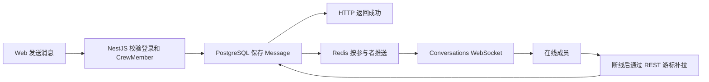

# FizzDragon 剧组协作产品开发文档 v1

状态：评审稿  
日期：2026-07-27  
目标产品：FizzDragon 线上 AI 创作剧组  
目标前端：`apps/web`  
目标后端：`apps/server` + PostgreSQL + Redis  
外部服务：BoldSign（可选合同）

## 1. 产品定义

FizzDragon 剧组不是线下制片管理软件，也不是通用项目管理平台。

它是一个面向 AI 内容创作者的线上协作空间：

> 一个剧组、一个群聊、现有剧集任务、一处文件资产、可选电子合同。

本轮基于现有剧组功能增加协作能力，不重做剧组大厅、招募、成员和剧集制作。

## 2. 现有基础

当前剧组已经具备：

- 剧组创建、编辑、公开展示和剧组大厅。
- 岗位发布、薪资范围、申请和审核。
- 成员添加、移除、主理人和财务权限。
- 剧集创建和成员分工。
- 成员提交、主理人通过或驳回。
- 任务收益记录和不可变活动日志。
- 剧组与剧集相关的站内通知。
- FizzDragon 用户登录和身份体系。

因此本轮只补四件事：

1. 剧组群聊。
2. 聊天附件与剧组文件。
3. 现有剧集任务的交互补强。
4. 可选 BoldSign 合同。

## 3. 已确定的产品原则

1. 一个剧组只有一个群聊。
2. 暂不支持私聊、多频道和临时讨论组。
3. 所有用户继续使用 FizzDragon 账号，不创建第三方账号。
4. UI 全部由 FizzDragon 原生实现，保持现有设计语言。
5. 消息先保存到 FizzDragon 数据库，实时服务只负责推送。
6. 当前有效成员可以查看该剧组的完整群聊历史；被移除后立即失去访问权。
7. 不新建一套 GitHub Issues，不迁移现有 EpisodeAssignment。
8. Episode 是一集或一批制作工作，Assignment 是成员在该集中的制作任务。
9. 文件进入现有 MediaAsset 存储体系，并增加剧组归属和权限。
10. 合同不是加入剧组、领取任务或开始创作的前置条件。
11. 合同只对当事人和授权者可见，不进入普通群聊或公共文件列表。
12. 本轮不接入 Ably，优先复用平台现有 Conversations、Redis 和 WebSocket。

## 4. 产品信息架构

现有剧组工作区调整为：

1. **群聊**：默认进入，处理日常沟通。
2. **剧集制作**：保留现有任务、交付、审核和收益。
3. **文件**：查看群聊附件和任务成果。
4. **成员**：成员、角色、财务权限和可选合同。
5. **招募**：现有岗位与申请。
6. **概览**：现有剧组摘要。

合同不增加一级导航。主理人只在某个成员详情中发起合同。

## 5. 完整用户流程

### 5.1 入组与交流

1. 用户通过申请审核或主理人添加加入剧组。
2. 系统把该用户加入剧组唯一群聊。
3. 群聊出现“成员加入”系统消息。
4. 用户进入工作区后默认打开群聊。
5. 用户可以查看历史、未读消息并发送文字。

### 5.2 分配制作任务

1. 主理人在现有「剧集制作」中创建剧集。
2. 主理人为该剧集分配成员和角色。
3. Assignment 作为该成员的制作任务。
4. 系统在群聊中发送简短任务动态，并通知负责人。
5. 负责人点击动态直接进入对应剧集和任务。

### 5.3 提交与审核

1. 成员打开自己的任务。
2. 选择已有 FizzDragon AI 资产、上传新文件、添加外部链接或填写说明。
3. 提交后任务进入待审核。
4. 主理人选择通过或驳回；驳回时必须填写原因。
5. 成员修改后重新提交。
6. 财务或主理人记录最终收益。
7. 群聊只显示状态变化，不公开显示收益金额。

### 5.4 文件沉淀

1. 群聊附件与任务成果统一登记为剧组文件。
2. 文件页按时间展示，并支持图片、视频、音频和文档筛选。
3. 同一资产可以被消息和任务共同引用，不重复上传。
4. 成员离开剧组不会删除已经交付给剧组的成果。

### 5.5 可选合同

1. 主理人在成员详情中点击「发起合同」。
2. 选择 FizzDragon 已配置的 BoldSign 模板。
3. 填写合作周期、金额等必要变量。
4. 成员收到站内通知，在 FizzDragon 中打开 BoldSign 签署页。
5. BoldSign 回调更新待签、完成、拒绝或失效状态。
6. 完成后，最终 PDF 与审计文件归档为私有文件。
7. 没有合同的成员不会显示错误，也不影响其他流程。

## 6. 功能设计

### 6.1 剧组群聊

首版支持：

- 文字消息。
- 历史消息游标分页。
- 未读数量和最后阅读位置。
- 成员加入、退出和任务状态系统消息。
- 发送失败重试。
- FizzDragon 用户头像、昵称和角色。

文件阶段补充：

- 图片、视频、音频和文档附件。
- 引用 FizzDragon 已有资产。
- 点击任务动态进入对应任务。

本轮不支持：

- 私聊、群聊分组和线程回复。
- 语音、视频会议和屏幕共享。
- 表情反应、投票和机器人。
- 独立任务评论区。

历史消息规则：

- 数据库中的 Message 是唯一事实源。
- WebSocket 断开不会造成历史消息丢失。
- 当前成员可以查看完整历史。
- 被移除成员不能继续读取、发送或接收消息。
- 保存期限遵循平台统一的数据保留策略。

### 6.2 剧集任务

本轮不新增通用任务模型。

继续使用现有结构：

```text
Crew
  -> Episode
    -> EpisodeAssignment
```

继续使用现有状态：

```text
in_progress
  -> submitted
  -> approved

submitted
  -> rejected
  -> submitted
```

需要补强：

- 「我的任务」筛选，让成员快速看到自己的 Assignment。
- 通知可直接打开目标剧集和 Assignment。
- 完整的提交表单：成果文件、外部链接和说明。
- 主理人收到成员提交通知。
- 已批准剧集不再显示可编辑操作。
- 前端与后端统一收益编辑权限。
- 所有写操作重新校验成员仍然在组。

只有出现以下真实需求后，才评估通用 CrewTask：

- 与任何剧集无关的运营任务大量出现。
- 同一个成员在同一集需要多条独立任务。
- 现有 Assignment 无法清晰表达实际分工。

### 6.3 剧组文件

首版文件中心保持简单：

- 按时间排列。
- 按文件类型筛选。
- 显示上传人、来源消息或来源任务。
- 支持预览和下载。
- 不做目录、版本树和复杂网盘管理。

技术上复用 MediaAsset 的上传与对象存储能力，新增 CrewFile 作为业务归属与访问控制：

```text
CrewFile
  - crewId
  - mediaAssetId
  - uploaderUserId
  - displayName
  - sourceType: message | assignment | manual
  - sourceId
  - visibility: crew | restricted
  - createdAt
  - deletedAt
```

注意：现有 MediaAsset 以 Workspace 为权限域，CrewMember 不是 WorkspaceMember。正式开发前需单独确定 crew ACL 与存储配额桥接，不能直接放开 Workspace 文件权限。

### 6.4 收益与薪资

本轮不建设工资系统：

- 岗位薪资是招募时的合作条件。
- Assignment 收益是某项已完成工作的实际记录。
- 合同金额是协议快照。
- 三者不自动触发真实支付。
- 工资发放、税务、发票、付款批次和平台钱包不在本轮。

### 6.5 BoldSign 合同

FizzDragon 负责：

- 验证 FizzDragon 用户与剧组关系。
- 提供发起入口和合同列表。
- 保存合同状态。
- 发送站内通知。
- 归档签署后的 PDF 和审计文件。

BoldSign 负责：

- 合同模板。
- 嵌入式签署页面。
- 签名流程与证据。
- 签署状态事件。

产品状态简化为：

```text
准备中 -> 待签署 -> 已完成
                 -> 已拒绝 / 已撤销 / 已失效 / 处理失败
```

约束：

- 模板由运营在 BoldSign 管理。
- API Key 和 Webhook Secret 只在服务端。
- 签署链接按需生成，不保存、不发到群聊。
- 浏览器回跳不能直接把合同标记为完成，以 BoldSign Webhook 为准。
- 完成文件只能被合同当事人和授权者访问。
- `.cn` 开放前需验证网络可用性与数据合规。

## 7. 权限

| 操作                  |        主理人 |          财务 |   普通成员 | 非成员 |
| --------------------- | ------------: | ------------: | ---------: | -----: |
| 查看和发送群消息      |             ✓ |             ✓ |          ✓ |      ✗ |
| 查看普通剧组文件      |             ✓ |             ✓ |          ✓ |      ✗ |
| 创建剧集、分配成员    |             ✓ |             ✗ |          ✗ |      ✗ |
| 提交自己的 Assignment |             ✓ |             ✓ |          ✓ |      ✗ |
| 审核 Assignment       |             ✓ |             ✗ |          ✗ |      ✗ |
| 设置 Assignment 收益  |             ✓ |             ✓ |          ✗ |      ✗ |
| 管理成员和招募        |             ✓ |             ✗ |          ✗ |      ✗ |
| 发起合同              |             ✓ |        按授权 |          ✗ |      ✗ |
| 查看合同              | 当事人/授权者 | 当事人/授权者 | 仅本人合同 |      ✗ |

所有权限必须由服务端校验。隐藏按钮不能代替后端鉴权。

## 8. 群聊技术方案

仓库已有 Conversations 模块，当前用于 service/order 双人会话。它已经具备：

- Conversation、Participant 和 Message 持久化。
- 历史分页。
- 最后阅读游标和未读数量。
- Redis 实时分发。
- `/ws/conversations` WebSocket。
- 断线后重新读取数据库历史。

剧组群聊应扩展这套底层，而不是新建平行消息系统。

需要改造：

1. Conversation context 增加 `crew`。
2. 每个 Crew 固定一个 `lookupKey = crew:{crewId}`。
3. 参与者从固定 buyer/creator 扩展为群组 member。
4. CrewMember 加入或移除时同步 Participant。
5. 所有读取和发送再次校验有效 CrewMember。
6. 现有 inbox 的“对方”投影改为支持剧组名称、logo 和成员数。
7. 广播时只发送给当前有效参与者。
8. Message 增加客户端幂等键；附件阶段增加 CrewFile 引用。

写入与推送：



首版沿用“数据库为准、WebSocket 为加速”的现有模式。可靠 Outbox 可以作为后续稳定性增强，不是群聊上线的前置条件。

### 为什么当前不接 Ably

Ably 能提供频道、Token Auth、Presence 和短期历史，但：

- Ably 不是阿里云产品。
- FizzDragon 仍然必须维护用户、成员权限和长期历史。
- Ably 没有公开保证中国大陆可用性或大陆数据驻留。
- 仓库已经有消息数据库、Redis 和 WebSocket。

现在接入 Ably 会形成第二套实时链路，不能减少本轮核心的群组权限、历史消息和 UI 开发。因此本轮继续使用现有技术；如果未来连接规模或运维成本证明需要托管服务，再通过 provider 适配。

## 9. UI 要求

- 延续现有剧组工作区，不嵌入第三方聊天或任务 UI。
- 遵守 FizzDragon Web 的 dark-only 方向。
- 工作区保持紧凑，不使用营销页大字号。
- 卡片主要通过间距、层级和背景区分，避免堆叠明显边框。
- 品牌红只用于主要动作、未读和关键选择状态。
- 群聊输入框在桌面和移动端都固定可达。
- 发送、提交、审核和签署都要有明确的进行中、成功和失败状态。
- 后端具体错误直接展示，不能统一替换成模糊的“操作失败”。
- 新增文案同步进入 `en-US`、`zh-CN`、`zh-HK`。

## 10. 推荐开发顺序

### R0：修正现有剧集任务

- 移除成员不能继续提交旧 Assignment。
- 补齐任务提交表单。
- 提交后通知主理人。
- 通知深链直接打开目标剧集和 Assignment。
- 对齐主理人/财务的收益编辑权限。
- 修正已批准剧集仍显示编辑按钮的问题。

完成结果：现有任务闭环稳定可用。

### R1：一个剧组一个文字群聊

- Conversations 增加 crew context。
- 成员生命周期与群参与者同步。
- 群聊页面、历史、未读和系统消息。
- 被移除成员立即失去访问权。
- 发送幂等、断线补拉和基础监控。

完成结果：成员可以把日常文字沟通迁入 FizzDragon。

### R2：附件与文件

- CrewFile 与 crew ACL。
- 群聊附件。
- Assignment 成果附件。
- 简单文件列表、筛选、预览和下载。

完成结果：沟通素材与任务成果不再散落在外部网盘。

### R3：可选 BoldSign 合同

- BoldSign 模板配置。
- 发起合同与嵌入签署。
- Webhook 状态更新。
- 已签 PDF 和审计文件私有归档。

完成结果：需要正式协议时可以签，不需要时没有额外步骤。

### 后续决策门

R0～R3 上线并观察实际使用后，再判断是否需要非剧集通用任务。没有真实数据前，不开发 CrewTask、甘特图或复杂 Issue 系统。

## 11. 验收标准

### 群聊

- 一个 Crew 只对应一个群聊。
- 只有当前成员能查看、发送和接收消息。
- 刷新或断线返回后能读取完整历史，不重复显示消息。
- 未读数量和最后阅读位置准确。
- 成员移除后不能继续访问。

### 剧集任务

- 现有 Episode 和 Assignment 数据不迁移、不丢失。
- 成员只能提交自己的 Assignment，且必须仍是有效成员。
- 主理人能收到提交并完成通过或驳回。
- 驳回后可以重新提交。
- 收益权限和冻结状态前后端一致。

### 文件

- 上传失败不会生成可用 CrewFile。
- 消息附件和任务成果都能在文件页找到。
- 非成员拿不到私有下载地址。
- 合同文件不会出现在普通文件列表。

### 合同

- 没有合同不影响群聊和任务。
- 只有合同当事人或授权者能获取签署入口。
- 以 BoldSign 服务端事件更新最终状态。
- 完成后能访问签署 PDF 和审计文件。

## 12. 需要评审确认的事项

1. 当前成员是否都能查看入组前的完整群聊历史。本文档默认“可以”。
2. Assignment 收益是否允许主理人和财务共同编辑。本文档默认“两者都可以”。
3. 文件单文件大小与剧组总容量限制。
4. BoldSign 首批合同模板、签约主体和签署人角色。
5. 聊天与合同文件的正式保存期限。
6. `.cn` 是否开放 BoldSign。

## 13. 官方参考

- [Ably Platform Architecture](https://ably.com/docs/platform/architecture)
- [Ably Chat Data Storage](https://ably.com/docs/chat/external-storage-and-processing/data-storage)
- [BoldSign：从模板发送文档](https://developers.boldsign.com/documents/send-document-from-template/)
- [BoldSign：Embedded Signing Link](https://developers.boldsign.com/embedded-signing/get-embedded-signing-link/)
- [BoldSign：Webhook Events](https://developers.boldsign.com/webhooks/available-events/)
- [BoldSign：下载签署文件](https://developers.boldsign.com/documents/download-document/)
- [BoldSign：下载审计记录](https://developers.boldsign.com/documents/download-audit-trail/)
