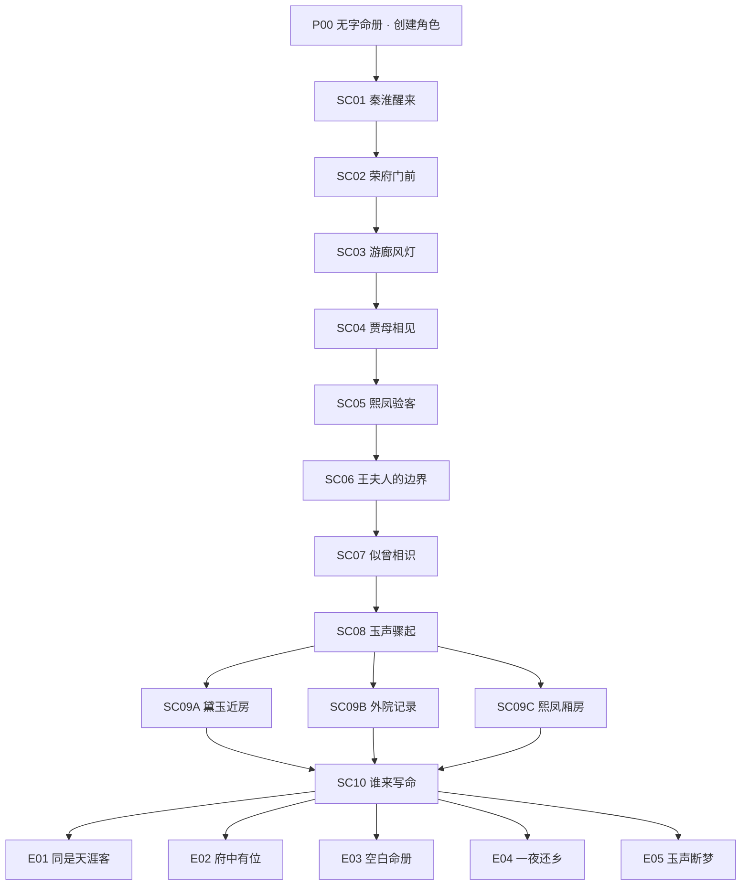

# 第一季分支图与状态规则

状态：DRAFT · v0.1
最后更新：2026-07-10
准源关系：[03-SEASON-01-STORY.md](./03-SEASON-01-STORY.md) 负责文学与表演；本文负责可达性、条件与状态。

## 1. 主干结构

SC09 的三个入口不是三条完全独立长线，而是不同开场、不同线索和部分不同对话，之后进入共同夜谈核心。

## 2. 状态分类

### 2.1 角色创建常量

- origin：WEAVE | KIN | MEDIC
- trait：HEART | CAREFUL | QUICK
- token：由 origin 决定，后续可扩展为选择。
- playerName：自由文本，仅用于动态文字层。

### 2.2 关系状态

- daiyuTrust：0–5
- baoyuAffinity：0–4
- xifengLeverage：-2–4
- houseStanding：-2–5

### 2.3 叙事状态

- identityCredibility：-3–5
- ledgerInsight：0–5

### 2.4 关键旗标

- inspectedLetterAuthor
- inspectedRedSeal
- watchedDaiyuFirst
- borrowedDaiyuName
- protectedDaiyuAtLantern
- protectedLetterAtLantern
- gaveLetterToXifeng
- exposedXifengDateTest
- roomNearDaiyu | roomNearOuter | roomNearXifeng
- toldBaoyuOutsideLedger
- jadeAction：CATCH | SHIELD | CALL | HESITATE
- toldDaiyuLetterTruth
- toldDaiyuLedgerTruth
- finalLetterAction：DAIYU | XIFENG | KEEP | BURN

## 3. 选择设计不变量

1. 每个主要选择至少产生以下一项：独立反应片、后续回收、路线条件、线索或空间变化。
2. 关系变化必须与角色可见行为一致；不能在角色不知情时直接改变其态度。
3. 出身和专长解锁额外方法，但不得让未选择该专长的玩家无法完成主线。
4. QTE 失败不得单独触发坏结局。
5. 最终选择不能覆盖全部前置状态。
6. 任何结局必须至少依赖一个早于 SC09 的选择。

## 4. 结局条件草案

条件为设计表达，数值在实现前通过路径枚举校准。

### E03 空白命册

- ledgerInsight ≥ 4；
- inspectedRedSeal = true；
- finalLetterAction = KEEP；
- identityCredibility ≥ 0；
- 玩家在 SC09 发现或说出命册真相。

### E05 玉声断梦

- jadeAction = HESITATE；
- identityCredibility ≤ 0；
- houseStanding ≤ 0；
- daiyuTrust ≤ 1；
- xifengLeverage ≤ 0 或熙凤选择公开荐书异常。

### E04 一夜还乡

- finalLetterAction = BURN；或
- 玩家没有担保但不满足 E05；或
- 玩家在最终场景主动选择离府。

### E01 同是天涯客

- finalLetterAction = DAIYU；
- daiyuTrust ≥ 3；
- borrowedDaiyuName = false，或已在 SC09 坦白并获得谅解；
- 不满足 E03 / E05。

### E02 府中有位

- finalLetterAction = XIFENG；或
- houseStanding ≥ 3 且 xifengLeverage ≥ 2；
- 不满足 E03 / E05 / E04 / E01。

## 5. 路线覆盖目标

在不考虑自由姓名的情况下，自动枚举：

- 3 种出身；
- 3 种专长；
- 所有主要选择；
- QTE 四种动作；
- 四种最终荐书处理。

发布前必须满足：

- 五个结局均可达；
- 没有不可达场景；
- 没有无出口循环；
- 没有一个结局占全部合理路径的 50% 以上；
- E05 不能由单次操作失误触发；
- 每个出身至少拥有两次有意义的专属内容；
- 每个专长至少拥有两次可感知的专属方法。

## 6. 回收矩阵

| 早期行为        | 即时反馈           | 后续回收                      |
| --------------- | ------------------ | ----------------------------- |
| SC01 先看黛玉   | 黛玉回望           | SC09 提到玩家第一眼没有先看信 |
| SC02 借黛玉名义 | 门上合并报帖       | SC05 熙凤复述；SC09 黛玉质问  |
| SC03 先护黛玉   | 黛玉身体反应       | SC08 / SC09 信任动作          |
| SC03 先护荐书   | 黛玉看见           | SC09 她追问玩家究竟在藏什么   |
| SC05 交信给熙凤 | 熙凤收信           | SC09 房间被查；E02 条件       |
| SC07 说不在册中 | 宝玉明显停顿       | 后续季宝玉再次提到“册”        |
| SC08 护黛玉     | 玉落地，黛玉被护住 | SC09 黛玉主动来访；E01 加强   |
| SC08 接玉       | 手伤或抓痕         | SC09 黛玉/宝玉关心；府中认可  |

## 7. 自动校验要求

未来内容编译器必须校验：

- 节点 ID、选择 ID、媒体 ID 全局唯一；
- 所有 next 引用存在；
- 所有条件引用已声明状态；
- 所有主要选择存在 reactionAssetId；
- 所有结局存在独立 endingAssetId；
- 所有动态姓名出现场景使用安全文字层，不烧录固定名称；
- 角色创建组合不会引用不存在的配音或视频变体；
- 媒体时长、字幕时码和选择出现时间合法。
