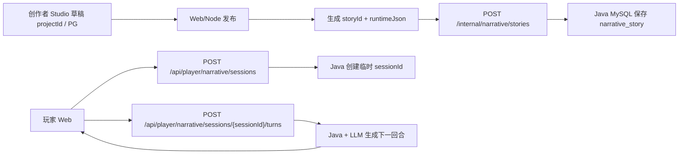

# 文字游戏 Narrative Runtime — 产品形态与 Java 接口需求 v0

> 状态: 需求草案。
> 这份文档分成两部分:
>
> 1. 完整产品预期形态: 解释未来这套文字游戏系统应该如何工作。
> 2. 当前阶段 Java 接口: 只描述目前建议 Java 先承接的最小运行时能力。

当前阶段先做极简闭环: **Java 持久化已发布 story runtime, 玩家进度和回合历史暂不持久化**。刷新页面或 Java 服务重启后, 玩家进度可以丢失。

---

# 第一部分: 完整产品预期形态

## 1. 产品目标

FizzDragon / 气泡龙的文字游戏系统包含两个核心场景:

- 创作者侧: 在 Studio 里编辑故事、剧情节点、角色、线索、场景、音乐、视频和规则。
- 玩家侧: 在 Web 里游玩故事, 可以选择预设选项, 也可以自由输入行动。

系统的目标不是做一个完全固定分支的选择游戏, 而是做一种混合形态:

- 有创作者设定的故事框架和关键剧情节点。
- 有预设选项, 方便玩家推进。
- 有 open answer / 自由输入, 让玩家能自然表达行动。
- 有线索、规则和状态, 限制 AI 不乱跑、不提前剧透。
- 由 AI 根据当前剧情状态生成下一段文本。

## 2. 系统边界

| 模块                  | 主要职责                                               | 存储         |
| --------------------- | ------------------------------------------------------ | ------------ |
| Web Studio / 创作者侧 | 编辑草稿工程、画布、节点、角色、线索、资产、规则       | PG           |
| Web Player / 玩家侧   | 展示游玩 UI, 发送玩家输入, 展示 AI 输出和状态变化      | 浏览器状态   |
| Web/Node 后端         | 发布创作者草稿, 生成运行时 JSON, 同步给 Java           | PG           |
| Java Runtime          | 玩家运行时, 处理 session、玩家输入、LLM 调用、状态推进 | MySQL        |
| LLM 服务              | 判断玩家输入、生成下一段剧情文本、返回结构化状态变化   | 外部模型服务 |

建议边界:

- PG 是创作者侧源数据和发布记录源头。
- Java MySQL 是玩家运行时副本。
- 前端不应每回合向 Java 传完整剧情或隐藏信息。
- Java 处理玩家回合时, 应从自己保存的 `runtimeJson` 和当前 session 状态中推导下一步。

## 3. 核心对象

| 名称        | 含义                            | 当前阶段说明                         |
| ----------- | ------------------------------- | ------------------------------------ |
| `userId`    | 平台用户 ID, 可以是创作者或玩家 | 玩家身份直接复用 `userId`            |
| `projectId` | 创作者编辑态草稿工程            | 存在 Web/Node + PG, 玩家侧不直接使用 |
| `storyId`   | 已发布、可游玩的故事            | Java 根据它读取 `runtimeJson`        |
| `sessionId` | 某个玩家的一局临时游玩会话      | 当前阶段可以只存在 Java 内存         |
| `turnId`    | 一次玩家输入和 AI 输出的回合 ID | 当前阶段可以只作为日志 ID            |
| `versionId` | 某次发布版本                    | 当前阶段不引入                       |

关系:

```txt
projectId  -> 发布 -> storyId
storyId    -> 开始游玩 -> sessionId
sessionId  -> 多次提交 -> turn
```

## 4. 发布与游玩数据流



## 5. 发布模型

当前阶段不引入 `versionId`。

规则建议:

- `projectId` 是创作者编辑态草稿, 可以反复修改。
- 发布后生成 `storyId`。
- `storyId` 对应的运行内容不可修改。
- 如果创作者要修改剧情节点、线索、角色规则、AI 约束等运行内容, 重新发布为新的 `storyId`。
- 发布后可以允许修改展示元信息, 例如标题、简介、封面、标签、可见性。

后续如果需要支持同一个作品的多次发布和历史存档, 再引入:

```txt
storyId
  versionId: v1
  versionId: v2
```

## 6. Runtime JSON

`runtimeJson` 是 Java 玩家运行时的核心配置。它不是 React Flow 画布数据, 不包含卡片坐标、抽屉状态、UI 临时状态。

它应该描述:

- 故事入口。
- 剧情节点。
- 预设选项。
- 可解锁线索。
- 角色设定。
- 表现资产。
- AI 运行规则。
- LLM 输出约束。

发布给 Java 的整体 payload 示例:

```json
{
  "storyId": "story_36_hours_case",
  "sourceProjectId": "project_123",
  "creatorUserId": "user_isaac",
  "schemaVersion": "narrative-runtime-v1",
  "locale": "zh-CN",
  "title": "36 小时溺亡案",
  "summary": "17 岁少女被送入精英学校矫正, 却在首宗溺亡案中发现真相。",
  "coverUrl": "https://cdn.example.com/covers/36-hours.png",
  "visibility": "private",
  "runtimeJson": {
    "schemaVersion": "narrative-runtime-v1",
    "entryPlotId": "plot_a",
    "storyBackground": "现代中国, 一名 17 岁少女被送往精英学校。",
    "plots": [],
    "choices": [],
    "clues": [],
    "characters": [],
    "assets": [],
    "rules": [],
    "llmPolicy": {}
  }
}
```

顶层字段:

| 字段              | 类型   | 来源                 | Java 是否存储 | 说明                                                        |
| ----------------- | ------ | -------------------- | ------------- | ----------------------------------------------------------- |
| `storyId`         | string | Web/Node 发布时生成  | 是            | 已发布故事 ID。玩家开局和 session 都绑定它。                |
| `sourceProjectId` | string | Web Studio 草稿工程  | 是            | 来源草稿 ID, 用于追踪发布来源。                             |
| `creatorUserId`   | string | 平台用户系统         | 是            | 创作者用户 ID。                                             |
| `schemaVersion`   | string | Web/Node 发布逻辑    | 是            | payload schema 版本, 当前建议 `narrative-runtime-v1`。      |
| `locale`          | string | 发布语言             | 是            | 当前 `storyId` 的内容主语言。当前阶段可以先只支持 `zh-CN`。 |
| `title`           | string | 创作者填写           | 是            | 故事展示标题。                                              |
| `summary`         | string | 创作者填写或 AI 生成 | 是            | 故事简介, 用于展示。                                        |
| `coverUrl`        | string | 媒体资源             | 是            | 封面图 URL。                                                |
| `visibility`      | enum   | 发布设置             | 是            | 建议取值: `private` / `public` / `unlisted`。               |
| `runtimeJson`     | object | Web/Node 从画布生成  | 是            | Java 玩家运行时核心配置。                                   |

`runtimeJson` 字段:

| 字段              | 类型   | 说明                                           |
| ----------------- | ------ | ---------------------------------------------- |
| `schemaVersion`   | string | runtime JSON 的 schema 版本。                  |
| `entryPlotId`     | string | 入口剧情节点 ID。                              |
| `storyBackground` | string | 故事背景。可用于 LLM system/context。          |
| `secretTruth`     | string | 可选。隐藏真相或最终谜底, 不应直接返回给前端。 |
| `plots`           | array  | 剧情节点。                                     |
| `choices`         | array  | 预设选项。                                     |
| `clues`           | array  | 线索。                                         |
| `characters`      | array  | 角色。                                         |
| `assets`          | array  | 场景、图片、音乐、视频、道具等表现资产。       |
| `rules`           | array  | 全局或局部规则。                               |
| `llmPolicy`       | object | LLM 生成策略和输出约束。                       |

## 7. 剧情节点模型

剧情节点是玩家运行时的主要状态单位。它不是单纯文本段落, 而是一个“当前阶段”。

建议结构:

```ts
interface PlotRuntimeNode {
  plotId: string;
  title: string;
  location?: string;
  objective: string;
  context: string;
  openActionPolicy: {
    enabled: boolean;
    allowedIntents: string[];
    offTopicBehavior: "redirect" | "refuse" | "soft_redirect";
    maxTurnsBeforeNudge?: number;
  };
  presetChoiceIds: string[];
  discoverableClueIds: string[];
  assetIds: string[];
  entryConditions: RuntimeCondition[];
  exitConditions: RuntimeCondition[];
  nextPlotIds: string[];
}
```

含义:

- `objective`: 当前剧情阶段的目标。
- `context`: 给 LLM 的剧情上下文。
- `openActionPolicy`: 玩家自由输入的允许范围。
- `presetChoiceIds`: 该阶段可展示的预设选项。
- `discoverableClueIds`: 该阶段可以发现的线索。
- `exitConditions`: 允许进入下一个剧情节点的条件。

## 8. 玩家输入模型

玩家每回合可以有两种输入:

```txt
choice      = 选择预设选项
open_answer = 自由输入
```

自由输入不是完全无边界的。Java + LLM 需要判断:

- 输入是否属于当前剧情允许范围。
- 是否命中某个行动意图。
- 是否解锁线索。
- 是否更新 flags / risk / inventory 等状态。
- 是否满足退出条件进入后续剧情节点。
- 如果跑题, 是否自然拉回当前场景。

线索的作用:

- 表示玩家已经知道的证据状态。
- 限制 AI 不能提前引用未解锁信息。
- 作为后续剧情推进、追问、推理或结局判断的依据。

## 9. 完整产品后续能力

当前阶段不需要一次性完成以下能力, 但产品长期会需要:

- 玩家 session 落库。
- 回合历史落库。
- 刷新恢复进度。
- `versionId` 和发布版本管理。
- 旧存档和新版本之间的迁移规则。
- 更完整的规则引擎。
- 角色关系和道具系统。
- 多语言 runtime。
- 内容安全、限流、计费、审计。
- 运营后台审核和上下架。
- 故事数据分析, 例如完成率、卡点、线索发现率。

---

# 第二部分: 当前阶段 Java 接口需求

## 10. 当前阶段范围

当前阶段建议 Java 先实现最小运行时闭环:

- 保存已发布故事 `runtimeJson`。
- 创建临时 `sessionId`。
- 用内存维护临时 session 状态。
- 接收玩家预设选项或自由输入。
- 调 LLM 返回下一段文本。
- 返回基础状态变化, 例如当前剧情节点、解锁线索、可选选项。

当前阶段可以先不做:

- 玩家 session 落库。
- 回合历史落库。
- 刷新恢复进度。
- 持久化幂等。
- `versionId`。
- 复杂规则引擎。

## 11. 通用响应格式

沿用 Java 现有 envelope:

```json
{
  "code": 200,
  "msg": "ok",
  "data": {}
}
```

业务失败示例:

```json
{
  "code": 409,
  "msg": "当前 session 正在处理上一回合",
  "data": null
}
```

## 12. 内部接口: 发布故事到 Java

该接口由 Web/Node 后端 server-to-server 调用, 不给浏览器直接调用。

### 12.1 创建已发布故事

`POST /internal/narrative/stories`

用途: Web/Node 将创作者发布后的 runtime JSON 同步给 Java/MySQL。

请求体:

```json
{
  "storyId": "story_36_hours_case",
  "sourceProjectId": "project_123",
  "creatorUserId": "user_isaac",
  "schemaVersion": "narrative-runtime-v1",
  "locale": "zh-CN",
  "title": "36 小时溺亡案",
  "summary": "17 岁少女被送入精英学校矫正, 却在首宗溺亡案中发现真相。",
  "coverUrl": "https://cdn.example.com/covers/36-hours.png",
  "visibility": "private",
  "runtimeJson": {
    "schemaVersion": "narrative-runtime-v1",
    "entryPlotId": "plot_a",
    "storyBackground": "现代中国, 一名 17 岁少女被送往精英学校。",
    "plots": [],
    "choices": [],
    "clues": [],
    "characters": [],
    "assets": [],
    "rules": [],
    "llmPolicy": {}
  }
}
```

返回:

```json
{
  "storyId": "story_36_hours_case",
  "status": "created",
  "createdAt": "2026-06-30T10:00:00.000Z"
}
```

建议处理:

- `storyId` 重复时返回冲突。
- Java 完整保存 `runtimeJson`。
- 玩家游玩时 Java 读取自己 MySQL 中的 `runtimeJson`。

### 12.2 更新展示元信息

`PATCH /internal/narrative/stories/{storyId}/metadata`

用途: 发布后调整展示元信息, 不修改运行内容。

请求体:

```json
{
  "title": "36 小时溺亡案",
  "summary": "更新后的简介",
  "coverUrl": "https://cdn.example.com/covers/new-cover.png",
  "visibility": "public",
  "tags": ["悬疑", "校园", "推理"]
}
```

该接口不处理:

- `runtimeJson`
- `plots`
- `choices`
- `clues`
- `characters`
- `rules`
- `entryPlotId`

## 13. 玩家侧接口

### 13.1 获取故事公开信息

`GET /api/player/narrative/stories/{storyId}`

用途: 玩家进入游玩页前获取展示信息。不返回隐藏剧情和完整 `runtimeJson`。

返回:

```json
{
  "storyId": "story_36_hours_case",
  "title": "36 小时溺亡案",
  "summary": "17 岁少女被送入精英学校矫正, 却在首宗溺亡案中发现真相。",
  "coverUrl": "https://cdn.example.com/covers/36-hours.png",
  "visibility": "public",
  "status": "published"
}
```

### 13.2 创建临时玩家 session

`POST /api/player/narrative/sessions`

请求体:

```json
{
  "storyId": "story_36_hours_case",
  "userId": "user_123"
}
```

字段说明:

| 字段      | 类型   | 说明                                             |
| --------- | ------ | ------------------------------------------------ |
| `storyId` | string | 玩家要开始游玩的已发布故事 ID。                  |
| `userId`  | string | 当前登录用户 ID。当前阶段不单独引入 `playerId`。 |

说明:

- 当前阶段不传 `locale`; 一个 `storyId` 对应一个单语言 runtime。
- 当前阶段的 `sessionId` 可以只存在 Java 内存中。
- 刷新页面后可以重新开始。

返回:

```json
{
  "sessionId": "session_abc",
  "storyId": "story_36_hours_case",
  "currentPlotId": "plot_a",
  "openingText": "你站在精英学校门口, 手里拿着转学通知书。",
  "availableChoices": [
    {
      "choiceId": "choice_a_01",
      "label": "出示转学通知书"
    }
  ],
  "unlockedClues": [],
  "state": {
    "turnCount": 0,
    "risk": 0,
    "flags": []
  }
}
```

### 13.3 提交玩家回合

`POST /api/player/narrative/sessions/{sessionId}/turns`

当前阶段不要求持久化幂等, 请求头可以先不传 `Idempotency-Key`。

自由输入:

```json
{
  "inputType": "open_answer",
  "text": "我先不说话, 观察校门口的保安和登记册。"
}
```

预设选项:

```json
{
  "inputType": "choice",
  "choiceId": "choice_a_03"
}
```

返回:

```json
{
  "turnId": "turn_001",
  "sessionId": "session_abc",
  "assistantText": "你没有立刻出示通知书, 而是停在校门外观察。保安在你开口前叫出了你的名字。",
  "inputJudgement": {
    "relevance": "in_scope",
    "matchedIntent": "观察环境",
    "offTopic": false
  },
  "currentPlotId": "plot_a",
  "transition": {
    "moved": false,
    "fromPlotId": "plot_a",
    "toPlotId": null,
    "reason": "尚未满足进入下一剧情节点的退出条件"
  },
  "unlockedCluesDelta": [
    {
      "clueId": "clue_guard_knows_name",
      "title": "保安提前知道主角姓名",
      "summary": "保安在主角递交通知书之前就叫出了她的名字。"
    }
  ],
  "availableChoices": [
    {
      "choiceId": "choice_a_01",
      "label": "出示转学通知书"
    }
  ],
  "statePatch": {
    "turnCount": 1,
    "risk": 0,
    "flagsAdded": ["observed_gate"]
  }
}
```

跑题输入也可以返回自然文本, 但不推进关键状态:

```json
{
  "assistantText": "你试图转移话题, 但此刻你仍站在精英学校门口。接待老师已经注意到你停留太久。",
  "inputJudgement": {
    "relevance": "off_topic",
    "matchedIntent": null,
    "offTopic": true
  },
  "transition": {
    "moved": false,
    "fromPlotId": "plot_a",
    "toPlotId": null,
    "reason": "输入与当前剧情目标无关"
  },
  "unlockedCluesDelta": [],
  "availableChoices": []
}
```

## 14. 当前阶段 Java 临时状态

当前阶段可以用 Java 内存 Map 保存:

```txt
sessionId -> RuntimeSessionState
```

建议状态:

```json
{
  "storyId": "story_36_hours_case",
  "userId": "user_123",
  "currentPlotId": "plot_a",
  "unlockedClueIds": ["clue_guard_knows_name"],
  "visitedPlotIds": ["plot_a"],
  "flags": ["observed_gate"],
  "risk": 0,
  "turnCount": 1,
  "status": "active"
}
```

说明:

- 该状态当前阶段不要求写入 MySQL。
- Java 服务重启后丢失可以接受。
- 浏览器刷新后重新开始可以接受。
- 如果后端是多实例部署, 内存 session 会有一致性问题; 当前阶段建议先按单实例联调。

## 15. MySQL 表建议

### 15.1 当前阶段: 已发布故事

`narrative_story`

| 字段                | 说明                              |
| ------------------- | --------------------------------- |
| `story_id`          | 主键                              |
| `source_project_id` | 来源创作者草稿                    |
| `creator_user_id`   | 创作者                            |
| `schema_version`    | runtime schema                    |
| `locale`            | 内容主语言                        |
| `title`             | 展示标题                          |
| `summary`           | 展示简介                          |
| `cover_url`         | 封面                              |
| `visibility`        | `private` / `public` / `unlisted` |
| `runtime_json`      | 完整不可变运行时 JSON             |
| `created_at`        | 发布时间                          |
| `updated_at`        | 元信息更新时间                    |

### 15.2 后续阶段: 玩家 session

当前阶段可以不建。

`narrative_player_session`

| 字段              | 说明                                 |
| ----------------- | ------------------------------------ |
| `session_id`      | 主键                                 |
| `story_id`        | 绑定的故事                           |
| `user_id`         | 当前玩家用户                         |
| `current_plot_id` | 当前剧情节点                         |
| `state_json`      | 玩家状态                             |
| `status`          | `active` / `completed` / `abandoned` |
| `created_at`      | 创建时间                             |
| `updated_at`      | 更新时间                             |

### 15.3 后续阶段: 回合记录

当前阶段可以不建。

`narrative_player_turn`

| 字段               | 说明                     |
| ------------------ | ------------------------ |
| `turn_id`          | 主键                     |
| `session_id`       | session                  |
| `client_turn_id`   | 前端幂等 ID              |
| `input_type`       | `open_answer` / `choice` |
| `player_text`      | 玩家输入文本             |
| `choice_id`        | 选择的预设选项           |
| `assistant_text`   | AI 输出                  |
| `state_patch_json` | 本回合状态变化           |
| `llm_trace_id`     | LLM 调用链路 ID          |
| `created_at`       | 创建时间                 |

## 16. 当前阶段检查点

建议联调时确认:

1. Web/Node 可以发布一个 `storyId` 到 Java。
2. Java 可以保存完整 `runtimeJson`。
3. 玩家可以基于 `storyId` 创建临时 `sessionId`。
4. 玩家可以提交预设选项并收到 AI 文本。
5. 玩家可以提交自由输入并收到 AI 文本。
6. 命中线索时, Java 返回 `unlockedCluesDelta`。
7. 满足简单退出条件时, Java 返回剧情节点迁移信息。
8. 跑题输入不会错误推进剧情或解锁线索。
9. 同一个 `sessionId` 并发提交时不产生交错状态。
10. 刷新页面后丢失进度是当前阶段允许行为。

## 17. 后续再补

后续阶段再考虑:

- 玩家 session 落库。
- 回合历史落库。
- 刷新恢复进度。
- `clientTurnId` / `Idempotency-Key` 持久化幂等。
- `versionId`。
- 多语言 runtime。
- 运营审核和上下架。
- 计费、限流、内容安全审计。
