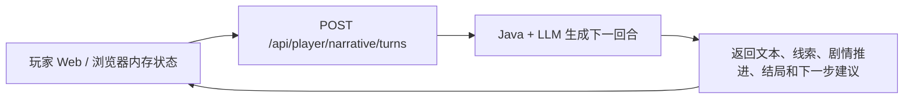
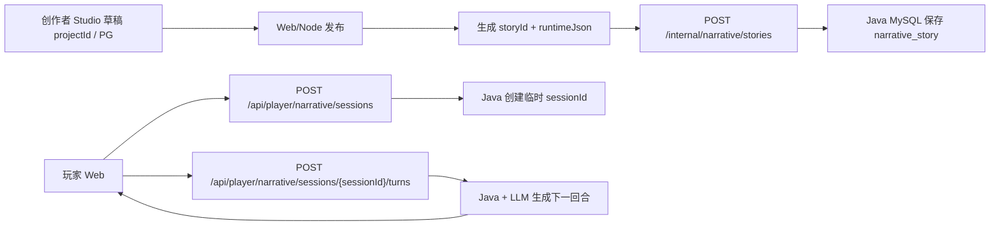

# 文字游戏 Narrative Runtime — 产品形态与 Java 接口需求 v0

> 状态: 需求草案。
> 这份文档分成两部分:
>
> 1. 完整产品预期形态: 解释未来这套文字游戏系统应该如何工作。
> 2. 当前阶段 Java 接口: 只描述目前建议 Java 先承接的最小运行时能力。

当前阶段先做极简闭环: **Java 先承接玩家回合生成接口**。前端暂时保留浏览器内存状态, Java 不需要先实现 session 持久化、回合历史或完整发布链路。

---

# 第一部分: 完整产品预期形态

## 1. 产品目标

FizzDragon / 气泡龙的文字游戏系统包含两个核心场景:

- 创作者侧: 在 Studio 里编辑故事、剧情节点、角色、线索、场景、音乐、视频和规则。
- 玩家侧: 在 Web 里游玩故事, 可以选择预设选项, 也可以自由输入行动。

系统的目标不是做一个完全固定分支的选择游戏, 而是做一种混合形态:

- 有创作者设定的故事框架和关键剧情节点。
- 有预设选项, 方便玩家推进。
- 有 open answer / 自由输入, 让玩家能自然表达行动。
- 有线索、规则和状态, 限制 AI 不乱跑、不提前剧透。
- 由 AI 根据当前剧情状态生成下一段文本。

## 2. 系统边界

| 模块                  | 主要职责                                             | 存储         |
| --------------------- | ---------------------------------------------------- | ------------ |
| Web Studio / 创作者侧 | 编辑草稿工程、画布、节点、角色、线索、资产、规则     | PG           |
| Web Player / 玩家侧   | 展示游玩 UI, 发送玩家输入, 展示 AI 输出和状态变化    | 浏览器状态   |
| Web/Node 后端         | 发布创作者草稿, 生成运行时 JSON, 同步给 Java         | PG           |
| Java Runtime          | 玩家运行时, 处理玩家输入、LLM 调用、状态推进         | MySQL / 内存 |
| LLM 服务              | 判断玩家输入、生成下一段剧情文本、返回结构化状态变化 | 外部模型服务 |

建议边界:

- PG 是创作者侧源数据和发布记录源头。
- 长期形态下, Java MySQL 是玩家运行时副本。
- 长期形态下, 前端不应每回合向 Java 传完整剧情或隐藏信息。
- 当前接入阶段, 前端可以先把当前剧情上下文、已解锁线索和近期故事文本传给 Java, Java 负责调用 LLM 并返回结构化结果。

## 3. 核心对象

| 名称        | 含义                            | 当前阶段说明                         |
| ----------- | ------------------------------- | ------------------------------------ |
| `userId`    | 平台用户 ID, 可以是创作者或玩家 | 玩家身份直接复用 `userId`            |
| `projectId` | 创作者编辑态草稿工程            | 存在 Web/Node + PG, 玩家侧不直接使用 |
| `storyId`   | 已发布、可游玩的故事            | 当前阶段用于标识正在玩的故事         |
| `sessionId` | 某个玩家的一局临时游玩会话      | 当前阶段不要求实现                   |
| `turnId`    | 一次玩家输入和 AI 输出的回合 ID | 当前阶段不要求实现                   |
| `versionId` | 某次发布版本                    | 当前阶段不引入                       |

关系:

```txt
projectId  -> 发布 -> storyId
storyId    -> 玩家进入 Web play 页面
play 页面  -> 多次提交 -> turn
```

## 4. 发布与游玩数据流

当前前端接入阶段:



后续完整 runtime 形态:



## 5. 发布模型

当前阶段不引入 `versionId`。

规则建议:

- `projectId` 是创作者编辑态草稿, 可以反复修改。
- 发布后生成 `storyId`。
- `storyId` 对应的运行内容不可修改。
- 如果创作者要修改剧情节点、线索、角色规则、AI 约束等运行内容, 重新发布为新的 `storyId`。
- 发布后可以允许修改展示元信息, 例如标题、简介、封面、标签、可见性。

后续如果需要支持同一个作品的多次发布和历史存档, 再引入:

```txt
storyId
  versionId: v1
  versionId: v2
```

## 6. Runtime JSON

`runtimeJson` 是 Java 玩家运行时的核心配置。它不是 React Flow 画布数据, 不包含卡片坐标、抽屉状态、UI 临时状态。

它应该描述:

- 故事入口。
- 剧情节点。
- 预设选项。
- 可解锁线索。
- 角色设定。
- 表现资产。
- AI 运行规则。
- LLM 输出约束。

发布给 Java 的整体 payload 示例:

```json
{
  "storyId": "story_36_hours_case",
  "sourceProjectId": "project_123",
  "creatorUserId": "user_isaac",
  "schemaVersion": "narrative-runtime-v1",
  "locale": "zh-CN",
  "title": "36 小时溺亡案",
  "summary": "17 岁少女被送入精英学校矫正, 却在首宗溺亡案中发现真相。",
  "coverUrl": "https://cdn.example.com/covers/36-hours.png",
  "visibility": "private",
  "runtimeJson": {
    "schemaVersion": "narrative-runtime-v1",
    "entryPlotId": "plot_a",
    "storyBackground": "现代中国, 一名 17 岁少女被送往精英学校。",
    "plots": [],
    "choices": [],
    "clues": [],
    "characters": [],
    "assets": [],
    "rules": [],
    "llmPolicy": {}
  }
}
```

顶层字段:

| 字段              | 类型   | 来源                 | Java 是否存储 | 说明                                                        |
| ----------------- | ------ | -------------------- | ------------- | ----------------------------------------------------------- |
| `storyId`         | string | Web/Node 发布时生成  | 是            | 已发布故事 ID。玩家开局和 session 都绑定它。                |
| `sourceProjectId` | string | Web Studio 草稿工程  | 是            | 来源草稿 ID, 用于追踪发布来源。                             |
| `creatorUserId`   | string | 平台用户系统         | 是            | 创作者用户 ID。                                             |
| `schemaVersion`   | string | Web/Node 发布逻辑    | 是            | payload schema 版本, 当前建议 `narrative-runtime-v1`。      |
| `locale`          | string | 发布语言             | 是            | 当前 `storyId` 的内容主语言。当前阶段可以先只支持 `zh-CN`。 |
| `title`           | string | 创作者填写           | 是            | 故事展示标题。                                              |
| `summary`         | string | 创作者填写或 AI 生成 | 是            | 故事简介, 用于展示。                                        |
| `coverUrl`        | string | 媒体资源             | 是            | 封面图 URL。                                                |
| `visibility`      | enum   | 发布设置             | 是            | 建议取值: `private` / `public` / `unlisted`。               |
| `runtimeJson`     | object | Web/Node 从画布生成  | 是            | Java 玩家运行时核心配置。                                   |

`runtimeJson` 字段:

| 字段              | 类型   | 说明                                           |
| ----------------- | ------ | ---------------------------------------------- |
| `schemaVersion`   | string | runtime JSON 的 schema 版本。                  |
| `entryPlotId`     | string | 入口剧情节点 ID。                              |
| `storyBackground` | string | 故事背景。可用于 LLM system/context。          |
| `secretTruth`     | string | 可选。隐藏真相或最终谜底, 不应直接返回给前端。 |
| `plots`           | array  | 剧情节点。                                     |
| `choices`         | array  | 预设选项。                                     |
| `clues`           | array  | 线索。                                         |
| `characters`      | array  | 角色。                                         |
| `assets`          | array  | 场景、图片、音乐、视频、道具等表现资产。       |
| `rules`           | array  | 全局或局部规则。                               |
| `llmPolicy`       | object | LLM 生成策略和输出约束。                       |

## 7. 剧情节点模型

剧情节点是玩家运行时的主要状态单位。它不是单纯文本段落, 而是一个“当前阶段”。

建议结构:

```ts
interface PlotRuntimeNode {
  plotId: string;
  title: string;
  location?: string;
  objective: string;
  context: string;
  openActionPolicy: {
    enabled: boolean;
    allowedIntents: string[];
    offTopicBehavior: "redirect" | "refuse" | "soft_redirect";
    maxTurnsBeforeNudge?: number;
  };
  presetChoiceIds: string[];
  discoverableClueIds: string[];
  assetIds: string[];
  entryConditions: RuntimeCondition[];
  exitConditions: RuntimeCondition[];
  nextPlotIds: string[];
}
```

含义:

- `objective`: 当前剧情阶段的目标。
- `context`: 给 LLM 的剧情上下文。
- `openActionPolicy`: 玩家自由输入的允许范围。
- `presetChoiceIds`: 该阶段可展示的预设选项。
- `discoverableClueIds`: 该阶段可以发现的线索。
- `exitConditions`: 允许进入下一个剧情节点的条件。

## 8. 玩家输入模型

玩家每回合可以有两种输入:

```txt
choice      = 选择预设选项
open_answer = 自由输入
```

自由输入不是完全无边界的。Java + LLM 需要判断:

- 输入是否属于当前剧情允许范围。
- 是否命中某个行动意图。
- 是否解锁线索。
- 是否更新 flags / risk / inventory 等状态。
- 是否满足退出条件进入后续剧情节点。
- 如果跑题, 是否自然拉回当前场景。

线索的作用:

- 表示玩家已经知道的证据状态。
- 限制 AI 不能提前引用未解锁信息。
- 作为后续剧情推进、追问、推理或结局判断的依据。

## 9. 完整产品后续能力

当前阶段不需要一次性完成以下能力, 但产品长期会需要:

- 玩家 session 落库。
- 回合历史落库。
- 刷新恢复进度。
- `versionId` 和发布版本管理。
- 旧存档和新版本之间的迁移规则。
- 更完整的规则引擎。
- 角色关系和道具系统。
- 多语言 runtime。
- 内容安全、限流、计费、审计。
- 运营后台审核和上下架。
- 故事数据分析, 例如完成率、卡点、线索发现率。

---

# 第二部分: 当前阶段 Java 接口需求

## 10. 当前阶段范围

当前阶段 Java 先实现一个可以被玩家端替换接入的回合生成接口。目标是让现有
`/zh-CN/play/story_36_hours_case` 从 mock/Next route 切到 Java, 而不是先建设完整发布和存档系统。

当前阶段必须做:

- 接收玩家本回合输入: 自由输入、预设行动点、继续。
- 接收前端传入的当前剧情上下文、近期故事、已解锁线索、风险值和回合数。
- 调用 Qwen/LLM。
- 返回下一段文本、判断说明、新解锁线索、剧情推进、结局、角色说话人和下一步建议。

当前阶段先不做:

- 玩家 session 创建接口。
- 玩家 session 落库。
- 回合历史落库。
- 刷新恢复进度。
- 发布 `runtimeJson` 到 Java。
- `versionId`。
- 复杂规则引擎。

## 11. 通用响应格式

沿用 Java 现有 envelope:

```json
{
  "code": 200,
  "msg": "ok",
  "data": {}
}
```

业务失败示例:

```json
{
  "code": 400,
  "msg": "playerText is required for this action",
  "data": null
}
```

前端接入时读取 `data`。如果 `code !== 200`, 前端按失败处理并展示 `msg`。

## 12. 当前必须接口: 提交玩家回合

`POST /api/player/narrative/turns`

用途: 玩家每次点击“继续”、点击 LLM 给出的行动点, 或打开“我来行动”输入文字后, 调用该接口生成下一段剧情。

### 12.1 请求体

```json
{
  "storyId": "story_36_hours_case",
  "action": "freeInput",
  "locale": "zh-CN",
  "playerText": "我检查转学通知书背面。",
  "story": [
    {
      "kind": "narrator",
      "body": "清晨的校门像一块黑色玻璃。你站在门外，手里捏着转学通知书。",
      "meta": "剧情节点 A / 精英学校校门",
      "clueIds": []
    }
  ],
  "unlockedClueIds": ["guard_name"],
  "currentPlot": {
    "id": "plotA",
    "title": "进入精英学校",
    "location": "精英学校校门",
    "objective": "建立处境：她被送来矫正，但学校和哥哥都在控制信息。",
    "boundary": "只能处理校门登记、转学通知书、接待老师、保安和哥哥消息；不能提前进入溺亡案、校长室或真凶。"
  },
  "currentSuggestedActions": ["翻看通知书背面"],
  "risk": 0,
  "turnCount": 2
}
```

字段说明:

| 字段                      | 类型   | 必填 | 说明                                                                                     |
| ------------------------- | ------ | ---- | ---------------------------------------------------------------------------------------- |
| `storyId`                 | string | 是   | 当前游玩的故事 ID。当前测试值为 `story_36_hours_case`。                                  |
| `action`                  | enum   | 是   | `freeInput` / `choice` / `continue`。                                                    |
| `locale`                  | string | 是   | 当前内容语言。当前先支持 `zh-CN`。                                                       |
| `playerText`              | string | 条件 | `freeInput` 和 `choice` 时必填; `continue` 可以为空字符串。                              |
| `story`                   | array  | 是   | 前端保留的近期故事记录。Java 只需要取最近若干条作为 LLM context。                        |
| `unlockedClueIds`         | array  | 是   | 玩家当前已经解锁的线索 ID。Java 不要重复返回这些线索。                                   |
| `currentPlot`             | object | 是   | 当前剧情节点。Java/LLM 必须遵守其中的 `boundary`。                                       |
| `currentSuggestedActions` | array  | 否   | 当前界面已经展示的行动点。Java 应避免重复返回完全相同的建议。                            |
| `risk`                    | number | 是   | 当前累计风险值。它是产品层的“叙事压力/暴露风险”, 不是代码错误分。Java 只返回本回合增量。 |
| `turnCount`               | number | 是   | 当前已完成回合数。Java 可以用它判断是否推进剧情或进入结局。                              |

`action` 含义:

| 值          | 含义                                 |
| ----------- | ------------------------------------ |
| `freeInput` | 玩家在“我来行动”里输入的自由行动。   |
| `choice`    | 玩家点击了 LLM 建议的行动点。        |
| `continue`  | 玩家不额外输入, 让 AI 继续当前剧情。 |

`story[]` 每项字段:

| 字段      | 类型     | 必填 | 说明                                                                |
| --------- | -------- | ---- | ------------------------------------------------------------------- |
| `kind`    | enum     | 是   | 故事记录来源。取值: `narrator` / `player` / `system`。              |
| `body`    | string   | 是   | 该条记录的正文。Java 可把最近 8-12 条拼入 LLM 上下文。              |
| `meta`    | string   | 否   | 辅助说明, 例如剧情节点、角色名、Qwen 处理摘要。                     |
| `clueIds` | string[] | 否   | 该条记录关联的新线索。可为空数组。Java 不应把它当作“本回合新线索”。 |

`story.kind` 含义:

| 值         | 含义                                       |
| ---------- | ------------------------------------------ |
| `narrator` | AI / 旁白已经生成并展示给玩家的故事文本。  |
| `player`   | 玩家已经提交过的行动文本。                 |
| `system`   | 前端插入的系统性记录, 例如进入新剧情节点。 |

`currentPlot` 字段:

| 字段        | 类型   | 必填 | 说明                                                                   |
| ----------- | ------ | ---- | ---------------------------------------------------------------------- |
| `id`        | string | 是   | 当前剧情节点 ID。当前测试故事取值: `plotA` / `plotB`。                 |
| `title`     | string | 是   | 当前剧情标题, 用于 LLM 理解玩家所处阶段。                              |
| `location`  | string | 否   | 当前场景位置, 例如 `精英学校校门`。                                    |
| `objective` | string | 是   | 当前剧情目标。Java/LLM 应围绕该目标生成, 不要无目的散写。              |
| `boundary`  | string | 是   | 当前剧情边界。LLM 不能越过该边界提前进入后续剧情、剧透真相或乱换场景。 |

请求字段处理建议:

| 字段                      | Java 处理方式                                                            |
| ------------------------- | ------------------------------------------------------------------------ |
| `storyId`                 | 用于选择故事配置。当前阶段可以先只支持 `story_36_hours_case`。           |
| `locale`                  | 用于选择提示词语言和输出语言。当前阶段非 `zh-CN` 可以先按 `zh-CN` 处理。 |
| `playerText`              | `freeInput` / `choice` 必须 trim 后非空; `continue` 可以为空。           |
| `story`                   | 不建议全量拼 prompt, 取最近 8-12 条即可, 避免 token 爆炸。               |
| `unlockedClueIds`         | 作为“已知事实”输入 LLM, 同时用于过滤重复线索。                           |
| `currentSuggestedActions` | 用于去重下一轮建议; 不要原样重复返回。                                   |
| `risk`                    | 当前累计风险值, Java 不直接覆盖它, 只返回 `riskDelta`。                  |
| `turnCount`               | 当前已完成回合数, Java 可用它做剧情推进或结局判断。                      |

`risk` 的产品意义:

`risk` 表示玩家当前被剧情世界中的“控制力量”注意到、阻拦或干预的程度。它不是玩家输赢分数, 也不是接口错误码, 而是一个叙事调度信号。

在本测试故事里, 这些“控制力量”主要包括:

- 校方: 试图把异常解释成学生个人问题, 压低事件影响。
- 保安 / 接待流程: 提前掌握主角身份, 控制她能接触的信息。
- 警方或制度性说法: 快速把溺亡案定性为自杀。
- 哥哥 / 情报部门: 当主角接近更高层真相时, 以保护为名介入。

`risk` 的作用:

| 作用         | 说明                                                                   |
| ------------ | ---------------------------------------------------------------------- |
| 控制 AI 语气 | 风险越高, AI 输出可以更紧张、更压迫, 角色反应更警觉。                  |
| 控制剧情阻力 | 风险升高后, 校方、保安、哥哥等角色可以阻止、转移话题或限制行动。       |
| 控制结局分流 | 风险过高时, 可以进入 `intervention` 这类被强制带离/干预结局。          |
| 防止玩家乱冲 | 玩家过度暴露、威胁、硬闯或提前指控时, 不应直接奖励线索, 而应增加风险。 |
| 提供反馈节奏 | 让玩家感觉世界在回应自己的行为, 而不是每次输入都无成本推进。           |

`risk` 增加的典型情况:

| 玩家行为                       | 建议 `riskDelta` | 产品含义                                 |
| ------------------------------ | ---------------- | ---------------------------------------- |
| 正常观察、检查物品、合理询问   | `0`              | 合理行动, 不引起额外警觉。               |
| 反复追问敏感问题、明显试探校方 | `1`              | 对方开始警觉, 但仍可继续调查。           |
| 硬闯、威胁、公开指控、越界调查 | `2`              | 明显触发阻力, 后续角色应加强控制。       |
| 直接触碰隐藏真相或高层秘密     | `3`              | 高风险行为, 可能触发哥哥介入或强制中断。 |

`risk` 不应该增加的情况:

- 玩家只是正常选择“继续”。
- 玩家在当前剧情边界内观察细节。
- 玩家问了合理问题但没有触碰敏感真相。
- 玩家跑题但没有对剧情世界造成威胁; 这种情况应拉回场景, 不一定增加风险。

当前建议阈值:

| 累计 `risk` | 建议表现                                               |
| ----------- | ------------------------------------------------------ |
| `0-1`       | 正常调查, 世界轻微回应。                               |
| `2-4`       | 环境开始收紧, 角色变得警惕, AI 输出更压迫。            |
| `5+`        | 可考虑触发 `endingId=intervention`, 哥哥或更高层介入。 |

### 12.2 返回体

成功响应:

```json
{
  "code": 200,
  "msg": "ok",
  "data": {
    "response": "你翻到通知书背面，发现纸张边缘有一道极淡的压痕。",
    "judgement": "玩家行动有效，聚焦在当前节点允许的转学通知书检查。",
    "clueIds": ["transfer_date"],
    "nextState": "stay",
    "nextPlotId": null,
    "endingId": null,
    "riskDelta": 0,
    "speakerId": "linFeng",
    "suggestedActions": ["对比签发日期", "询问接待老师", "观察保安反应"]
  }
}
```

`data` 字段说明:

| 字段               | 类型   | 必填 | 说明                                                             |
| ------------------ | ------ | ---- | ---------------------------------------------------------------- |
| `response`         | string | 是   | 展示给玩家的下一段正文。                                         |
| `judgement`        | string | 是   | 给前端/调试看的本回合判断摘要, 不需要暴露完整 prompt。           |
| `clueIds`          | array  | 是   | 本回合新解锁的线索 ID。只返回新增, 不返回已解锁。                |
| `nextState`        | enum   | 是   | `stay` / `advancePlot` / `ending`。                              |
| `nextPlotId`       | string | 否   | `nextState=advancePlot` 时返回目标剧情节点 ID, 否则为 `null`。   |
| `endingId`         | string | 否   | `nextState=ending` 时返回结局 ID, 否则为 `null`。                |
| `riskDelta`        | number | 是   | 本回合新增的叙事压力/暴露风险。建议 `0-3`。                      |
| `speakerId`        | string | 否   | 本段主要说话/聚焦角色 ID。                                       |
| `suggestedActions` | array  | 是   | 下一步行动建议, 0-3 个。它不是固定分支, 是当前剧情下的行动灵感。 |

枚举约束:

```txt
nextState: stay | advancePlot | ending
nextPlotId: plotA | plotB | null
endingId: truth | intervention | coverup | null
speakerId: linFeng | brother | receptionTeacher | securityGuard | null
```

响应字段处理建议:

| 字段               | Java 处理方式                                                                                    |
| ------------------ | ------------------------------------------------------------------------------------------------ |
| `response`         | 必须是可以直接展示给玩家的正文, 不要包含 JSON、Markdown 代码块或内部提示词。                     |
| `judgement`        | 可以简短描述“为什么这样处理玩家输入”, 方便调试; 不要泄露隐藏真相或完整 prompt。                  |
| `clueIds`          | 只返回本回合新增线索。已在请求 `unlockedClueIds` 里的线索必须过滤掉。                            |
| `nextState`        | 默认 `stay`; 只有满足推进或结局条件才返回其他值。                                                |
| `nextPlotId`       | 仅 `nextState=advancePlot` 时有值; 其他情况必须为 `null`。                                       |
| `endingId`         | 仅 `nextState=ending` 时有值; 其他情况必须为 `null`。                                            |
| `riskDelta`        | 建议整数 `0-3`; 它表示本回合让剧情世界更警觉的程度。模型返回负数、小数或过大值时由 Java 归一化。 |
| `speakerId`        | 没有明确角色时可以为 `null`; 不要返回未知角色 ID。                                               |
| `suggestedActions` | 最多 3 个, 每个建议应该是当前情境下可执行的小动作, 不是大类名。                                  |

`suggestedActions` 写法:

| 推荐                   | 不推荐     |
| ---------------------- | ---------- |
| `翻看通知书背面`       | `观察环境` |
| `留意保安手势`         | `询问角色` |
| `检查登记台发票`       | `推进剧情` |
| `追问接待老师迟到原因` | `获得线索` |

Java 返回前必须做一次归一化:

```txt
response: trim 后非空, 否则使用兜底文案
clueIds: 过滤未知线索 + 过滤已解锁线索 + 去重
nextState: 非法值归一为 stay
nextPlotId: 只允许 plotA / plotB / null
endingId: 只允许 truth / intervention / coverup / null
riskDelta: clamp 到 0-3
speakerId: 只允许 linFeng / brother / receptionTeacher / securityGuard / null
suggestedActions: trim + 去重 + 最多 3 个
```

### 12.3 线索 ID

当前测试故事先支持这些线索:

| clueId                    | 含义                   | 解锁建议                                                     |
| ------------------------- | ---------------------- | ------------------------------------------------------------ |
| `transfer_date`           | 转学通知书日期异常     | 玩家检查、出示或追问转学通知书时可解锁。                     |
| `brother_read`            | 哥哥没有回复但已读     | 玩家联系哥哥、提到短信/电话/消息时可解锁。                   |
| `guard_name`              | 保安提前知道主角姓名   | 玩家观察校门、保安、登记流程或安保反应时可解锁。             |
| `case_report_no_struggle` | 事故简报写着无挣扎痕迹 | 玩家进入溺亡案阶段后查看事故简报、无挣扎痕迹等信息时可解锁。 |

Java 必须保证:

- 不能返回不在当前故事里的 `clueId`。
- 不能重复返回请求里已有的 `unlockedClueIds`。
- 不能因为纯粹跑题输入解锁关键线索。

### 12.4 剧情推进和结局规则

当前测试故事先只要求支持:

```txt
plotA -> plotB -> ending
```

建议 Java 使用保守规则:

- `plotA` 阶段满足至少 2 回合且拿到关键入校线索后, 可以返回 `nextState=advancePlot`, `nextPlotId=plotB`。
- `plotB` 阶段满足至少 6 回合或证据链足够后, 可以返回 `nextState=ending`。
- 风险过高时返回 `endingId=intervention`。
- 证据足够时返回 `endingId=truth`。
- 回合过多但关键证据不足时返回 `endingId=coverup`。

如果没有明确满足推进条件, 返回:

```json
{
  "nextState": "stay",
  "nextPlotId": null,
  "endingId": null
}
```

### 12.5 跑题输入

跑题输入也返回 `code=200`, 但不要推进剧情、不要解锁线索:

```json
{
  "code": 200,
  "msg": "ok",
  "data": {
    "response": "你试图把注意力转向无关的话题，但此刻你仍站在精英学校门口。保安的视线没有离开你手里的转学通知书。",
    "judgement": "输入与当前剧情目标无关，已拉回校门场景。",
    "clueIds": [],
    "nextState": "stay",
    "nextPlotId": null,
    "endingId": null,
    "riskDelta": 0,
    "speakerId": "securityGuard",
    "suggestedActions": ["递出通知书", "观察登记册", "询问接待老师"]
  }
}
```

## 13. Qwen / LLM 调用要求

Java 负责调用 LLM。前端不传 API key。

建议 Java 使用环境变量:

```txt
NARRATIVE_QWEN_API_KEY
NARRATIVE_QWEN_BASE_URL
NARRATIVE_QWEN_MODEL
```

LLM 输出必须被 Java 校验和归一化:

- 模型没返回 JSON 时, Java 兜底成有效 `data`。
- `riskDelta` 超出范围时裁剪到 `0-3`。
- `suggestedActions` 最多 3 个。
- `response` 不能为空。
- `nextPlotId` / `endingId` / `speakerId` 必须在允许枚举内。

## 14. P1 再做接口: 故事公开信息

`GET /api/player/narrative/stories/{storyId}`

用途: 玩家进入 `/play/{storyId}` 时获取公开展示信息。当前前端还可以先用本地 mock, Java 可以晚一点做。

成功响应:

```json
{
  "code": 200,
  "msg": "ok",
  "data": {
    "storyId": "story_36_hours_case",
    "title": "36 小时溺亡案",
    "summary": "17 岁少女被送入精英学校矫正，却在首宗溺亡案中发现真相。",
    "coverUrl": "https://cdn.example.com/covers/36-hours.png",
    "visibility": "public",
    "status": "published",
    "locale": "zh-CN"
  }
}
```

## 15. P1/P2 再做接口: 发布故事到 Java

该接口由 Web/Node 后端 server-to-server 调用, 不给浏览器直接调用。

`POST /internal/narrative/stories`

用途: Web/Node 将创作者发布后的 runtime JSON 同步给 Java/MySQL。当前玩家端先不依赖它。

请求体:

```json
{
  "storyId": "story_36_hours_case",
  "sourceProjectId": "project_123",
  "creatorUserId": "user_isaac",
  "schemaVersion": "narrative-runtime-v1",
  "locale": "zh-CN",
  "title": "36 小时溺亡案",
  "summary": "17 岁少女被送入精英学校矫正, 却在首宗溺亡案中发现真相。",
  "coverUrl": "https://cdn.example.com/covers/36-hours.png",
  "visibility": "private",
  "runtimeJson": {
    "schemaVersion": "narrative-runtime-v1",
    "entryPlotId": "plotA",
    "storyBackground": "现代中国, 一名 17 岁少女被送往精英学校。",
    "plots": [],
    "choices": [],
    "clues": [],
    "characters": [],
    "assets": [],
    "rules": [],
    "llmPolicy": {}
  }
}
```

## 16. 后续阶段: session 和回合持久化

当前阶段不要求实现下面两个接口。等我们要做刷新恢复、跨设备续玩或数据分析时再加:

```txt
POST /api/player/narrative/sessions
POST /api/player/narrative/sessions/{sessionId}/turns
```

后续 MySQL 表建议:

`narrative_story`

| 字段                | 说明                              |
| ------------------- | --------------------------------- |
| `story_id`          | 主键                              |
| `source_project_id` | 来源创作者草稿                    |
| `creator_user_id`   | 创作者                            |
| `schema_version`    | runtime schema                    |
| `locale`            | 内容主语言                        |
| `title`             | 展示标题                          |
| `summary`           | 展示简介                          |
| `cover_url`         | 封面                              |
| `visibility`        | `private` / `public` / `unlisted` |
| `runtime_json`      | 完整不可变运行时 JSON             |
| `created_at`        | 发布时间                          |
| `updated_at`        | 元信息更新时间                    |

`narrative_player_session`

| 字段              | 说明                                 |
| ----------------- | ------------------------------------ |
| `session_id`      | 主键                                 |
| `story_id`        | 绑定的故事                           |
| `user_id`         | 当前玩家用户                         |
| `current_plot_id` | 当前剧情节点                         |
| `state_json`      | 玩家状态                             |
| `status`          | `active` / `completed` / `abandoned` |
| `created_at`      | 创建时间                             |
| `updated_at`      | 更新时间                             |

`narrative_player_turn`

| 字段               | 说明                                |
| ------------------ | ----------------------------------- |
| `turn_id`          | 主键                                |
| `session_id`       | session                             |
| `client_turn_id`   | 前端幂等 ID                         |
| `input_type`       | `freeInput` / `choice` / `continue` |
| `player_text`      | 玩家输入文本                        |
| `assistant_text`   | AI 输出                             |
| `state_patch_json` | 本回合状态变化                      |
| `llm_trace_id`     | LLM 调用链路 ID                     |
| `created_at`       | 创建时间                            |

## 17. 当前阶段联调检查点

建议联调时确认:

1. `POST /api/player/narrative/turns` 能收到 `freeInput` 并返回 AI 文本。
2. `continue` 不需要 `playerText`, 也能返回自然续写。
3. `choice` 使用 `playerText` 作为点击的行动点文本。
4. 命中线索时, Java 只返回新增 `clueIds`。
5. 已解锁线索不会被重复返回。
6. 跑题输入不会错误推进剧情或解锁线索。
7. 满足条件时, Java 能返回 `advancePlot` 和 `nextPlotId=plotB`。
8. 满足结局条件时, Java 能返回 `ending` 和合法 `endingId`。
9. 返回 `suggestedActions` 不超过 3 个, 且不重复当前请求中的 `currentSuggestedActions`。
10. API key 不出现在前端、日志和仓库代码里。
