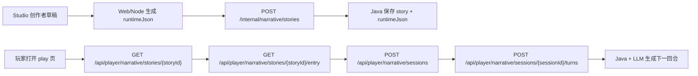
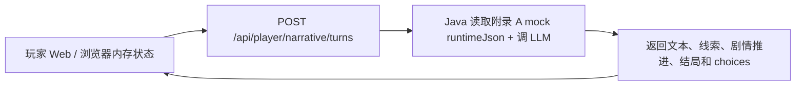

# 文字游戏 Narrative Runtime — Java 接口契约 v0

> 状态: 需求草案。
> 目标读者: Java 后端、Web 玩家端、Studio 创作端。
>
> 本文只做两件事:
>
> 1. 先列出从创作端到玩家端会涉及的 Java 接口, 说明每个接口的使用场景。
> 2. 再逐个接口列出请求字段、返回字段、字段含义和处理规则。

当前建议先做 **第一批可联调闭环**, 不一次性上完整存档、统计和版本系统。

- 第一批: Java 可以先读 mock runtimeJson, 提供 story detail、entry 和无 session 回合生成。
- 第二批: Java 保存发布后的 story, 接通创作端发布链路。
- 第三批: Java 接管 session、turn 历史、刷新恢复和数据统计。

当前 mock 数据:

- 见本文底部 **附录 A: 雙城香港 runtimeJson mock**。

玩家端 LLM 写作规则:

- `docs/narrative-player-runtime-writing-skill-v1.md`

---

# 第一部分: API 接口清单与使用场景

## 1. 整体链路

文字游戏链路分成两端:

- 创作端: Studio / Web Node 负责把创作者草稿发布成 `runtimeJson`, 再同步给 Java。
- 玩家端: Web 玩家页面从 Java 读取可见故事信息、创建游玩 session、提交玩家回合。

完整链路:



第一批无 session 链路:



## 2. 接口总览

### 2.1 创作端 / 内部接口

| 批次 | 接口 | 调用方 | 是否调 LLM | 使用场景 | 描述 |
| --- | --- | --- | --- | --- | --- |
| 第二批 | `POST /internal/narrative/stories` | Web/Node 创作端 -> Java | 否 | 创作者点击发布文游 | Web/Node 从 Studio 草稿生成 `runtimeJson`, 发送给 Java 保存为可玩的 story。 |
| 第二批 | `PATCH /internal/narrative/stories/{storyId}/metadata` | Web/Node 创作端 -> Java | 否 | 发布后修改展示信息 | 只改标题、简介、封面、标签、可见性等公开元信息, 不改运行内容。 |
| 第二批 | `POST /internal/narrative/stories/{storyId}/status` | Web/Node / 后台 -> Java | 否 | 上架、下架、审核失败 | 管理 story 的可玩状态。玩家端详情、entry、turn 都应检查状态。 |

### 2.2 玩家端接口

| 批次 | 接口 | 调用方 | 是否调 LLM | 使用场景 | 描述 |
| --- | --- | --- | --- | --- | --- |
| 第一批 | `GET /api/player/narrative/stories/{storyId}` | Web 玩家端 -> Java | 否 | 玩家打开作品页 | 获取文游作品公开信息: 标题、简介、封面、状态、语言、是否可访问。 |
| 第一批 | `GET /api/player/narrative/stories/{storyId}/entry` | Web 玩家端 -> Java | 否 | 玩家进入开局设置页 | 返回开局页可见信息: 入口剧情、可选角色、改编方向、节奏、公开角色和媒体资源。 |
| 第一批 | `POST /api/player/narrative/turns` | Web 玩家端 -> Java | 是 | 第一批回合生成 | 无 session 回合接口。前端把当前剧情节点、近期故事、已解锁线索、risk、turnCount 一起传给 Java。 |
| 第三批 | `POST /api/player/narrative/sessions` | Web 玩家端 -> Java | 否 | 玩家选完开局设置后开始游戏, 或从旧局重开 | 创建一局新的游玩 session。重开不清空旧 session, 而是创建新 session 并记录来源。 |
| 第三批 | `GET /api/player/narrative/sessions/{sessionId}` | Web 玩家端 -> Java | 否 | 刷新页面、跨设备继续 | 恢复当前进度、已解锁线索、risk、turnCount、最近故事、当前 choices。 |
| 第三批 | `POST /api/player/narrative/sessions/{sessionId}/turns` | Web 玩家端 -> Java | 是 | 玩家点击继续、点击选项、输入自由行动 | session 化正式回合接口。Java 自己读取 runtime 和 session 状态, 调 LLM 生成下一回合。 |
| 第三批 | `GET /api/player/narrative/sessions/{sessionId}/turns` | Web 玩家端 -> Java | 否 | 加载长局历史记录 | 分页返回玩家和 AI 的回合历史。 |

### 2.3 数据统计接口

| 批次 | 接口 | 调用方 | 是否调 LLM | 使用场景 | 描述 |
| --- | --- | --- | --- | --- | --- |
| 第三批/后续 | `POST /api/player/narrative/events` | Web 玩家端 -> Java | 否 | 记录开局选择、黄金开局选择、命运节点、结局达成 | 支撑 AIGC 需求里的数据洞察。 |
| 第三批/后续 | `GET /internal/narrative/stories/{storyId}/analytics` | Studio / 后台 -> Java | 否 | 创作者查看作品数据 | 返回游玩人数、完成率、平均步数、结局分布、线索发现率、卡点等。 |

## 3. 推荐实现顺序

### 3.1 第一批: 最小联调闭环

先实现:

```txt
GET  /api/player/narrative/stories/{storyId}
GET  /api/player/narrative/stories/{storyId}/entry
POST /api/player/narrative/turns
```

说明:

- Java 可以先内置本文附录 A 的 mock runtimeJson。
- 暂时不要求 Java 保存玩家 session。
- 前端继续保留浏览器内存状态。
- turn 接口负责调 LLM。

### 3.2 第二批: 创作端发布闭环

再实现:

```txt
POST  /internal/narrative/stories
PATCH /internal/narrative/stories/{storyId}/metadata
POST  /internal/narrative/stories/{storyId}/status
```

说明:

- Studio / Web Node 发布后把 `runtimeJson` 同步给 Java。
- Java 不应要求前端每回合传完整 `runtimeJson`。
- 发布后的运行内容建议不可变。剧情、规则、线索、隐藏真相变更时重新发布新的 story 或 version。

### 3.3 第三批: session 化正式 runtime

最后把玩家端切到:

```txt
POST /api/player/narrative/sessions
GET  /api/player/narrative/sessions/{sessionId}
POST /api/player/narrative/sessions/{sessionId}/turns
GET  /api/player/narrative/sessions/{sessionId}/turns
```

说明:

- Java 持有当前 plot、risk、turnCount、已解锁线索、最近回合。
- 前端提交回合时只需要传玩家输入和动作类型。
- 刷新恢复、跨设备继续、复盘和统计都依赖这批接口。

## 4. 哪些接口会调用 LLM

只允许回合生成接口调用 LLM:

```txt
POST /api/player/narrative/turns
POST /api/player/narrative/sessions/{sessionId}/turns
```

以下接口不应该调 LLM:

```txt
GET  /api/player/narrative/stories/{storyId}
GET  /api/player/narrative/stories/{storyId}/entry
POST /api/player/narrative/sessions
POST /internal/narrative/stories
```

原因:

- story detail 是公开作品信息。
- entry 是从已发布 `runtimeJson` 中筛出玩家可见的开局配置。
- session 创建只是初始化状态。
- 发布接口只是保存创作端生成的 runtime。

LLM 的职责是根据玩家本回合行动生成下一段文本、判断线索、推进剧情和返回 choices。

---

# 第二部分: 接口字段详解

## 5. 通用约定

### 5.1 Java 响应 envelope

Java 接口统一返回:

```json
{
  "code": 200,
  "msg": "ok",
  "data": {}
}
```

业务失败也使用 envelope:

```json
{
  "code": 400,
  "msg": "playerText is required for this action",
  "data": null
}
```

前端处理规则:

- `code === 200`: 使用 `data`。
- `code !== 200`: 视为业务失败, 展示 `msg`。
- HTTP 非 2xx: 视为网络或服务失败。

### 5.2 常用 ID

| 字段 | 含义 | 例子 |
| --- | --- | --- |
| `storyId` | 已发布、可游玩的文游作品 ID | `story_two_hong_kongs` |
| `sourceIpId` | 来源 IP ID | `2eddb763-a259-52d5-bef4-a7ade100c57c` |
| `sourceProjectId` | Studio 创作工程 ID | `story_studio_mock_two_hong_kongs` |
| `sessionId` | 玩家某一局游玩会话 ID | `sess_abc123` |
| `turnId` | 一次玩家输入和 AI 输出的回合 ID | `turn_001` |
| `clientTurnId` | 前端生成的幂等 ID | `ct_20260702_001` |
| `plotId` | 剧情节点 ID | `plot_fault_event` |
| `clueId` | 线索 ID | `station_zero_hint` |
| `endingId` | 结局 ID | `break_machine` |

命名约定:

- `Id`: 用于真实对象或可持久化引用, 例如 story、plot、clue、character、session、turn。
- `key`: 用于开局配置里的选项值, 例如 `adaptationDirections[].key`、`paceOptions[].key`、`hintLevelOptions[].key`。
- 玩家 setup 传已选择的枚举值时, 使用明确字段名。含义容易混淆的字段带 `Key`, 例如 `adaptationDirectionKey`; 简单枚举直接用字段名, 例如 `pace`、`hintLevel`。

### 5.3 通用枚举

```txt
locale: zh-CN | zh-HK | en-US
visibility: private | public | unlisted
storyStatus: draft | published | offline | review_failed
sessionStatus: active | completed | abandoned | restarted
action: freeInput | choice | continue
nextState: stay | advancePlot | ending
```

### 5.4 choices 与 suggestedActions

正式 Java 接口建议使用 `choices`。

```json
{
  "choices": [
    { "choiceId": "choice_1", "text": "檢查無線電時間戳", "kind": "observe" }
  ]
}
```

产品规则:

- 默认每回合返回 4 个 choices, 对齐 AIGC 需求里的“每步 4 个选择”。
- `continue` 可以没有玩家文本, 但返回后仍应给下一步 choices。
- choices 是行动建议, 不是固定分支树。玩家仍可以自由输入。

当前本地临时 Next route 使用过 `suggestedActions`。接 Java 正式接口时, 前端应迁移到 `choices`。

### 5.5 steps 与 pace

不要把 steps 做成创作者必须手填的 40-70 个节点。

`steps` 不进入每个 story 的 `runtimeJson`。它是 Java runtime 的全局产品策略, 由玩家 entry 前选择的 `pace` 间接控制。

- `compact`: 更快进入冲突、线索和反转。
- `standard`: 按标准节奏推进。
- `loose`: 更多环境、心理、人物关系和探索空间。

文游全局规则保持在 Java 代码或后台配置里, 不放进 story payload:

| 规则 | 当前建议 | 说明 |
| --- | --- | --- |
| 每回合 choices 数量 | `4` | 对齐 AIGC 需求里的“每步 4 个选择”。 |
| 黄金开局回合 | 前 `3` 回合 | Java 在前 3 回合提高开局吸引力和选择质量。 |
| 节奏选择 | `compact` / `standard` / `loose` | 玩家选择体验节奏, Java 用它调节推进速度和描写密度。 |
| 起承转合 | Java 内部判断 | 根据 `pace`、`turnCount`、当前 `plot`、已解锁线索和结局条件动态判断, 不要求创作者配置每幕步数。 |

## 6. `POST /internal/narrative/stories`

### 6.1 使用场景

创作者在 Studio 中编辑完成后点击发布。Web/Node 从创作者草稿生成 `runtimeJson`, 调用该接口同步给 Java。

当前可以先不做这个接口, Java 读取本文附录 A 的 mock runtimeJson 即可。第二批开始应实现。

### 6.2 请求体示例

```json
{
  "storyId": "story_two_hong_kongs",
  "sourceIpId": "2eddb763-a259-52d5-bef4-a7ade100c57c",
  "sourceProjectId": "story_studio_mock_two_hong_kongs",
  "creatorUserId": "user_isaac",
  "schemaVersion": "narrative-runtime-v1",
  "locale": "zh-HK",
  "title": "雙城香港",
  "summary": "香港在斷層事件後分裂為地上香港與地下香港，玩家透過無線電和交界區任務追查時間折疊真相。",
  "coverUrl": "/narrative-demo/two-hong-kongs/cover.jpg",
  "visibility": "private",
  "runtimeJson": {
    "schemaVersion": "narrative-runtime-v1",
    "entryPlotId": "plot_fault_event",
    "storyBackground": "香港發生斷層事件後，城市被分割為地上香港與地下香港，兩邊只能透過無線電和舊電話線路有限交流。",
    "secretTruth": "這不是空間分裂，而是 2027 年地下香港與 2047 年地上香港被時間折疊實驗強行疊合。",
    "styleGuide": "懸疑、都市科幻、資訊戰；優先使用第二人稱；不要提前揭示時間線真相。",
    "playerSetup": {},
    "plots": [],
    "actions": [],
    "clues": [],
    "characters": [],
    "assets": [],
    "endings": []
  }
}
```

### 6.3 顶层字段

| 字段 | 类型 | 必填 | 说明 |
| --- | --- | --- | --- |
| `storyId` | string | 是 | 已发布故事 ID。玩家详情、entry、session、turn 都绑定它。 |
| `sourceIpId` | string | 否 | 来源 IP ID。用于知道这个 playable story 从哪个 IP 改编而来。 |
| `sourceProjectId` | string | 是 | Studio 创作工程 ID。用于追踪发布来源。 |
| `creatorUserId` | string | 是 | 创作者用户 ID。 |
| `schemaVersion` | string | 是 | 发布 payload schema 版本。当前建议 `narrative-runtime-v1`。 |
| `locale` | string | 是 | 内容主语言。当前先支持 `zh-CN` / `zh-HK`。 |
| `title` | string | 是 | 作品展示标题。 |
| `summary` | string | 是 | 作品简介, 用于详情页和列表页。 |
| `coverUrl` | string | 否 | 封面图 URL。 |
| `visibility` | enum | 是 | `private` / `public` / `unlisted`。 |
| `runtimeJson` | object | 是 | Java 玩家运行时核心配置。 |

### 6.4 `runtimeJson` 字段

| 字段 | 类型 | 必填 | 是否可返回给玩家端 | 说明 |
| --- | --- | --- | --- | --- |
| `schemaVersion` | string | 是 | 可以 | runtime JSON schema 版本。 |
| `entryPlotId` | string | 是 | 可以 | 玩家进入故事时的入口剧情节点。 |
| `storyBackground` | string | 是 | 部分可以 | 给 LLM 的故事背景。玩家端只能看公开摘要。 |
| `secretTruth` | string | 否 | 不可以 | 隐藏真相、最终谜底或后期反转。例如《雙城香港》的 2027/2047 时间线真相。 |
| `styleGuide` | string | 否 | 不可以 | 当前故事的写作口味和叙事风格。通用 LLM 输出格式不放这里。 |
| `playerSetup` | object | 是 | 可以 | 开局可选角色、改编方向、节奏、默认设置。 |
| `plots` | array | 是 | 入口 plot 可部分返回 | 剧情节点。玩家端不应拿到完整 plot graph 和后续节点隐藏信息。 |
| `actions` | array | 是 | 部分可以 | 剧情内行动点。用于 LLM 参考和 choices 生成。 |
| `clues` | array | 是 | 未解锁前不可以 | 线索库。只能在玩家解锁后返回对应线索详情。 |
| `characters` | array | 是 | 公开角色可以 | 角色设定。隐藏角色或剧透角色不返回。 |
| `assets` | array | 否 | 公开素材可以 | 场景、图片、音乐、视频、道具等表现资产。 |
| `endings` | array | 是 | 不可以或只返回公开标题 | 结局定义和触发条件。结局条件不能提前给前端。 |

通用运行规则不放进 `runtimeJson`, 例如:

- 每回合返回 4 个 choices。
- `riskDelta` 归一到 `0-3`。
- 模型必须返回结构化 JSON。
- 跑题输入不推进剧情、不解锁线索。
- 不能返回未知 `clueId` / `plotId` / `endingId`。

这些属于 Java runtime 和接口契约, 不是单个故事的数据。

第一批阶段不单独提供额外的故事级 notes/policy 字段。故事约束先放在:

- `secretTruth`: Java/LLM 可知但不能直接展示给玩家的隐藏真相。
- `styleGuide`: 当前故事的写作口味和叙事风格。
- `plots[].boundary`: 当前剧情节点的硬边界, 防止提前剧透、乱换场景或越过当前节点。
- Java 全局 runtime policy: choices 数量、跑题处理、risk、结构化输出和 ID 校验。

### 6.5 `plot` 字段

```json
{
  "plotId": "plot_fault_event",
  "actId": "qi",
  "title": "斷層事件",
  "location": "港鐵站出口 / 臨時避難通道",
  "objective": "建立處境：香港被分裂為地上與地下兩個世界，玩家第一次意識到普通通訊和交通規則已經失效。",
  "context": "港鐵站出口被臨時鐵閘封死。閘外是地上香港的晨光，閘內是地下香港的應急燈。",
  "boundary": "只能展示斷層事件、地上/地下隔絕、無線電異常和港鐵站混亂；不能提前揭示時間線真相。",
  "openActionPolicy": {
    "enabled": true,
    "allowedIntents": ["檢查港鐵站結構", "調整無線電頻率"],
    "offTopicBehavior": "soft_redirect",
    "maxTurnsBeforeNudge": 4
  },
  "actionIds": ["action_scan_station_map"],
  "discoverableClueIds": ["year_mismatch"],
  "assetIds": ["asset_fault_event_video"],
  "entryConditions": [],
  "exitConditions": [],
  "nextPlotIds": ["plot_first_contact"]
}
```

| 字段 | 类型 | 必填 | 说明 |
| --- | --- | --- | --- |
| `plotId` | string | 是 | 剧情节点 ID。 |
| `actId` | enum | 建议 | 当前节点属于起承转合哪一段: `qi` / `cheng` / `zhuan` / `he`。 |
| `title` | string | 是 | 剧情节点标题。 |
| `location` | string | 否 | 当前地点。 |
| `objective` | string | 是 | 当前节点的叙事目标。 |
| `context` | string | 是 | 给 LLM 的当前节点上下文。 |
| `boundary` | string | 是 | 当前节点边界。LLM 不能越过边界提前剧透或乱换场景。 |
| `openActionPolicy` | object | 是 | 自由输入允许范围和跑题处理方式。 |
| `actionIds` | string[] | 是 | 当前节点可参考的行动点。 |
| `discoverableClueIds` | string[] | 是 | 当前节点允许解锁的线索。 |
| `assetIds` | string[] | 否 | 当前节点相关素材。 |
| `entryConditions` | array | 否 | 进入当前节点的条件。 |
| `exitConditions` | array | 否 | 离开当前节点或进入下一节点的条件。 |
| `nextPlotIds` | string[] | 否 | 允许进入的后续剧情节点。 |

### 6.6 `action` 字段

`actions` 是给 Java / LLM 参考的行动库, 用于生成 choices 和判断玩家自由输入是否命中当前剧情允许的行动方向。它不是玩家点击记录。

```json
{
  "actionId": "action_tune_radio_frequency",
  "plotId": "plot_fault_event",
  "label": "調整無線電頻率",
  "choiceKind": "act",
  "intent": "嘗試接收另一側香港的聲音，確認通訊是否能跨越斷層。",
  "possibleClueIds": ["year_mismatch"],
  "riskLevel": "low"
}
```

| 字段 | 类型 | 必填 | 说明 |
| --- | --- | --- | --- |
| `actionId` | string | 是 | 行动点 ID。 |
| `plotId` | string | 是 | 该行动属于哪个剧情节点。 |
| `label` | string | 是 | 可用于生成 choice 的短文案。 |
| `choiceKind` | string | 是 | 行动类型, 例如 `observe` / `ask` / `act` / `deduce`。 |
| `intent` | string | 是 | 行动意图说明。LLM 用它理解玩家选择或自由输入。 |
| `possibleClueIds` | string[] | 否 | 该行动可能解锁的线索。Java 仍需校验线索是否属于当前 plot 的 `discoverableClueIds`。 |
| `riskLevel` | enum | 否 | 行动风险等级: `low` / `medium` / `high`。Java 可映射为实际 `riskDelta`。 |

### 6.7 成功响应

```json
{
  "code": 200,
  "msg": "ok",
  "data": {
    "storyId": "story_two_hong_kongs",
    "status": "published",
    "schemaVersion": "narrative-runtime-v1"
  }
}
```

## 7. `PATCH /internal/narrative/stories/{storyId}/metadata`

### 7.1 使用场景

发布后修改公开展示信息, 例如标题、简介、封面、标签、可见性。

该接口不允许修改:

- `runtimeJson.plots`
- `runtimeJson.clues`
- `runtimeJson.secretTruth`
- 结局条件

如果要修改运行内容, 应重新发布新的 story 或 version。

### 7.2 请求体

```json
{
  "title": "雙城香港",
  "summary": "香港在斷層事件後分裂為地上香港與地下香港，玩家透過無線電和交界區任務追查時間折疊真相。",
  "coverUrl": "/narrative-demo/two-hong-kongs/cover.jpg",
  "visibility": "public",
  "tags": ["懸疑", "時間科幻", "香港", "生存博弈"]
}
```

| 字段 | 类型 | 必填 | 说明 |
| --- | --- | --- | --- |
| `title` | string | 否 | 展示标题。 |
| `summary` | string | 否 | 展示简介。 |
| `coverUrl` | string | 否 | 封面图 URL。 |
| `visibility` | enum | 否 | `private` / `public` / `unlisted`。 |
| `tags` | string[] | 否 | 展示标签。 |

### 7.3 成功响应

```json
{
  "code": 200,
  "msg": "ok",
  "data": {
    "storyId": "story_two_hong_kongs",
    "updated": true
  }
}
```

## 8. `POST /internal/narrative/stories/{storyId}/status`

### 8.1 使用场景

后台或发布系统管理 story 状态:

- 发布上线
- 下架
- 审核失败
- 恢复可见

### 8.2 请求体

```json
{
  "status": "published",
  "reason": "manual publish"
}
```

| 字段 | 类型 | 必填 | 说明 |
| --- | --- | --- | --- |
| `status` | enum | 是 | `published` / `offline` / `review_failed`。 |
| `reason` | string | 否 | 操作原因, 用于审计。 |

### 8.3 成功响应

```json
{
  "code": 200,
  "msg": "ok",
  "data": {
    "storyId": "story_two_hong_kongs",
    "status": "published"
  }
}
```

## 9. `GET /api/player/narrative/stories/{storyId}`

### 9.1 使用场景

玩家打开某个文游作品页时调用。

该接口只返回公开展示信息, 不返回完整 `runtimeJson`。

### 9.2 请求参数

示例:

```txt
GET /api/player/narrative/stories/story_two_hong_kongs?locale=zh-HK
```

| 参数 | 位置 | 必填 | 说明 |
| --- | --- | --- | --- |
| `storyId` | path | 是 | 要查看的文游作品 ID。 |
| `locale` | query | 否 | 返回哪个语言版本的展示信息。默认使用 story 主语言。 |
| 登录态 | cookie/header | 视情况 | 判断用户是否能访问 private/unlisted 作品。 |

### 9.3 成功响应

```json
{
  "code": 200,
  "msg": "ok",
  "data": {
    "storyId": "story_two_hong_kongs",
    "title": "雙城香港",
    "summary": "香港在斷層事件後分裂為地上香港與地下香港，玩家透過無線電和交界區任務追查時間折疊真相。",
    "coverUrl": "/narrative-demo/two-hong-kongs/cover.jpg",
    "visibility": "public",
    "status": "published",
    "locale": "zh-HK",
    "canPlay": true
  }
}
```

| 字段 | 类型 | 说明 |
| --- | --- | --- |
| `storyId` | string | 文游作品 ID。 |
| `title` | string | 展示标题。 |
| `summary` | string | 展示简介。 |
| `coverUrl` | string | 封面图 URL。 |
| `visibility` | enum | `private` / `public` / `unlisted`。 |
| `status` | enum | `published` / `offline` / `review_failed`。 |
| `locale` | string | 当前返回语言。 |
| `canPlay` | boolean | 当前用户是否可以进入游玩。 |

## 10. `GET /api/player/narrative/stories/{storyId}/entry`

### 10.1 使用场景

玩家刚进入文游, 还没有正式开始第一回合前调用。

它用于开局设置页:

- 展示开场氛围。
- 展示可扮演角色。
- 展示改编方向。
- 展示节奏选项: 紧凑 / 正常 / 宽松。
- 展示公开角色和开场媒体资源。

该接口不调 LLM。Java 只从已发布的 `runtimeJson` 里筛出玩家可见数据。

### 10.2 请求参数

```txt
GET /api/player/narrative/stories/story_two_hong_kongs/entry?locale=zh-HK
```

| 参数 | 位置 | 必填 | 说明 |
| --- | --- | --- | --- |
| `storyId` | path | 是 | 要开始的文游作品 ID。 |
| `locale` | query | 否 | 返回哪个语言版本的开局配置。 |
| 登录态 | cookie/header | 视情况 | 判断用户是否可进入。 |

### 10.3 成功响应

```json
{
  "code": 200,
  "msg": "ok",
  "data": {
    "storyId": "story_two_hong_kongs",
    "entryPlot": {
      "plotId": "plot_fault_event",
      "title": "斷層事件",
      "location": "港鐵站出口 / 臨時避難通道",
      "opening": "港鐵站出口的鐵閘在你面前落下，聲音像整座城市被切成兩半。你手上的維修終端忽然跳出一段無線電：『這裡是中環，請確認你們還在 2027。』",
      "objective": "建立處境：香港被分裂為地上與地下兩個世界，玩家第一次意識到普通通訊和交通規則已經失效。"
    },
    "setupOptions": {
      "roles": [
        {
          "roleId": "mtrEngineer",
          "label": "港鐵工程師",
          "description": "熟悉港鐵維修系統和舊線路圖，能辨認零號站與交界區的工程異常。"
        }
      ],
      "adaptationDirections": [
        {
          "key": "suspense",
          "label": "懸疑",
          "description": "強調錯位信息、真假信號和逐步反轉。"
        }
      ],
      "paces": [
        {
          "key": "standard",
          "label": "正常",
          "description": "探索、任務和反轉保持均衡。"
        }
      ],
      "hintLevels": [
        {
          "key": "normal",
          "label": "正常",
          "description": "在關鍵卡點給出輕量提示。"
        }
      ],
      "defaultSetup": {
        "roleId": "mtrEngineer",
        "adaptationDirectionKey": "suspense",
        "pace": "standard",
        "hintLevel": "normal"
      }
    },
    "publicCharacters": [],
    "entryAssets": []
  }
}
```

### 10.4 返回字段

| 字段 | 类型 | 说明 |
| --- | --- | --- |
| `storyId` | string | 文游作品 ID。 |
| `entryPlot` | object | 入口剧情节点的公开信息。 |
| `entryPlot.plotId` | string | 入口 plot ID。 |
| `entryPlot.title` | string | 入口剧情标题。 |
| `entryPlot.location` | string | 入口地点。 |
| `entryPlot.opening` | string | 固定开场文本。来自 runtime, 不由 LLM 临时生成。 |
| `entryPlot.objective` | string | 玩家可见的当前目标, 不应剧透。 |
| `setupOptions.roles` | array | 可扮演角色。 |
| `setupOptions.adaptationDirections` | array | 可选改编方向。选项值使用 `key`, 不使用实体 `id`。 |
| `setupOptions.paces` | array | 可选节奏。选项值使用 `key`。 |
| `setupOptions.hintLevels` | array | 可选提示强度。选项值使用 `key`。 |
| `setupOptions.defaultSetup` | object | 默认开局设置。 |
| `publicCharacters` | array | 玩家开局可见角色。 |
| `entryAssets` | array | 开场可展示媒体资源。 |

### 10.5 不能返回的内容

entry 接口不能返回:

- `secretTruth`
- 完整 `clues`
- 隐藏结局条件
- 后续 plot 的隐藏内容
- `styleGuide`
- Java 全局 runtime 策略

## 11. `POST /api/player/narrative/sessions`

### 11.1 使用场景

玩家在 entry 页选完角色、改编方向、节奏等设置后, 点击“开始游戏”。

也用于“重新开始”:

- 不清空旧 session。
- 把旧 session 标记为 `restarted` 或 `abandoned`。
- 创建一局新的 session。
- 新 session 记录 `restartFromSessionId`。

### 11.2 请求体

```json
{
  "storyId": "story_two_hong_kongs",
  "locale": "zh-HK",
  "setup": {
    "roleId": "mtrEngineer",
    "adaptationDirectionKey": "suspense",
    "pace": "standard",
    "hintLevel": "normal"
  },
  "restartFromSessionId": null,
  "reuseSetup": false
}
```

| 字段 | 类型 | 必填 | 说明 |
| --- | --- | --- | --- |
| `storyId` | string | 是 | 要开始哪一个文游作品。 |
| `locale` | string | 否 | 游玩语言。默认使用 story 主语言。 |
| `setup` | object | 是 | 玩家开局设置。 |
| `setup.roleId` | string | 是 | 玩家扮演角色 ID。 |
| `setup.adaptationDirectionKey` | string | 是 | 改编方向 key, 必须来自 entry 返回的 `setupOptions.adaptationDirections[].key`。 |
| `setup.pace` | enum | 是 | 节奏: `compact` / `standard` / `loose`。 |
| `setup.hintLevel` | enum | 否 | 提示强度, 如 `low` / `normal` / `high`。 |
| `restartFromSessionId` | string/null | 否 | 如果从旧局重开, 传旧 sessionId。 |
| `reuseSetup` | boolean | 否 | 重开时是否沿用旧局 setup。 |

### 11.3 成功响应

```json
{
  "code": 200,
  "msg": "ok",
  "data": {
    "sessionId": "sess_abc123",
    "storyId": "story_two_hong_kongs",
    "currentPlotId": "plot_fault_event",
    "status": "active",
    "setup": {
      "roleId": "mtrEngineer",
      "adaptationDirectionKey": "suspense",
      "pace": "standard",
      "hintLevel": "normal"
    },
    "state": {
      "turnCount": 0,
      "risk": 0,
      "currentAct": "qi",
      "unlockedClueIds": []
    },
    "opening": {
      "kind": "narrator",
      "body": "港鐵站出口的鐵閘在你面前落下，聲音像整座城市被切成兩半。",
      "meta": "斷層事件 / 港鐵站出口",
      "media": []
    }
  }
}
```

| 字段 | 类型 | 说明 |
| --- | --- | --- |
| `sessionId` | string | 新建 session ID。 |
| `storyId` | string | 文游作品 ID。 |
| `currentPlotId` | string | 当前剧情节点。初始为 `runtimeJson.entryPlotId`。 |
| `status` | enum | session 状态, 初始为 `active`。 |
| `setup` | object | 实际使用的开局设置。 |
| `state.turnCount` | number | 已完成回合数, 初始为 `0`。 |
| `state.risk` | number | 当前风险值, 初始为 `0`。 |
| `state.currentAct` | enum | 当前起承转合阶段。 |
| `state.unlockedClueIds` | string[] | 已解锁线索 ID, 初始为空。 |
| `opening` | object | 固定开场文本。默认不调 LLM。 |

## 12. `GET /api/player/narrative/sessions/{sessionId}`

### 12.1 使用场景

玩家刷新页面、切换设备、重新进入未完成的一局时调用。

### 12.2 请求参数

```txt
GET /api/player/narrative/sessions/sess_abc123
```

| 参数 | 位置 | 必填 | 说明 |
| --- | --- | --- | --- |
| `sessionId` | path | 是 | 要恢复的 session ID。 |
| 登录态 | cookie/header | 是 | Java 必须校验 session 属于当前用户。 |

### 12.3 成功响应

```json
{
  "code": 200,
  "msg": "ok",
  "data": {
    "sessionId": "sess_abc123",
    "storyId": "story_two_hong_kongs",
    "status": "active",
    "currentPlotId": "plot_fault_event",
    "setup": {
      "roleId": "mtrEngineer",
      "adaptationDirectionKey": "suspense",
      "pace": "standard",
      "hintLevel": "normal"
    },
    "state": {
      "turnCount": 4,
      "risk": 1,
      "currentAct": "qi",
      "unlockedClueIds": ["station_zero_hint"]
    },
    "recentTurns": [],
    "currentChoices": []
  }
}
```

| 字段 | 类型 | 说明 |
| --- | --- | --- |
| `sessionId` | string | session ID。 |
| `storyId` | string | 文游作品 ID。 |
| `status` | enum | `active` / `completed` / `abandoned` / `restarted`。 |
| `currentPlotId` | string | 当前剧情节点。 |
| `setup` | object | 玩家开局设置。 |
| `state` | object | 当前运行状态。 |
| `recentTurns` | array | 最近若干回合, 用于恢复 UI。 |
| `currentChoices` | array | 当前可展示的 4 个 choices。 |

## 13. `POST /api/player/narrative/sessions/{sessionId}/turns`

### 13.1 使用场景

正式 session 化回合接口。玩家每次操作都调用它:

- 点击一个 choice。
- 输入自由行动。
- 点击继续。

该接口会调用 LLM。

### 13.2 请求体

```json
{
  "clientTurnId": "ct_20260702_001",
  "action": "choice",
  "playerText": "檢查無線電時間戳",
  "choiceId": "choice_1"
}
```

| 字段 | 类型 | 必填 | 说明 |
| --- | --- | --- | --- |
| `clientTurnId` | string | 是 | 前端生成的幂等 ID。重复提交时 Java 应返回同一个结果或拒绝重复处理。 |
| `action` | enum | 是 | `freeInput` / `choice` / `continue`。 |
| `playerText` | string | 条件 | `freeInput` 和 `choice` 必填; `continue` 可以为空。 |
| `choiceId` | string | 否 | 玩家点击 choice 时传。自由输入时为空。 |

session 化接口不需要前端传:

- `currentPlot`
- `story` 历史
- `unlockedClueIds`
- `risk`
- `turnCount`

这些状态由 Java 从 session 读取。

### 13.3 成功响应

```json
{
  "code": 200,
  "msg": "ok",
  "data": {
    "turnId": "turn_001",
    "sessionId": "sess_abc123",
    "response": "你把維修終端接上備用天線，雜訊裡的時間戳忽然穩定下來：一端標著 2027，另一端卻回報 2047。兩個聲音都堅稱自己正在中環。",
    "judgement": "玩家行動有效，聚焦在當前節點允許的無線電調頻和年份比對。",
    "clueIds": ["year_mismatch"],
    "nextState": "stay",
    "nextPlotId": null,
    "endingId": null,
    "riskDelta": 0,
    "speakerId": "mtrEngineer",
    "choices": [
      { "choiceId": "choice_1", "text": "比對兩邊年份", "kind": "observe" },
      { "choiceId": "choice_2", "text": "詢問地上代表", "kind": "ask" },
      { "choiceId": "choice_3", "text": "觀察隧道信號", "kind": "observe" },
      { "choiceId": "choice_4", "text": "嘗試再次發訊", "kind": "contact" }
    ],
    "state": {
      "turnCount": 1,
      "risk": 0,
      "currentPlotId": "plot_fault_event",
      "currentAct": "qi",
      "unlockedClueIds": ["year_mismatch"]
    }
  }
}
```

### 13.4 返回字段

| 字段 | 类型 | 说明 |
| --- | --- | --- |
| `turnId` | string | Java 生成的回合 ID。 |
| `sessionId` | string | 当前 session ID。 |
| `response` | string | 展示给玩家的下一段正文。 |
| `judgement` | string | 本回合判断摘要, 用于调试; 不应泄露隐藏真相或完整 prompt。 |
| `clueIds` | string[] | 本回合新解锁线索 ID。只返回新增, 不返回已解锁。 |
| `nextState` | enum | `stay` / `advancePlot` / `ending`。 |
| `nextPlotId` | string/null | `nextState=advancePlot` 时返回目标 plot ID, 否则为 `null`。 |
| `endingId` | string/null | `nextState=ending` 时返回结局 ID, 否则为 `null`。 |
| `riskDelta` | number | 本回合新增风险值, 建议 `0-3`。 |
| `speakerId` | string/null | 本段主要说话或聚焦角色 ID。 |
| `choices` | array | 下一回合 4 个行动选择。 |
| `state` | object | Java 更新后的 session 状态。 |

### 13.5 Java 校验规则

Java 返回前必须归一化:

```txt
response: trim 后非空, 否则使用兜底文案
clueIds: 过滤未知线索 + 过滤已解锁线索 + 去重
nextState: 非法值归一为 stay
nextPlotId: 必须存在于 runtimeJson.plots
endingId: 必须存在于 runtimeJson.endings
riskDelta: clamp 到 0-3
speakerId: 必须存在于 runtimeJson.characters
choices: trim + 去重 + 默认 4 个 + 不暴露隐藏信息
```

### 13.6 起承转合处理

Java 不应完全依赖 LLM 自觉控制起承转合。

Java 应把这些信息放进 LLM prompt:

```json
{
  "pace": "standard",
  "turnCount": 12,
  "currentAct": "qi",
  "currentPlot": {},
  "unlockedClueIds": [],
  "boundary": "不能提前揭示真相"
}
```

分工:

```txt
runtimeJson / Java = 控制结构、当前阶段、推进条件和隐藏信息
LLM = 在当前阶段里写下一回合文本和 choices
Java = 校验 LLM 有没有越界、剧透、乱解锁线索或乱推进
```

## 14. `GET /api/player/narrative/sessions/{sessionId}/turns`

### 14.1 使用场景

长局恢复或复盘时分页加载历史回合。

### 14.2 请求参数

```txt
GET /api/player/narrative/sessions/sess_abc123/turns?limit=20&cursor=turn_020
```

| 参数 | 位置 | 必填 | 说明 |
| --- | --- | --- | --- |
| `sessionId` | path | 是 | session ID。 |
| `limit` | query | 否 | 每页数量, 默认 20。 |
| `cursor` | query | 否 | 分页游标。 |

### 14.3 成功响应

```json
{
  "code": 200,
  "msg": "ok",
  "data": {
    "items": [
      {
        "turnId": "turn_001",
        "kind": "narrator",
        "body": "港鐵站出口的鐵閘在你面前落下，聲音像整座城市被切成兩半。",
        "clueIds": [],
        "createdAt": "2026-07-02T12:00:00Z"
      }
    ],
    "nextCursor": null
  }
}
```

| 字段 | 类型 | 说明 |
| --- | --- | --- |
| `items` | array | 回合历史。 |
| `items[].turnId` | string | 回合 ID。 |
| `items[].kind` | enum | `narrator` / `player` / `system`。 |
| `items[].body` | string | 文本内容。 |
| `items[].clueIds` | string[] | 该条记录关联的新线索。 |
| `items[].createdAt` | string | 创建时间。 |
| `nextCursor` | string/null | 下一页游标。 |

## 15. `POST /api/player/narrative/turns`

### 15.1 使用场景

这是第一批要联调的无 session 回合接口。它不依赖 Java session 落库, 前端把当前状态一起传给 Java。

该接口用于第一批玩家回合生成: 前端提交当前局面和玩家动作, Java 根据 story runtime 调 LLM 并返回下一回合。

### 15.2 请求体

```json
{
  "storyId": "story_two_hong_kongs",
  "action": "freeInput",
  "locale": "zh-HK",
  "playerText": "我調整無線電頻率，要求兩邊同時報出年份。",
  "setup": {
    "roleId": "mtrEngineer",
    "adaptationDirectionKey": "suspense",
    "pace": "standard",
    "hintLevel": "normal"
  },
  "story": [
    {
      "kind": "narrator",
      "body": "港鐵站出口的鐵閘在你面前落下，聲音像整座城市被切成兩半。",
      "meta": "斷層事件 / 港鐵站出口",
      "clueIds": []
    }
  ],
  "unlockedClueIds": ["station_zero_hint"],
  "currentPlot": {
    "plotId": "plot_fault_event",
    "title": "斷層事件",
    "location": "港鐵站出口 / 臨時避難通道",
    "objective": "建立處境：香港被分裂為地上與地下兩個世界，玩家第一次意識到普通通訊和交通規則已經失效。",
    "boundary": "只能展示斷層事件、地上/地下隔絕、無線電異常和港鐵站混亂；不能提前揭示時間線真相。"
  },
  "currentChoices": [
    { "choiceId": "choice_1", "text": "調整無線電頻率", "kind": "act" }
  ],
  "risk": 0,
  "turnCount": 2
}
```

### 15.3 请求字段

| 字段 | 类型 | 必填 | 说明 |
| --- | --- | --- | --- |
| `storyId` | string | 是 | 当前游玩的故事 ID。 |
| `action` | enum | 是 | `freeInput` / `choice` / `continue`。 |
| `locale` | string | 是 | 当前内容语言。 |
| `playerText` | string | 条件 | `freeInput` 和 `choice` 必填; `continue` 可以为空。 |
| `setup` | object | 是 | 玩家开局设置。 |
| `story` | array | 是 | 前端保留的近期故事记录。Java 只取最近 8-12 条。 |
| `unlockedClueIds` | string[] | 是 | 玩家当前已经解锁的线索 ID。 |
| `currentPlot` | object | 是 | 当前剧情节点。Java/LLM 必须遵守其中的 `boundary`。 |
| `currentChoices` | array | 否 | 当前界面已经展示的 choices。Java 应避免重复返回完全相同的选择。 |
| `risk` | number | 是 | 当前累计风险值。Java 只返回本回合增量。 |
| `turnCount` | number | 是 | 当前已完成回合数。 |

### 15.4 成功响应

```json
{
  "code": 200,
  "msg": "ok",
  "data": {
    "response": "你把維修終端接上備用天線，雜訊裡的時間戳忽然穩定下來：一端標著 2027，另一端卻回報 2047。兩個聲音都堅稱自己正在中環。",
    "judgement": "玩家行動有效，聚焦在當前節點允許的無線電調頻和年份比對。",
    "clueIds": ["year_mismatch"],
    "nextState": "stay",
    "nextPlotId": null,
    "endingId": null,
    "riskDelta": 0,
    "speakerId": "mtrEngineer",
    "choices": [
      { "choiceId": "choice_1", "text": "比對兩邊年份", "kind": "observe" },
      { "choiceId": "choice_2", "text": "詢問地上代表", "kind": "ask" },
      { "choiceId": "choice_3", "text": "觀察隧道信號", "kind": "observe" },
      { "choiceId": "choice_4", "text": "嘗試再次發訊", "kind": "contact" }
    ]
  }
}
```

返回字段与 session 化 turn 基本一致, 但没有 `sessionId`、`turnId` 和持久化后的 `state`。

## 16. `POST /api/player/narrative/events`

### 16.1 使用场景

记录 AIGC 需求里的数据洞察:

- 改编方向热度
- 角色热度
- 黄金开局选择
- 命运节点偏好
- 结局分布
- 自定义输入词频

第三批/后续再做, 不阻塞第一批接口。

### 16.2 请求体

```json
{
  "storyId": "story_two_hong_kongs",
  "sessionId": "sess_abc123",
  "eventType": "choice_selected",
  "payload": {
    "turnId": "turn_001",
    "choiceId": "choice_1",
    "text": "檢查無線電時間戳",
    "turnCount": 1,
    "currentAct": "qi"
  }
}
```

| 字段 | 类型 | 必填 | 说明 |
| --- | --- | --- | --- |
| `storyId` | string | 是 | 文游作品 ID。 |
| `sessionId` | string | 否 | 当前 session ID。 |
| `eventType` | enum | 是 | 事件类型。 |
| `payload` | object | 是 | 事件详情。 |

建议事件类型:

```txt
entry_viewed
setup_selected
session_started
choice_selected
free_input_submitted
clue_unlocked
plot_advanced
ending_reached
session_abandoned
```

## 17. `GET /internal/narrative/stories/{storyId}/analytics`

### 17.1 使用场景

创作者或后台查看某个文游作品的数据表现。

第三批/后续再做。

### 17.2 请求参数

```txt
GET /internal/narrative/stories/story_two_hong_kongs/analytics?from=2026-07-01&to=2026-07-31
```

| 参数 | 位置 | 必填 | 说明 |
| --- | --- | --- | --- |
| `storyId` | path | 是 | 文游作品 ID。 |
| `from` | query | 否 | 统计开始日期。 |
| `to` | query | 否 | 统计结束日期。 |

### 17.3 成功响应

```json
{
  "code": 200,
  "msg": "ok",
  "data": {
    "storyId": "story_two_hong_kongs",
    "sessionsStarted": 1200,
    "sessionsCompleted": 430,
    "completionRate": 0.358,
    "averageTurns": 42.6,
    "directionDistribution": {},
    "roleDistribution": {},
    "endingDistribution": {},
    "clueUnlockRates": {},
    "dropOffByTurn": {}
  }
}
```

| 字段 | 类型 | 说明 |
| --- | --- | --- |
| `sessionsStarted` | number | 开始游玩的 session 数。 |
| `sessionsCompleted` | number | 达成结局的 session 数。 |
| `completionRate` | number | 完成率。 |
| `averageTurns` | number | 平均回合数。 |
| `directionDistribution` | object | 改编方向选择分布。 |
| `roleDistribution` | object | 角色选择分布。 |
| `endingDistribution` | object | 结局分布。 |
| `clueUnlockRates` | object | 线索发现率。 |
| `dropOffByTurn` | object | 每个回合附近的流失情况。 |

## 18. 风险值 `risk`

`risk` 表示玩家当前被剧情世界中的控制力量注意到、阻拦或干预的程度。它不是接口错误码, 也不是玩家分数。

用途:

| 作用 | 说明 |
| --- | --- |
| 控制 AI 语气 | 风险越高, 输出越紧张、压迫。 |
| 控制剧情阻力 | 风险升高后, 角色可以阻止、转移话题或限制行动。 |
| 控制结局分流 | 风险过高时, 可进入干预类结局。 |
| 防止玩家乱冲 | 硬闯、威胁、公开指控不应直接奖励线索, 而应增加风险。 |

建议 `riskDelta`:

| 玩家行为 | 建议 `riskDelta` | 含义 |
| --- | --- | --- |
| 正常观察、检查物品、合理询问 | `0` | 不引起额外警觉。 |
| 反复追问敏感问题、明显试探 | `1` | 对方开始警觉。 |
| 硬闯、威胁、公开指控、越界调查 | `2` | 触发明显阻力。 |
| 直接触碰隐藏真相或高层秘密 | `3` | 高风险, 可能触发干预结局。 |

`runtimeJson.actions[].riskLevel` 只是行动库里的参考等级。Java 最终仍返回本回合实际 `riskDelta`; 可按 `low -> 0-1`、`medium -> 1-2`、`high -> 2-3` 映射。

## 19. 线索 `clueIds`

turn 接口里的 `clueIds` 只表示本回合新解锁线索, 不是全部线索。

Java 必须保证:

- 不返回 runtime 中不存在的 `clueId`。
- 不重复返回请求或 session 中已经解锁的 `clueId`。
- 不返回当前 plot 不允许发现的线索。
- 不因为跑题输入解锁关键线索。

## 20. 跑题输入处理

跑题输入也返回 `code=200`, 但不要推进剧情、不要解锁线索。

示例:

```json
{
  "code": 200,
  "msg": "ok",
  "data": {
    "response": "你試圖把注意力轉向無關的話題，但此刻港鐵站的鐵閘仍封死在你面前。維修終端上的無線電雜訊一遍遍重複同一句話：請確認你們還在 2027。",
    "judgement": "輸入與當前劇情目標無關，已拉回斷層事件現場。",
    "clueIds": [],
    "nextState": "stay",
    "nextPlotId": null,
    "endingId": null,
    "riskDelta": 0,
    "speakerId": "mtrEngineer",
    "choices": [
      { "choiceId": "choice_1", "text": "調整無線電頻率", "kind": "act" },
      { "choiceId": "choice_2", "text": "掃描港鐵線路圖", "kind": "observe" },
      { "choiceId": "choice_3", "text": "詢問地上代表", "kind": "ask" },
      { "choiceId": "choice_4", "text": "嘗試再次發訊", "kind": "contact" }
    ]
  }
}
```

## 21. 联调检查点

第一批联调:

1. `GET /api/player/narrative/stories/{storyId}` 能返回公开信息。
2. `GET /api/player/narrative/stories/{storyId}/entry` 能返回开局配置, 且不泄露隐藏真相。
3. `POST /api/player/narrative/turns` 能处理 `freeInput`。
4. `continue` 不需要 `playerText`。
5. `choice` 使用 `playerText` 和/或 `choiceId`。
6. 命中线索时, Java 只返回新增 `clueIds`。
7. 已解锁线索不会被重复返回。
8. 跑题输入不会推进剧情或解锁线索。
9. 满足条件时, Java 能返回 `advancePlot`。
10. 满足结局条件时, Java 能返回 `ending` 和合法 `endingId`。
11. 每回合默认返回 4 个 `choices`。
12. API key 不出现在前端、日志和仓库代码里。

第三批联调:

1. `POST /api/player/narrative/sessions` 创建新 session。
2. 重开时创建新 session, 不清空旧 session。
3. `GET /api/player/narrative/sessions/{sessionId}` 可恢复进度。
4. `POST /api/player/narrative/sessions/{sessionId}/turns` 不要求前端传完整状态。
5. `GET /api/player/narrative/sessions/{sessionId}/turns` 可分页读取历史。

---

# 附录 A: 雙城香港 runtimeJson mock

这份 mock 用于第一批 Java 联调。Java 可以先把它作为内置 story 配置读取, 等第二批创作端发布接口完成后, 再由 `POST /internal/narrative/stories` 写入真实 story。

```json
{
  "storyId": "story_two_hong_kongs",
  "sourceIpId": "ip_two_hong_kongs",
  "sourceProjectId": "story_studio_mock_two_hong_kongs",
  "creatorUserId": "user_isaac",
  "schemaVersion": "narrative-runtime-v1",
  "locale": "zh-HK",
  "title": "雙城香港",
  "summary": "香港在斷層事件後分裂為地上香港與地下香港。玩家透過無線電、舊電話線路和交界區任務，逐步發現這不是空間分裂，而是兩條時間線被強行折疊。",
  "coverUrl": "/narrative-demo/two-hong-kongs/cover.jpg",
  "visibility": "private",
  "runtimeJson": {
    "schemaVersion": "narrative-runtime-v1",
    "entryPlotId": "plot_fault_event",
    "storyBackground": "某天凌晨，全香港發生斷層事件。城市被分割為地上香港與地下香港，兩個世界無法直接接觸，只能透過無線電、舊電話線路和少數訊號塔有限交流。雙方每週派代表進入交界區，一條未完工的港鐵隧道，完成資訊交換、猜臥底和資源競拍任務。",
    "secretTruth": "地上與地下並不是空間上下分裂，而是兩條不同時間線的香港被強行折疊：地下香港是 2027 年，地上香港是 2047 年。每次跨時間訊號都會讓另一條時間線有人死亡。所謂遊戲其實是一台機器在計算哪一條時間線應被保留。",
    "styleGuide": "懸疑、都市科幻、冷峻、資訊戰；優先使用第二人稱；每回合用可觀察細節推進認知升級，不要提前揭示時間線真相。",
    "playerSetup": {
      "defaultRoleId": "mtrEngineer",
      "roleMode": "selectableProtagonistRole",
      "defaultAdaptationDirectionKey": "suspense",
      "defaultPace": "standard",
      "defaultHintLevel": "normal",
      "adaptationDirections": [
        {
          "key": "suspense",
          "label": "懸疑",
          "description": "強調錯位信息、真假信號和逐步反轉。"
        },
        {
          "key": "survival",
          "label": "生存博弈",
          "description": "強調資源競拍、陣營壓力和任務代價。"
        },
        {
          "key": "time_sci_fi",
          "label": "時間科幻",
          "description": "強調時間折疊、訊號代價和現實錯位。"
        },
        {
          "key": "conspiracy",
          "label": "陰謀智鬥",
          "description": "強調臥底、偽造信號和機器背後的操縱者。"
        }
      ],
      "paceOptions": [
        {
          "key": "compact",
          "label": "緊湊",
          "description": "更快進入交界區任務和陣營衝突。"
        },
        {
          "key": "standard",
          "label": "正常",
          "description": "探索、任務和反轉保持均衡。"
        },
        {
          "key": "loose",
          "label": "寬鬆",
          "description": "更多城市細節、人物關係和世界觀探索。"
        }
      ],
      "hintLevelOptions": [
        {
          "key": "low",
          "label": "少提示",
          "description": "讓玩家自行比對年份、信號和任務規則。"
        },
        {
          "key": "normal",
          "label": "正常",
          "description": "在關鍵卡點給出輕量提示。"
        },
        {
          "key": "high",
          "label": "多提示",
          "description": "更明確提示可調查方向。"
        }
      ]
    },
    "plots": [
      {
        "plotId": "plot_fault_event",
        "actId": "qi",
        "title": "斷層事件",
        "location": "港鐵站出口 / 臨時避難通道",
        "objective": "建立處境：香港被分裂為地上與地下兩個世界，玩家第一次意識到普通通訊和交通規則已經失效。",
        "context": "凌晨的港鐵站出口被臨時鐵閘封死。閘外是地上香港的晨光，閘內是地下香港的應急燈。你的維修終端仍能收到一段斷續無線電，但對方堅稱自己也在同一座香港。",
        "opening": "港鐵站出口的鐵閘在你面前落下，聲音像整座城市被切成兩半。閘外有晨光，閘內只剩紅色應急燈。你手上的維修終端忽然跳出一段無線電：『這裡是中環，請確認你們還在 2027。』",
        "boundary": "只能展示斷層事件、地上/地下隔絕、無線電異常和港鐵站混亂；不能提前揭示 2047、時間折疊、訊號死人或最終機器。",
        "openActionPolicy": {
          "enabled": true,
          "allowedIntents": [
            "檢查港鐵站結構",
            "調整無線電頻率",
            "詢問地上香港代表",
            "聯絡地下香港倖存者",
            "比對終端上的時間與地圖"
          ],
          "offTopicBehavior": "soft_redirect",
          "maxTurnsBeforeNudge": 4
        },
        "actionIds": [
          "action_scan_station_map",
          "action_tune_radio_frequency",
          "action_question_sky_delegate"
        ],
        "discoverableClueIds": [
          "year_mismatch",
          "station_zero_hint"
        ],
        "assetIds": [
          "asset_fault_event_video"
        ],
        "entryConditions": [],
        "exitConditions": [
          {
            "conditionId": "fault_event_exit_contact_ready",
            "type": "natural_language",
            "description": "玩家確認無線電能跨越斷層傳訊，並注意到地圖或年份存在不一致。"
          }
        ],
        "nextPlotIds": ["plot_first_contact"]
      },
      {
        "plotId": "plot_first_contact",
        "actId": "cheng",
        "title": "第一次交叉通訊",
        "location": "舊電話交換室",
        "objective": "讓玩家理解兩個香港可以有限交流，但雙方說出的時間、城市狀態和倖存者敘事互相矛盾。",
        "context": "舊電話交換室裡還有一排手動插線板。地上香港代表要求你只說一句真話，地下香港代表則警告你不要相信任何來自天空的聲音。每一次通訊都會讓某個儀表上的死亡計數跳動。",
        "opening": "你把線路接進舊電話交換室，耳機裡同時傳來兩個聲音。一個說中環還在，另一個說中環十年前已經消失。牆上的儀表沒有標籤，卻在你按下發訊鍵後跳了一格。",
        "boundary": "可以暴露年份錯位、真話限制、雙方互不信任和死亡計數異常；不能直接說明每次跨時間信號都會殺死另一條時間線的人。",
        "openActionPolicy": {
          "enabled": true,
          "allowedIntents": [
            "追問年份",
            "要求雙方描述中環",
            "檢查死亡計數儀表",
            "記錄一真多假的通訊規則",
            "嘗試辨認偽造信號"
          ],
          "offTopicBehavior": "soft_redirect",
          "maxTurnsBeforeNudge": 5
        },
        "actionIds": [
          "action_compare_years",
          "action_inspect_death_counter",
          "action_test_true_statement_rule"
        ],
        "discoverableClueIds": [
          "year_mismatch",
          "signal_death_counter",
          "one_truth_rule"
        ],
        "assetIds": [
          "asset_first_contact_audio"
        ],
        "entryConditions": [
          {
            "conditionId": "first_contact_entry_from_fault_event",
            "type": "natural_language",
            "description": "玩家完成第一次無線電接收，或確認兩邊香港可以透過特定線路交流。"
          }
        ],
        "exitConditions": [
          {
            "conditionId": "first_contact_exit_contact_zone",
            "type": "natural_language",
            "description": "玩家掌握一真多假規則，並知道下一次任務會在交界區進行。"
          }
        ],
        "nextPlotIds": ["plot_contact_zone"]
      },
      {
        "plotId": "plot_contact_zone",
        "actId": "zhuan",
        "title": "交界區任務",
        "location": "未完工港鐵隧道 / 交界區",
        "objective": "把故事推入任務博弈：資訊交換、猜臥底、資源競拍開始互相綁定，玩家發現遊戲本身可能是通訊協定。",
        "context": "交界區是一段沒有出現在任何工程圖上的未完工港鐵隧道。地上與地下雙方代表站在不同月台，中間隔著透明屏障。任務面板要求雙方先交換一句真話，再競拍氧氣、藥物和能源。",
        "opening": "交界區的隧道比地圖上多出三百米。地上代表隔著透明屏障看著你，地下代表則把一張手繪線路圖貼在玻璃上。任務面板亮起第一行字：『每方只能提交一句真話。』",
        "boundary": "可以出現交界區、猜臥底、資源競拍、偽造信號和零號站線索；不能提前進入最終選擇或明說整個香港是被刪除/備份比較。",
        "openActionPolicy": {
          "enabled": true,
          "allowedIntents": [
            "分析任務規則",
            "盤問地上代表",
            "盤問地下代表",
            "檢查零號站線路圖",
            "追蹤偽造信號來源",
            "參與資源競拍"
          ],
          "offTopicBehavior": "soft_redirect",
          "maxTurnsBeforeNudge": 6
        },
        "actionIds": [
          "action_enter_contact_zone",
          "action_inspect_resource_auction",
          "action_trace_forged_signal"
        ],
        "discoverableClueIds": [
          "station_zero_hint",
          "forged_signal",
          "game_as_protocol"
        ],
        "assetIds": [
          "asset_contact_zone_video"
        ],
        "entryConditions": [
          {
            "conditionId": "contact_zone_entry_from_first_contact",
            "type": "natural_language",
            "description": "玩家完成第一次交叉通訊，並得知交界區任務即將開始。"
          }
        ],
        "exitConditions": [
          {
            "conditionId": "contact_zone_exit_truth_path",
            "type": "natural_language",
            "description": "玩家把年份錯位、死亡計數和遊戲任務規則聯繫起來，開始懷疑這不是空間分裂。"
          },
          {
            "conditionId": "contact_zone_exit_risk",
            "type": "numeric",
            "field": "risk",
            "operator": ">=",
            "value": 5,
            "description": "玩家過度暴露自己掌握的線索，觸發雙方代表或機器操縱者干預。"
          }
        ],
        "nextPlotIds": []
      }
    ],
    "actions": [
      {
        "actionId": "action_scan_station_map",
        "plotId": "plot_fault_event",
        "label": "掃描港鐵線路圖",
        "choiceKind": "observe",
        "intent": "檢查港鐵線路是否出現不存在於公開地圖上的零號站或斷裂區段。",
        "possibleClueIds": ["station_zero_hint"],
        "riskLevel": "low"
      },
      {
        "actionId": "action_tune_radio_frequency",
        "plotId": "plot_fault_event",
        "label": "調整無線電頻率",
        "choiceKind": "act",
        "intent": "嘗試接收另一側香港的聲音，確認通訊是否能跨越斷層。",
        "possibleClueIds": ["year_mismatch"],
        "riskLevel": "low"
      },
      {
        "actionId": "action_question_sky_delegate",
        "plotId": "plot_fault_event",
        "label": "詢問地上代表",
        "choiceKind": "ask",
        "intent": "要求地上香港代表描述外面的城市狀態，尋找與地下香港不一致的地方。",
        "possibleClueIds": ["year_mismatch"],
        "riskLevel": "medium"
      },
      {
        "actionId": "action_compare_years",
        "plotId": "plot_first_contact",
        "label": "比對雙方年份",
        "choiceKind": "deduce",
        "intent": "讓雙方同時說出當前年份、最近新聞和中環狀態。",
        "possibleClueIds": ["year_mismatch"],
        "riskLevel": "low"
      },
      {
        "actionId": "action_inspect_death_counter",
        "plotId": "plot_first_contact",
        "label": "檢查死亡計數儀表",
        "choiceKind": "observe",
        "intent": "觀察每次發訊後儀表數字是否變化，以及變化是否與另一側事故同步。",
        "possibleClueIds": ["signal_death_counter"],
        "riskLevel": "medium"
      },
      {
        "actionId": "action_test_true_statement_rule",
        "plotId": "plot_first_contact",
        "label": "測試一句真話規則",
        "choiceKind": "deduce",
        "intent": "設計一組問題，驗證雙方是否只能提交一句真話。",
        "possibleClueIds": ["one_truth_rule"],
        "riskLevel": "medium"
      },
      {
        "actionId": "action_enter_contact_zone",
        "plotId": "plot_contact_zone",
        "label": "進入交界區",
        "choiceKind": "act",
        "intent": "進入未完工港鐵隧道，觀察雙方代表和任務面板。",
        "possibleClueIds": ["game_as_protocol"],
        "riskLevel": "low"
      },
      {
        "actionId": "action_inspect_resource_auction",
        "plotId": "plot_contact_zone",
        "label": "分析資源競拍",
        "choiceKind": "deduce",
        "intent": "分析氧氣、藥物和能源競拍是否在傳遞隱藏數字。",
        "possibleClueIds": ["game_as_protocol"],
        "riskLevel": "medium"
      },
      {
        "actionId": "action_trace_forged_signal",
        "plotId": "plot_contact_zone",
        "label": "追蹤偽造信號",
        "choiceKind": "observe",
        "intent": "追蹤任務期間出現的第三方信號，判斷是否有人在冒充雙方代表。",
        "possibleClueIds": ["forged_signal"],
        "riskLevel": "high"
      }
    ],
    "clues": [
      {
        "clueId": "year_mismatch",
        "title": "雙方年份不一致",
        "type": "時間線線索",
        "summary": "地下香港堅稱現在是 2027 年，地上香港描述的新聞和建築狀態卻指向 2047 年。",
        "evidence": "無線電時間戳、雙方新聞描述、中環是否存在的矛盾。",
        "unlockByPlotIds": ["plot_fault_event", "plot_first_contact"],
        "useFor": "讓玩家開始懷疑這不是普通空間分裂。",
        "hiddenUntilUnlocked": true
      },
      {
        "clueId": "station_zero_hint",
        "title": "零號站線索",
        "type": "地圖線索",
        "summary": "港鐵線路圖上出現一個沒有公開記錄的零號站，所有斷裂線路似乎都指向它。",
        "evidence": "維修終端線路圖、地下代表手繪地圖、交界區隧道長度異常。",
        "unlockByPlotIds": ["plot_fault_event", "plot_contact_zone"],
        "useFor": "指向斷層事件源頭和後續交界區任務。",
        "hiddenUntilUnlocked": true
      },
      {
        "clueId": "signal_death_counter",
        "title": "發訊後死亡計數變化",
        "type": "代價線索",
        "summary": "每次跨界發訊後，交換室裡的無名儀表都會跳動，並與另一側傳來的事故人數接近。",
        "evidence": "發訊時間、儀表跳數、另一側事故報告。",
        "unlockByPlotIds": ["plot_first_contact"],
        "useFor": "埋下跨時間信號會造成死亡的真相。",
        "hiddenUntilUnlocked": true
      },
      {
        "clueId": "one_truth_rule",
        "title": "每方只能提交一句真話",
        "type": "任務規則線索",
        "summary": "交界區任務要求每方只能說一句真話，其餘信息必須混入假話，導致所有情報都需要交叉驗證。",
        "evidence": "任務面板、雙方代表回答、前後矛盾的地名和年份。",
        "unlockByPlotIds": ["plot_first_contact", "plot_contact_zone"],
        "useFor": "建立猜臥底和資訊戰玩法。",
        "hiddenUntilUnlocked": true
      },
      {
        "clueId": "forged_signal",
        "title": "第三方偽造信號",
        "type": "陰謀線索",
        "summary": "任務中出現不屬於地上或地下任何一方的信號，像是在故意引導雙方猜錯臥底。",
        "evidence": "頻率漂移、重複語氣、與雙方已知口令不匹配。",
        "unlockByPlotIds": ["plot_contact_zone"],
        "useFor": "指向機器背後的操縱者或實驗發起者。",
        "hiddenUntilUnlocked": true
      },
      {
        "clueId": "game_as_protocol",
        "title": "遊戲即通訊協定",
        "type": "結構線索",
        "summary": "死亡人數、資源競拍結果和任務次序像一組編碼，整套遊戲可能不是淘汰賽，而是在發送一條巨大訊息。",
        "evidence": "100 人死亡對應座標、資源競拍數字、任務排序。",
        "unlockByPlotIds": ["plot_contact_zone"],
        "useFor": "把生存遊戲升級為資訊戰和時間戰。",
        "hiddenUntilUnlocked": true
      }
    ],
    "characters": [
      {
        "characterId": "mtrEngineer",
        "name": "港鐵工程師",
        "role": "玩家角色",
        "playable": true,
        "public": true,
        "summary": "熟悉港鐵維修系統和舊線路圖，能辨認零號站與交界區的工程異常。",
        "llmBehavior": "觀察偏向結構、線路、機械和訊號；不能憑空知道時間線真相。",
        "portraitUrl": "/narrative-demo/two-hong-kongs/characters/mtr-engineer.png"
      },
      {
        "characterId": "signalSpecialist",
        "name": "通訊專家",
        "role": "可選玩家角色",
        "playable": true,
        "public": true,
        "summary": "能調頻、識別偽造信號和分析通訊協定。",
        "llmBehavior": "觀察偏向頻率、口令、信號延遲和語音破綻。",
        "portraitUrl": "/narrative-demo/two-hong-kongs/characters/signal-specialist.png"
      },
      {
        "characterId": "skyDelegate",
        "name": "地上香港代表",
        "role": "陣營代表",
        "playable": false,
        "public": true,
        "summary": "來自金融和政治系統，代表擁有天空但沒有道路的一方。",
        "llmBehavior": "說話克制、利益導向，傾向把地下香港描述成倖存者或資源負擔。",
        "portraitUrl": "/narrative-demo/two-hong-kongs/characters/sky-delegate.png"
      },
      {
        "characterId": "deepDelegate",
        "name": "地下香港代表",
        "role": "陣營代表",
        "playable": false,
        "public": true,
        "summary": "來自地鐵、排水和地下基建系統，代表擁有道路但沒有天空的一方。",
        "llmBehavior": "語氣直接、警覺，堅持地上香港可能只是投影或謊言。",
        "portraitUrl": "/narrative-demo/two-hong-kongs/characters/deep-delegate.png"
      },
      {
        "characterId": "machineOperator",
        "name": "機器背後的操縱者",
        "role": "隱藏角色",
        "playable": false,
        "public": false,
        "summary": "設計時間折疊和博弈任務的神秘勢力。",
        "llmBehavior": "在前期只能透過偽造信號、任務規則和異常數字間接存在。",
        "portraitUrl": null
      }
    ],
    "assets": [
      {
        "assetId": "asset_fault_event_video",
        "kind": "video",
        "plotId": "plot_fault_event",
        "title": "斷層事件開場短片",
        "posterUrl": "/narrative-demo/two-hong-kongs/fault-event.jpg",
        "sourceUrl": "/narrative-demo/two-hong-kongs/fault-event.mp4",
        "playTiming": "onPlotEnter",
        "public": true
      },
      {
        "assetId": "asset_first_contact_audio",
        "kind": "audio",
        "plotId": "plot_first_contact",
        "title": "第一次交叉通訊音頻",
        "sourceUrl": "/narrative-demo/two-hong-kongs/first-contact.mp3",
        "playTiming": "onPlotEnter",
        "public": true
      },
      {
        "assetId": "asset_contact_zone_video",
        "kind": "video",
        "plotId": "plot_contact_zone",
        "title": "交界區任務短片",
        "posterUrl": "/narrative-demo/two-hong-kongs/contact-zone.jpg",
        "sourceUrl": "/narrative-demo/two-hong-kongs/contact-zone.mp4",
        "playTiming": "onPlotEnter",
        "public": true
      }
    ],
    "endings": [
      {
        "endingId": "preserve_sky",
        "title": "保留地上香港",
        "type": "tragic_choice",
        "condition": "玩家最終選擇保留 2047 年的地上香港。",
        "summary": "數百萬人的天空被保住，地下香港與其中的至親被抹除。",
        "reviewPrompt": "復盤玩家如何被地上香港的規模、秩序和利益說服。"
      },
      {
        "endingId": "preserve_deep",
        "title": "保留地下香港",
        "type": "tragic_choice",
        "condition": "玩家最終選擇保留 2027 年的地下香港。",
        "summary": "地下香港的道路、記憶和至親被保住，地上香港的未來城市消失。",
        "reviewPrompt": "復盤玩家如何被地下香港的人情、基建和真實感說服。"
      },
      {
        "endingId": "break_machine",
        "title": "拒絕二選一",
        "type": "hidden",
        "condition": "玩家收集足夠線索，理解遊戲是通訊協定，嘗試破壞比較兩條時間線的機器。",
        "summary": "主角拒絕替機器選擇哪個香港值得存在，但代價是兩條時間線同時進入不可預測的崩潰。",
        "reviewPrompt": "復盤玩家如何發現遊戲背後的機器邏輯，以及拒絕選擇的代價。"
      }
    ]
  }
}
```
